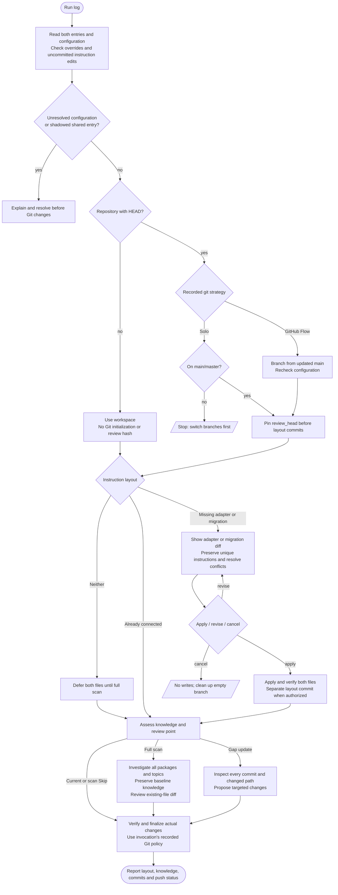

# /helm:log

Set up shared `AGENTS.md` project instructions and a `CLAUDE.md` import adapter, then keep project knowledge current. The captain's log holds durable architecture, configuration, conventions, domain rules and traps. Developers can switch between Claude and Codex sessions without rerunning setup.

In Codex, select the log workflow from the skill picker. Both hosts follow the same migration and knowledge-update workflow. [Compatibility](../setup/compatibility.html) explains ownership, overrides and shared rules.

## Flow

## Shared layout setup

The destination is always:

- `AGENTS.md`: shared project knowledge, one Helm configuration block, adopted `## Rules`, and the review marker.
- `CLAUDE.md`: a real file with a standalone `@AGENTS.md` import, followed by Claude-specific additions when needed.

An actual import loads shared content automatically in Claude. Prose telling Claude to read AGENTS.md is not an equivalent adapter. Shared resource dependencies in AGENTS.md use explicit read-and-follow directives because Codex does not expand Claude import syntax.

| Existing files | Setup action |
|---|---|
| Neither | After a full scan is selected, generate AGENTS.md and the adapter together. Skip writes neither. |
| AGENTS.md only | Preserve it and show the proposed Claude adapter for approval. |
| CLAUDE.md only | Propose moving shared content into AGENTS.md, retaining Claude-specific instructions in the adapter. |
| Both connected correctly | Keep the layout and continue assessment. |
| Both independent, partially connected or cyclic | Compare content and propose reconciliation. |

An adapter that imports AGENTS.md but still owns shared settings, Rules or a review marker is partially connected and needs reconciliation. Log may propose repairing a cycle confined to the two readable root files; it reads each once and resolves configuration before Git actions. Other cycles or missing targets still stop.

For independent files, summarize agreements, unique durable instructions, conflicts and host-specific content before asking. Offer a reviewed merge, either source as the content baseline, or cancel. A baseline does not authorize silently discarding unique safety rules, preferences or conflicting configuration. Show the resulting combined diff before applying it. Existing approval suffices when it covers that exact transformation.

Preserve custom headings, fenced configuration, confirmed settings and adopted rule paths. Convert shared imports explicitly rather than silently making them Claude-only. Remove an old reverse bridge only within the approved migration, preserving user-added instructions. Never leave AGENTS.md reading CLAUDE.md while CLAUDE.md imports AGENTS.md.

Moving content or creating an adapter does not constitute a knowledge review. Carry a valid review marker unchanged; disclose differing histories and propose a conservative review point or removal of an ambiguous marker for approval. A layout-only commit is separate from later knowledge edits and is treated as noise during gap assessment.

Setup runs before the up-to-date check. A later scan Skip or an already-current owner still finalizes any approved layout changes. Cancel at layout approval exits without a layout write or scan and cleans up an empty temporary branch.

## Git and scope

Resolve the existing effective strategy and auto-commit policy before Git changes. Invalid or conflicting Helm values require explicit resolution. Check instruction files for uncommitted work, including untracked existing entries; stop instead of incorporating those edits into migration. Do not reset or stash them.

- **Solo Mode:** run only on main/master.
- **GitHub Flow:** record the original branch and branch from updated main as `docs/log-{date}`. Re-read the actual files before computing a migration diff. If configuration differs from preflight, stop before writing and clean up the empty branch.
- **No repository or HEAD:** use the workspace, generate no review marker, and make no Git initialization, commit, merge, push or promotion. A marker retained by layout-only or partial work is provenance, not evidence that knowledge is current.

Finish the invocation under the Git policy recorded at its start. Project Config Check may save a different policy for the next run; it does not switch the current finalization path midway through the command.

An unconnected root AGENTS.override.md stops shared setup on either host before branching. Do not edit or import it. Preserve personal CLAUDE.local.md, nested instructions and global files. Non-root owners, other Claude entries and symlinks need an explicit placement decision. Migration is limited to the agreed root layout; it does not make both tools' nested-file discovery identical.

## Knowledge assessment

After layout setup, assess AGENTS.md:

- **Fresh file, Rules-only bootstrap, or no review marker:** offer a full scan/investigation or Skip.
- **Standard schema intact and no meaningful commits since review:** knowledge is current; finalize any layout changes.
- **Small/moderate meaningful gap:** recommend a gap update.
- **Large meaningful gap or missing standard sections:** recommend a full scan.
- **Customized owner:** preserve its structure. Investigate the same topics and propose targeted edits rather than replacing it with the standard schema.

Invalid or unrelated review markers are reported and offer full investigation. Commit types and subjects never determine what is skipped: fixes, styling, dependency updates, CRUD and refactors can all reveal durable constraints or traps. Inspect every commit's changed paths and relevant patches, including merge results, then follow affected code, tests, config and docs. Only changes shown to add, invalidate or alter no durable knowledge are noise. Pure layout moves require checking that their meaning and settings stayed the same.

If source commits were fully inspected and nothing durable changed, use the gap update's no-change outcome instead of dismissing the range by label. If only verified instruction maintenance remains and current memory already represents its durable content, keep the marker unchanged; do not create repeated marker-only commits for log's own output.

## Review snapshot and coverage

After branch setup, pin the current commit as `review_head` before layout work. Investigation covers that source snapshot, not the later layout, knowledge or merge commit. In a repository with HEAD, relevant uncommitted or visible untracked source/config/test/doc inputs stop the knowledge scan until the developer commits or resolves them; do not automatically commit, stash or discard them. Approved layout edits are expected outputs; use the post-layout memory as the preservation baseline. Without HEAD, investigate and recheck the workspace inputs directly and omit a marker on a completed scan.

Keep a working coverage summary by package/topic with inspected evidence paths, exclusions and unfinished or inaccessible areas. Gap reviews account for every commit and changed path in the validated range through `review_head`. Recheck source and instruction inputs before applying a proposal; changed inputs require refreshed investigation and approval of the new diff.

Advance the review marker only after complete investigation and acceptance and successful application of every proposed substantive knowledge change. Rejection, cancellation, partial acceptance or incomplete coverage leaves the old marker unchanged and reports what remains. Saving settings alone does not count as a review. A fully inspected source range with no durable change may receive a marker-only update alongside confirmed setting choices; no source changes or layout-only work does not justify one. Later commits and merges never replace the marker with their own hash.

## Full scan

Inventory first-party packages and entry points, then investigate each applicable topic across them. Inspect purpose/docs and metadata; dependency/runtime/config and install/run/build scripts; primary workflows through business logic, persistence and integrations; schemas, validation, permissions and lifecycle tests; development conventions, hooks and CI; deployment, jobs and destructive scripts; and prior memory, warnings and failure paths. Read operational commands without executing them. Record durable knowledge a future session would struggle to discover quickly.

Coverage summaries identify the evidence inspected and distinguish absent topics from blocked or unfinished investigation. Exclude vendor/build/cache artifacts and unrelated data with reasons. Respect credential and ledger restrictions. A restricted relevant area leaves the review incomplete rather than silently counting as reviewed.

For fresh or already-standard memory, use these eight sections:

1. Project Identity
2. Project Config
3. Dev Commands
4. Architecture Pointers
5. Domain Rules
6. Behavior Rules
7. Hard Safety Rules
8. Known Traps

Use existing memory as the baseline. Retain useful knowledge even if the scan cannot rediscover it, including historical rationale and operational facts. For every existing durable entry, retain it, propose a change/removal with evidence, or retain it pending clarification. Any removal or contradiction needs approval of the concrete diff; uncertainty never authorizes deletion. Preserve imports, user-authored/host-specific instructions, confirmed settings and the adopt-managed Rules section. Existing standard-format documents receive a reviewed full candidate; customized owners receive a reviewed targeted patch in their existing sections.

Project Config Check runs at most once, asking only about missing applicable settings in every update mode. Preserve explicit `false` and all unrelated existing settings. A No answer saves `git-auto-commit: false`, so it is not asked again as a missing flag. Ask merge strategy only for an existing or pending GitHub Flow configuration with no saved value. Reuse pending answers in the accepted write; do not ask again during generation. Keep fenced blocks intact. An existing owner without a config block receives a minimal proposed section addition for approval. Confirmed setting choices may be saved separately when the developer accepts settings only, without advancing the review point; cancelling the proposal discards pending choices. The invocation still finishes under its original Git policy.

Target under 150 lines without padding or sacrificing protected/durable content. Use `review_head` only when the coverage and acceptance conditions are met. Fresh incomplete reviews have no marker. For a fresh setup, selecting Full scan authorizes ordinary descriptive content and the Claude adapter; proposed new safety rules still require approval. Verify both files. Do not install or update `.claude/rules/` here; rule adoption belongs to adopt, and safety findings are proposed rather than silently installed.

## Gap update

Ask only about missing configuration, reusing any answers already collected. Inspect every commit's relevant changes through the pinned snapshot, using messages to navigate rather than filter out categories. A proposed addition must satisfy all three questions:

1. Would a future session struggle to find it quickly?
2. Would knowing it improve development decisions?
3. Will it stay true for weeks or months?

Patch affected sections only, preserving custom structure and prior knowledge. Propose substantive changes as a diff and wait for approval. Apply accepted changes and an eligible snapshot marker together after rechecking inputs. If a fully inspected range introduces or invalidates nothing durable, apply any confirmed missing settings and advance only the eligible marker without another knowledge-diff question. Partial acceptance or rejection leaves the marker unchanged and reports unresolved findings. Moving files alone never advances it.

## Finalization and verification

Track layout and knowledge/configuration writes separately, including eligible marker-only changes. If none changed or was committed, skip commit/merge/promotion and clean up any empty log branch. If layout changed, finalize it even when knowledge was current or the scan was skipped. Declining a commit leaves actual files and branch for review, without merge or push.

Commit under the invocation's recorded policy, with layout and knowledge changes kept separate. Push always requires confirmation. Existing environment promotion and GitHub Flow return/cleanup behavior remain. Cancelling push leaves the actual local commits/branch and reports that state.

Before a knowledge/configuration commit, read files back and check retained entries, approved changes, confirmed settings including `false`, Rules/imports and the exact eligible snapshot marker. Recheck relevant source inputs and stage only approved instruction changes. Verify essential ownership/output checks again after finalization. A failed check reports the actual changed files rather than claiming complete setup. An incomplete knowledge review can still finalize already-approved layout/config changes; preserve unapproved drafts and report the actual branch if local edits prevent cleanup.

Report shared setup status and paths, knowledge outcome (including configuration-only, partial or incomplete review), inspected snapshot/range, coverage and exclusions, review point with the reason if unchanged, unresolved/unaccepted findings and uncertain retained knowledge, sections changed, layout/knowledge commits, push status, environments promoted, relevant override/nested limitations, and any adopted rules worth revisiting.

## See also

- [`/helm:adopt`](adopt.html): installs shared rule files and connects their pointers.
- [`/helm:manifest`](manifest.html): maintains the public-facing README.
- [Compatibility and project instructions](../setup/compatibility.html): legacy layouts and host boundaries.
