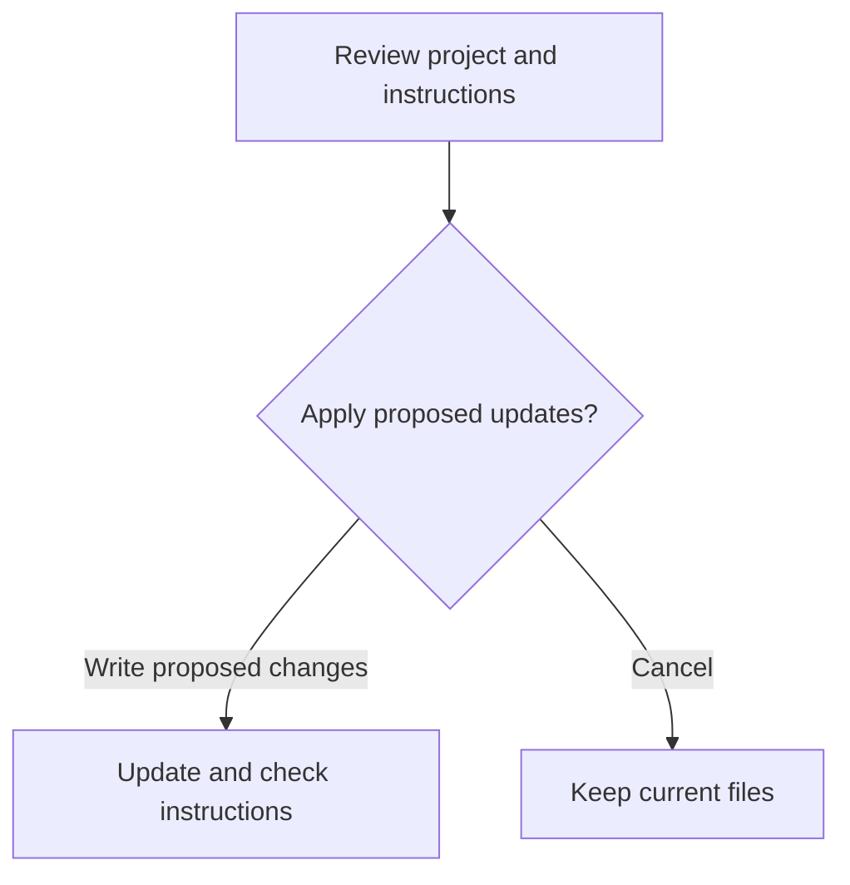

# Log



Use log when a new agent session needs better project context, or when the project has changed since its instructions were reviewed. It proposes updates to the knowledge and working agreements your agents read.

## Flow



## Start the command

```text
Codex → $log    Claude → /log
```

Use your client's [command prefix]({{ '/docs/setup/' | relative_url }}#run-a-command). Updates require clean **main or master**. Without Git history, log can create instructions and leave them uncommitted.

## Shared project instructions

Log connects Claude and Codex to shared project knowledge: `AGENTS.md` holds the common instructions, while `CLAUDE.md` imports it and keeps any Claude-specific additions.

It can set this up for a new project or reconcile existing files. Ready setup choices are grouped, and a clear reconciliation goes straight to its proposed diff. Custom content, settings, imports and adopted rules are preserved unless you approve a specific change.

## What the review covers

- **Full scan:** learn the project's important workflows, setup, architecture and constraints across its first-party packages.
- **Gap scan:** follow changes since a valid saved review point and update the affected knowledge.

You can also supply lessons from the current conversation. Log checks them alongside source evidence and proposes lasting guidance. If rewritten history changed the saved review point, it tries to recover a verified equivalent before requiring a Full scan.

Log checks whether existing content helps future agent decisions, as well as whether its facts are correct. It can propose shortening excessive detail, consolidating repetition or removing temporary task records, while preserving useful rationale and custom structure. Full scans cover all existing knowledge; Gap scans address affected passages and selected concerns.

Before approval, existing-file changes show exact additions and removals using `+` and `-`, followed by a clean preview of the affected content. A new file is shown in full once, with new safety rules identified for approval rather than printed again. Color highlighting depends on your client. The standard actions are **Write proposed changes** and **Cancel**. You can type an exact selection, correction or replacement wording instead; previews change no files. Editorial changes alone do not establish a new source review.

## Your result

You get updated instructions, unresolved findings and a size report. A complete accepted source review advances the review marker; layout-only work and partial acceptance retain the earlier one.

Outside log, ordinary coding presents needed instruction changes as a [concrete proposal for your approval](../rules/safety.html#maintaining-command-outputs). Approved targeted edits follow log’s authoring standards and preserve the review marker.

Changes follow your local commit policy and finish on the same branch. With auto-commit off, writing approval does not approve a commit; a missing commit decision is requested separately unless your specific request already covers it. Use [adopt](adopt.html) to maintain copied rules and [ship](ship.html) to publish.
