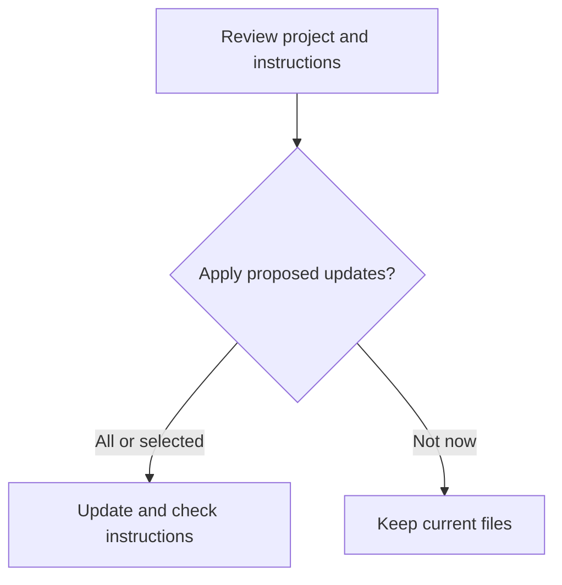

# log

Use log when a new agent session needs better project context, or when the project has changed since its instructions were reviewed. It proposes updates to the knowledge and working agreements your agents read.

## Flow



## Start the command

```text
log
```

Use your client's [command prefix]({{ '/docs/setup/' | relative_url }}#run-a-command). Updates require clean **main or master**. Without Git history, log can create instructions and leave them uncommitted.

## Shared project instructions

Log connects Claude and Codex to shared project knowledge: `AGENTS.md` holds the common instructions, while `CLAUDE.md` imports it and keeps any Claude-specific additions.

It can set this up for a new project or reconcile existing files. You review the changes first; custom content, settings, imports and adopted rules are preserved unless you approve a specific change.

## What the review covers

- **Full scan:** learn the project's important workflows, setup, architecture and constraints across its first-party packages.
- **Gap scan:** follow changes since a valid saved review point and update the affected knowledge.

You can also supply lessons from the current conversation. Log checks them alongside source evidence and proposes lasting guidance. If rewritten history changed the saved review point, it tries to recover a verified equivalent before requiring a Full scan.

Review the proposal, then apply all, select changes, revise or cancel. New safety instructions need explicit approval.

## Your result

You get updated instructions, unresolved findings and a size report. A complete accepted source review advances the review marker; layout-only work and partial acceptance retain the earlier one.

Changes follow your local commit policy and finish on the same branch. Use [adopt](adopt.html) to maintain copied rules and [ship](ship.html) to publish.

[Read the full workflow](https://github.com/myowinthein/agent-helm/blob/main/workflows/log.md).
