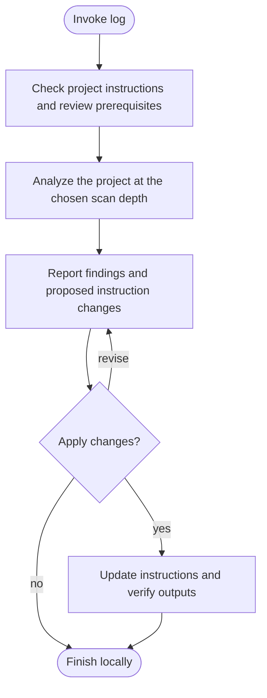

# /helm:log

Give fresh Claude and Codex sessions useful project context: essential commands, important boundaries, working agreements and lessons the developer has already taught the agent. Log sets up shared `AGENTS.md` and its `CLAUDE.md` import adapter, then maintains that knowledge without replacing task-specific code investigation.

Run `/helm:log` in Claude, or select log from the Helm skill picker in Codex, whenever you want the project instructions reviewed. It analyzes the project, reports findings and updates the instructions through a reviewed proposal. Both hosts use the same owner, preservation rules and review-marker contract. [Compatibility](../setup/compatibility.html) explains overrides, imports and shared rules.

## Investigation depth and coverage

Full scan covers every first-party package/topic through representative real workflow tracing, relevant setup/configuration/CI and tests, and review of all existing memory. It is not a line-by-line code quality review. Gap scan accounts for the exact complete commit range and relevant patches, including merges/reverts/renames/deletions and affected unchanged surfaces; a net diff alone is insufficient. Large independent packages/commit batches may use permitted read-only workers, with parent reconciliation of exact coverage and cross-package knowledge.

Follow the [shared investigation and exclusion rules](../setup/investigation.html). Inventories and worker evidence remain transient; inaccessible required material is not silently excluded or marked complete. Finding counts, duration and reasoning effort do not prove coverage.

## Usage

```text
log
```

The workflow recommends Full scan or Gap scan based on the current project and saved review point. You can request either depth. Findings and proposed instruction changes are reviewed before updating existing content; cancellation and genuine no-change results leave it intact.

## Flow



Without a repository or HEAD, log skips Git and leaves verified files uncommitted; it never initializes a repository. With Git history, writes require the current actual main/master base and clean inputs. Ineligible checkouts receive an explanation of the blocker instead of an automatic branch switch. Completion is local, with publication left to ship.

## Shared layout and preservation

Successful setup uses two real root files:

- `AGENTS.md` owns shared knowledge, Helm configuration, adopted Rules and any review marker.
- `CLAUDE.md` contains a standalone `@AGENTS.md` import and clearly Claude-specific additions when needed.

An actual import loads shared content in Claude. Shared dependencies in AGENTS.md use explicit read-and-follow directives because Codex does not expand Claude import syntax. Neither file duplicates the other's ownership.

| Existing layout | Proposed action |
|---|---|
| Neither root file | A selected full scan creates both together. Skip creates neither. |
| AGENTS.md only | Preserve it and propose the missing adapter. |
| CLAUDE.md only | Propose moving shared content to AGENTS.md, keeping Claude-only additions in the adapter. |
| Both correctly connected | Preserve layout and continue assessment. |
| Independent, partially connected or a root two-file cycle | Compare agreements, unique instructions, conflicts and host scope; propose reconciliation. |

Independent files offer reviewed merge, either source as baseline, or Cancel, followed by approval of the exact resulting diff. A baseline does not discard unique instructions. A partially connected adapter still owning shared settings/Rules/marker needs reconciliation. Only the readable root two-file cycle has log's limited read-once reconciliation exception; other cycles/missing targets stop. Preserve overrides, personal/global/nested files, fenced configuration and adopted rule paths. An unconnected root override blocks shared setup on either host.

Layout changes are reviewed from actual destination files and rechecked before writing. Keep prior marker provenance; moving text is not a review. A layout commit is separate from later knowledge commits. Historical layout commits count as noise only after their patches establish unchanged instruction meaning/settings or knowledge already represented. Later Skip/current knowledge still finalizes approved layout changes; layout Cancel ends the invocation without a scan.

## Cheap assessment and true no-op

Before deep patch reading, collect the marker's availability/validity, commit count, changed/renamed paths, approximate churn and affected packages. These are navigation data, not completed review. Never exclude instruction changes or a commit category automatically.

At the existing Full scan/Gap scan choice, use the [shared scan-depth selection](../setup/compatibility.html#shared-scan-depth-selection) with already permitted marker, snapshot and impact facts. Bounded changes normally favor Gap scan; added/removed first-party services/packages, major runtime/framework replacements or cross-area changes can favor Full. Age, counts and missing headings alone do not determine depth; unknown Full-scan history is not never-Full. Explicit Full remains available without a source gap, and an explicitly selected valid Gap must still cover every affected lesson under the per-commit patch contract.

Fresh/Rules-only/no-marker or invalid-marker owners offer full investigation or Skip within otherwise valid inputs. Ownership conflicts still block dependent work. Custom owners receive targeted edits in either depth, without a new targeted-scan mode. Layout preparation and no-op exits gain no scan/helper prerequisite. Log retains its own no-op, acceptance and marker rules.

The read-only no-op requires a clean selected base, connected entries, complete applicable settings, no explicitly requested scan or lessons/settings changes and a valid marker with no source gap. Inspect intervening instruction-maintenance patches before dismissing them; an output filename or log-like subject is insufficient. Report the exact local base SHA and that the remote was not fetched, leaving the marker untouched. Missing optional headings are informational.

Blocked preflight reports name the current checkout, known local base SHA, gaps and pending differences without claiming workspace or remote currency. A dirty tree blocks writes/reviews until the developer resolves it; no automatic commit, stash or discard. A selected write still uses the stable-base setup and clean-tree requirements. Unexpected source/input changes require reassessment; setup never updates the base.

## First-run settings and Git policy

On a selected write path, ask once about absent applicable settings before Git mutations. Batch questions when the host can represent them faithfully, preserving existing values and explicit false:

- Future shipping: `ship-method: direct|pr` (default pr), independent of team size/branch layout.
- Local commits: explicit `git-auto-commit: true|false` (default false).
- Future eligible ship integrations: `git-merge-strategy: squash|rebase|merge` (default squash), independent of ship method.

Record raw owner/configuration/overrides and freeze this run's local commit policy, including explicit answers for previously absent auto-commit. Changes to an existing setting apply next run. Publication preferences do not gate local branching; log can collect active choices during setup without requiring them for knowledge edits. There is no retired-key mapping or cleanup prompt: use the one-time upgrade guide for unsupported declarations. Preserve other settings/overrides and show the exact owner diff before saving.

Answers are pending values, not approval to write an unseen diff. Persist accepted values in the existing recognized block, retaining all unrelated settings and fenced wrappers. If no block exists, review a minimal addition. Never reask during generation or put shared settings in an adapter. Before local writes, unexpected raw declarations or ownership changes stop; an approved pending value is overlaid only while the key remains absent. Other commands retain their existing policy resolution.

## Eight useful topics, flexible structure

Use these topics as the default order for new memory and a checklist for investigation:

| Topic | Intended content |
|---|---|
| Project Identity | Short purpose, stack and blast radius. |
| Project Config | Confirmed Helm settings in one recognized block. |
| Dev Commands | Essential evidenced setup/run/build, focused-test, migration and diagnostic commands with prerequisites. |
| Architecture Pointers | Important entry points and boundaries with a short why; conditional references for occasional detail. |
| Domain Rules | Non-obvious application business, permission and lifecycle constraints. |
| Behavior Rules | Project-specific development agreements beyond loaded rules/configuration. |
| Hard Safety Rules | Concrete project hazards and restrictions, with explicit approval for new safety instructions. |
| Known Traps | Evidence-backed gotchas, historical rationale and developer-confirmed recurring corrections. |

A standard-format owner can use any useful subset of these headings plus `## Rules`. Custom/fenced layouts stay customized and keep their structure. Empty optional topics need no heading or `None` placeholder in new generation. Existing empty sections are preserved unless their exact removal is approved. Missing headings never make a file broken or force a full scan. Add useful missing content within an approved write.

Adopt's Rules section is outside this checklist and remains verbatim in place. Domain Rules describe application constraints, Behavior Rules describe development practices, and Hard Safety Rules describe hazardous operations. Avoid restating configuration or already-loaded Git/safety rules, while preserving necessary standalone safeguards.

## Full scan and gap review

A full scan investigates the current source snapshot across every first-party package/service. Inspect purpose and exposed entry points; manifests/runtime/config/scripts; major workflows through business logic, persistence and integrations; schema/validation/permissions/lifecycle tests; contributor conventions/hooks/CI; operations/jobs/destructive scripts; and prior knowledge/traps. Representative implementations are appropriate across all major areas, not a sample of one package standing for a monorepo. Consult history where specific rationale needs clarification. Read operational commands without executing them.

A gap review accounts for every commit's changed paths and relevant patches through the pinned snapshot, including merges, renames, deletions and reverted work. Messages and the net diff organize that review; they cannot replace it. Fixes, styling, dependency updates, CRUD and refactors may all reveal durable constraints. Reuse already-inspected evidence while inputs remain unchanged.

Keep a working coverage summary with evidence paths and absent/excluded/unfinished areas. Exclude vendor/build/cache artifacts, unrelated data, credentials and operational ledgers as required. Restricted relevant inputs make a review incomplete. Preserve prior knowledge that cannot be rediscovered; propose removals or contradictions only with evidence and approval.

Useful additions improve future decisions and remain relevant for weeks/months. Non-obvious knowledge deserves priority, but essential startup/test commands qualify even when discoverable in scripts. Completed task status alone is not durable memory. Keep detailed coverage in the review/report, not a new ledger or the always-loaded file.

## Confirmed developer knowledge during review

The project review can include developer corrections/agreements from the current visible conversation alongside source findings. Show candidate provenance in the proposal, without persisting transcripts, dates or a session changelog. Never mine hidden sessions, host-private auto-memory or personal files, and never turn an inferred preference into confirmed policy.

Propose a short actionable entry with a useful why. Shared lessons go in AGENTS.md; clearly Claude-only additions can go after the adapter's import, and Codex-only mechanics need an explicit condition. Configuration choices belong in the existing configuration block rather than duplicated prose.

When desired policy contradicts observed code, show the discrepancy and ask whether to record the policy, a trap/known violation, or drop the candidate, unless the developer already made that choice explicitly. Do not assert that desired behavior is implemented or silently modify code. Resolve conflicting guidance through a reviewed diff. New safety instructions still need explicit approval.

Confirmed knowledge is part of the normal review and its consolidated proposal, with the same source-coverage, approval and marker rules as other findings.

## Quality audit, approval and size

Before a knowledge/configuration proposal is applied:

- Trace commands to actual scripts/task runners/config and prerequisites; check input/reference paths by inspection, without running commands/tests. Identify placeholders, future outputs and unavailable external dependencies honestly.
- Check contradictions, ambiguous wording and duplicate statements against actual loaded configuration/rules/imports. Show evidence for proposed removals; uncertainty preserves the old entry. Keep mandatory eager safety reads.
- Check shared/host-specific scope and preserve ownership, Rules, imports and overrides.
- Prefer concrete project guidance and conditional pointers to existing detail. Eager imports still cost context. Do not generate support files/nested entries or prune automatically.
- Report current/proposed owner lines and UTF-8 bytes, with adapter/other mandatory reads separately when known. Keep the soft under-150-line goal without dropping protected knowledge. Codex's discovered-file byte budget and later explicit reads are different costs; unknown limits remain unknown.

Show one combined diff per completed phase, grouped by section, including settings, removals and any eligible marker change. Offer Apply all, Apply some, Revise or Cancel, capped at four faithful options. Reuse authorization for the same exact transformation; re-audit revisions. Partial acceptance preserves unaccepted content and prevents marker advancement. Commit approvals stay at their current concrete boundaries; no approval for an unknown future diff.

Choosing Full scan for a genuinely fresh/Rules-only owner authorizes ordinary descriptive generation and the fresh adapter. Disclose content/coverage; new safety instructions require explicit approval. Existing knowledge always receives its reviewed diff, and existing Rules/settings remain protected. Cancelling a knowledge proposal drops its pending values; earlier approved layout work remains real work.

## Review marker and completion

Pin `review_head` after branch setup and before layout writes. Full-scan currency attests to the source snapshot, not every intermediate commit; gap currency requires complete per-commit coverage. Validate a literal hexadecimal saved commit object and its ancestry before using a range. Invalid/unrelated history offers full investigation, never an invalid range or a current claim.

Recheck instruction/source inputs before applying and committing. Unrelated source changes or a moved HEAD require refreshed investigation and a new diff. Advance a marker only after complete coverage and acceptance/application of every substantive finding. Partial, rejected, skipped or incomplete work retains the prior marker and reports unresolved findings. Layout/configuration changes alone and verified instruction maintenance never advance it. A fully inspected gap with no durable changes may write an eligible marker and accepted settings without another knowledge-diff prompt. No source gap means no marker churn.

Place an eligible marker last in fresh/default generation, after preserved Rules. Targeted updates preserve custom placement, keeping an already-final marker last. Without HEAD, do not initialize Git or invent a marker; a completed accepted full scan omits one, while retained provenance on layout/partial paths is reported honestly.

Read accepted outputs back before local commits, verifying retained knowledge/settings including false, Rules/imports, both host paths and the actual marker. Commit layout separately before investigation and remaining outputs under frozen local policy with exact-path staging. Declined/failed commits and pending drafts stay intact; no reset/stash, automatic branch handling or publication follows. Finish on the same permitted branch after verifying local outputs and eligible commits. No push/PR question, branch creation/switch/update, integration, environment promotion, return checkout or branch cleanup follows. Remote/provider access and published source IDs are not prerequisites merely to finish locally. Invoke [ship](ship.html) separately when the whole selected work is ready to publish. See [Git and CI behavior](../setup/git-and-ci.html).

Safe return requires a clean index/tree, no in-progress Git operation, a valid original branch/worktree target and preserved ignored/untracked local inputs. If checkout is unsafe or fails, stay on the actual branch and report the pending return without forcing it. A clean committed branch may also be left safely after Leave local, missing remote access or a partial publication/PR failure; keep the branch and identify what was not published or created. Returning does not put the new knowledge on the original branch. Genuine no-op cleanup of an empty branch remains separate.

Report setup/knowledge results, reviewed snapshot/coverage, eligible/retained marker, lessons/settings changed, unresolved findings, quality/footprint limits and separate verified commits/uncommitted paths on the same actual branch. Publication was not performed. A local source review does not imply tests, native-client verification, remote currency or deployment.

## See also

- [`/helm:adopt`](adopt.html): installs shared rule files and connects their pointers.
- [`/helm:manifest`](manifest.html): maintains the human-facing README.
- [Compatibility and project instructions](../setup/compatibility.html): current layouts and host boundaries.
