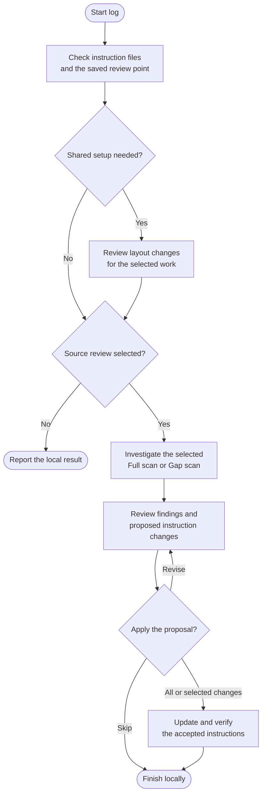

# log

Keep the project instructions useful for new agent sessions. Log reviews the project and proposes updates to its context, working agreements and lessons, so you spend less time explaining the same things again.

## Start the command

```text
log
```

Use the prefix for your app or terminal from [Setup]({{ '/docs/setup/' | relative_url }}#run-a-command).

For Git-backed updates, start on a clean **main or master** branch. Log explains blockers rather than switching branches. Without Git history, it can create instructions and leave them uncommitted.

## Flow



## Shared project instructions

`AGENTS.md` holds shared project knowledge and Helm settings. `CLAUDE.md` imports it with `@AGENTS.md`, keeping any Claude-specific additions separate. Both agents use the same shared context.

Log checks existing files before proposing a layout:

| What exists | What log proposes |
|---|---|
| Neither file | Create both together during the first Full scan. |
| Only `AGENTS.md` | Keep its content and add the Claude import file. |
| Only `CLAUDE.md` | Move shared content into `AGENTS.md` through a reviewed change. |
| Both files | Keep a working connection, or compare and reconcile independent content. |

Existing knowledge, custom sections, imports and adopted rules are preserved unless you approve a specific change. Conflicting or shadowed instruction files need reconciliation before shared setup can finish.

## What the review covers

A **Full scan** covers each first-party package and its important workflows, setup, configuration and tests. It traces representative implementations to find useful project knowledge rather than auditing every line for code quality.

A **Gap scan** reviews the commits since the saved review point, including relevant patches and affected surrounding code. Missing or unusable history calls for a Full scan instead. Broad project changes may also justify one; elapsed time or a commit count alone does not.

The review considers eight topics: project identity, Helm configuration, development commands, architecture, domain rules, development agreements, concrete safety hazards and known traps. These are a checklist, not eight compulsory headings. Relevant corrections you give the agent in the current conversation can become proposed lessons too.

The proposal explains what changed and why it will help future sessions. You can apply all, select changes, revise or cancel. New safety instructions need explicit approval. Existing custom layouts receive focused edits rather than an automatic rewrite.

## Your result

You get the verified instruction files, a summary of changes and any unresolved knowledge. Log reports the instruction file's size and aims to keep it focused, without deleting useful context to meet a quota. Missing Helm preferences are collected during setup and saved only through the approved change.

The `last-reviewed` comment identifies the source snapshot assessed. It advances only after a complete review and acceptance of all substantive findings. Partial acceptance keeps the earlier marker; layout changes alone do not advance it. A genuine no-change result leaves files untouched and reports local currency, without claiming the remote was checked.

Eligible changes follow your local commit policy. Log finishes on the same branch and keeps no separate ledger. Use [adopt](adopt.html) to maintain copied rules and [ship](ship.html) to publish when ready.
