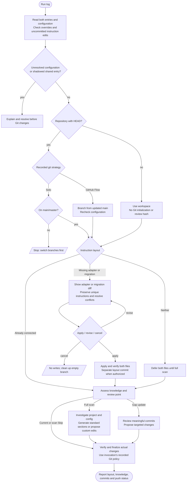

# /helm:log

Set up shared `AGENTS.md` project instructions and a `CLAUDE.md` import adapter, then keep project knowledge current. The captain's log holds durable architecture, configuration, conventions, domain rules and traps. Developers can switch between Claude and Codex sessions without rerunning setup.

In Codex, select the log workflow from the skill picker. Both hosts follow the same migration and knowledge-update workflow. [Compatibility](../setup/compatibility.html) explains ownership, overrides and shared rules.

## Flow

## Shared layout setup

The destination is always:

- `AGENTS.md`: shared project knowledge, one Helm configuration block, adopted `## Rules`, and the review marker.
- `CLAUDE.md`: a real file with a standalone `@AGENTS.md` import, followed by Claude-specific additions when needed.

An actual import loads shared content automatically in Claude. Prose telling Claude to read AGENTS.md is not an equivalent adapter. Shared resource dependencies in AGENTS.md use explicit read-and-follow directives because Codex does not expand Claude import syntax.

| Existing files | Setup action |
|---|---|
| Neither | After a full scan is selected, generate AGENTS.md and the adapter together. Skip writes neither. |
| AGENTS.md only | Preserve it and show the proposed Claude adapter for approval. |
| CLAUDE.md only | Propose moving shared content into AGENTS.md, retaining Claude-specific instructions in the adapter. |
| Both connected correctly | Keep the layout and continue assessment. |
| Both independent, partially connected or cyclic | Compare content and propose reconciliation. |

An adapter that imports AGENTS.md but still owns shared settings, Rules or a review marker is partially connected and needs reconciliation. Log may propose repairing a cycle confined to the two readable root files; it reads each once and resolves configuration before Git actions. Other cycles or missing targets still stop.

For independent files, summarize agreements, unique durable instructions, conflicts and host-specific content before asking. Offer a reviewed merge, either source as the content baseline, or cancel. A baseline does not authorize silently discarding unique safety rules, preferences or conflicting configuration. Show the resulting combined diff before applying it. Existing approval suffices when it covers that exact transformation.

Preserve custom headings, fenced configuration, confirmed settings and adopted rule paths. Convert shared imports explicitly rather than silently making them Claude-only. Remove an old reverse bridge only within the approved migration, preserving user-added instructions. Never leave AGENTS.md reading CLAUDE.md while CLAUDE.md imports AGENTS.md.

Moving content or creating an adapter does not constitute a knowledge review. Carry a valid review marker unchanged; disclose differing histories and propose a conservative review point or removal of an ambiguous marker for approval. A layout-only commit is separate from later knowledge edits and is treated as noise during gap assessment.

Setup runs before the up-to-date check. A later scan Skip or an already-current owner still finalizes any approved layout changes. Cancel at layout approval exits without a layout write or scan and cleans up an empty temporary branch.

## Git and scope

Resolve the existing effective strategy and auto-commit policy before Git changes. Invalid or conflicting Helm values require explicit resolution. Check instruction files for uncommitted work, including untracked existing entries; stop instead of incorporating those edits into migration. Do not reset or stash them.

- **Solo Mode:** run only on main/master.
- **GitHub Flow:** record the original branch and branch from updated main as `docs/log-{date}`. Re-read the actual files before computing a migration diff. If configuration differs from preflight, stop before writing and clean up the empty branch.
- **No repository or HEAD:** use the workspace, omit the review marker, and make no Git initialization, commit, merge, push or promotion.

Finish the invocation under the Git policy recorded at its start. Project Config Check may save a different policy for the next run; it does not switch the current finalization path midway through the command.

An unconnected root AGENTS.override.md stops shared setup on either host before branching. Do not edit or import it. Preserve personal CLAUDE.local.md, nested instructions and global files. Non-root owners, other Claude entries and symlinks need an explicit placement decision. Migration is limited to the agreed root layout; it does not make both tools' nested-file discovery identical.

## Knowledge assessment

After layout setup, assess AGENTS.md:

- **Fresh file, Rules-only bootstrap, or no review marker:** offer a full scan/investigation or Skip.
- **Standard schema intact and no meaningful commits since review:** knowledge is current; finalize any layout changes.
- **Small/moderate meaningful gap:** recommend a gap update.
- **Large meaningful gap or missing standard sections:** recommend a full scan.
- **Customized owner:** preserve its structure. Investigate the same topics and propose targeted edits rather than replacing it with the standard schema.

Invalid or unrelated review markers are reported and offer full investigation. Noise commits include routine fixes, styling, dependency updates, CRUD and pure layout moves.

## Full scan

Investigate business purpose, modules, implementation architecture, stack, conventions, domain constraints, operational context and existing documentation. Record durable knowledge a future session would struggle to discover quickly.

For fresh or already-standard memory, use these eight sections:

1. Project Identity
2. Project Config
3. Dev Commands
4. Architecture Pointers
5. Domain Rules
6. Behavior Rules
7. Hard Safety Rules
8. Known Traps

Project Config Check asks about branching strategy, auto-commit and, under GitHub Flow, merge strategy. Existing standard-format full scans retain their regeneration tradeoff: generated knowledge not rederived is not carried forward. Protected imports, user-authored/host-specific instructions and the adopt-managed Rules section remain protected. Customized owners instead receive a reviewed targeted patch in their existing sections, asking only about missing settings.

Target under 150 lines without padding. Append the actual HEAD review marker only when HEAD exists. For a fresh setup, also create and verify the Claude adapter. Do not install or update `.claude/rules/` here; rule adoption belongs to adopt, and safety findings are proposed rather than silently installed.

## Gap update

Ask only about missing configuration. Review meaningful commit messages, then relevant changes. A proposed addition must satisfy all three questions:

1. Would a future session struggle to find it quickly?
2. Would knowing it improve development decisions?
3. Will it stay true for weeks or months?

Patch affected sections only, preserving custom structure. Propose substantive changes as a diff and wait for approval. If nothing durable changed, only the review hash advances. Moving files alone never advances that hash.

## Finalization and verification

Track layout and knowledge writes separately. If neither changed or was committed, skip commit/merge/promotion and clean up any empty log branch. If layout changed, finalize it even when knowledge was current or the scan was skipped. Declining a commit leaves actual files and branch for review, without merge or push.

Commit under the invocation's recorded policy, with layout and knowledge changes kept separate. Push always requires confirmation. Existing environment promotion and GitHub Flow return/cleanup behavior remain. Cancelling push leaves the actual local commits/branch and reports that state.

Read files back before reporting success. Verify the Claude import, retained instructions, shared configuration, rule dependencies and the intended review point. A failed verification reports the actual changed files rather than claiming complete setup.

Report shared setup status and paths, knowledge outcome, review point, sections changed, layout/knowledge commits, push status, environments promoted, relevant override/nested limitations, and any adopted rules worth revisiting.

## See also

- [`/helm:adopt`](adopt.html): installs shared rule files and connects their pointers.
- [`/helm:manifest`](manifest.html): maintains the public-facing README.
- [Compatibility and project instructions](../setup/compatibility.html): legacy layouts and host boundaries.
