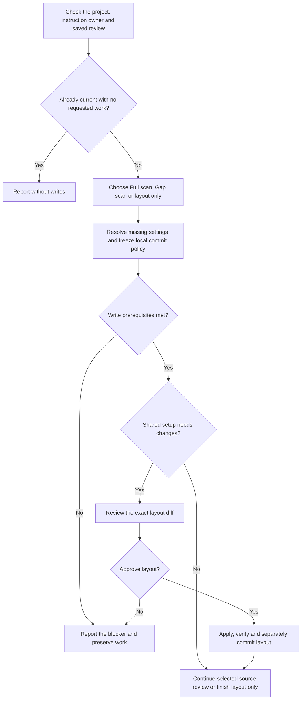
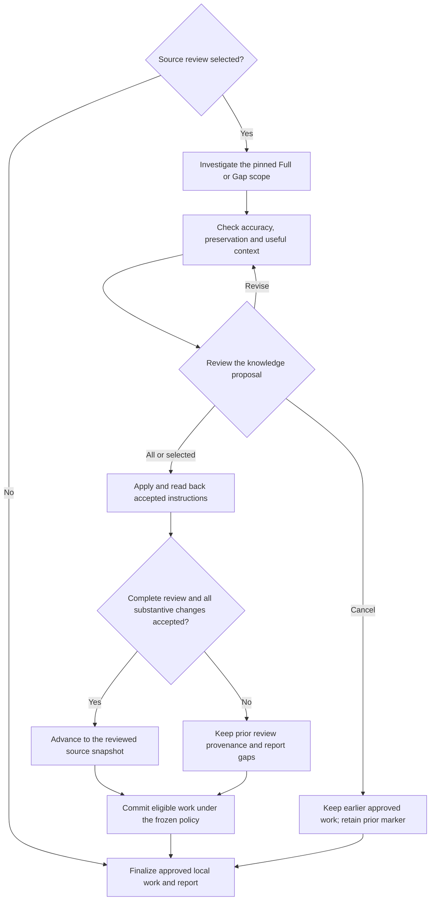

# log



Log turns project evidence and confirmed lessons into instructions that Claude and Codex can share. This guide follows the complete procedure, including how it chooses a review scope, preserves existing knowledge and decides whether a review marker can advance.

## Flow

The setup and source review are separate phases. A completed layout change can be kept even when you skip the source review.

After setup, only the selected source review runs. Coverage and acceptance determine the marker; writing a file alone does not establish a completed review.

The procedure below is also the Markdown instruction source loaded by the log skill. Its question map is at the end; the shared runtime supplies the common execution and safety rules.

{{ page.guide_source | guide_body }}
