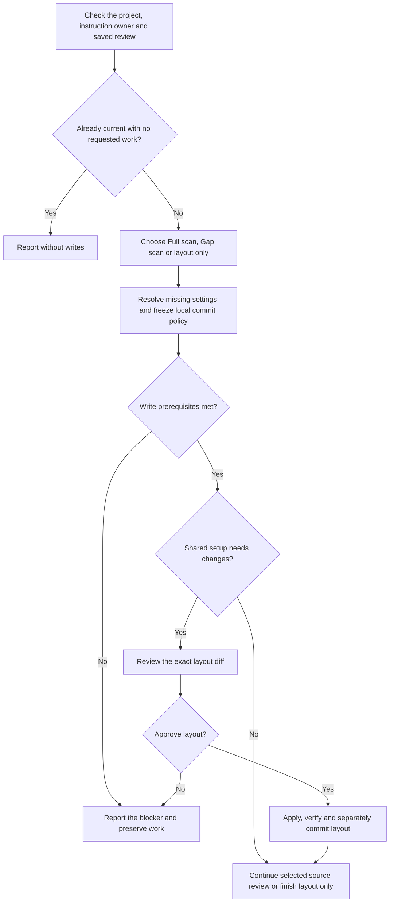
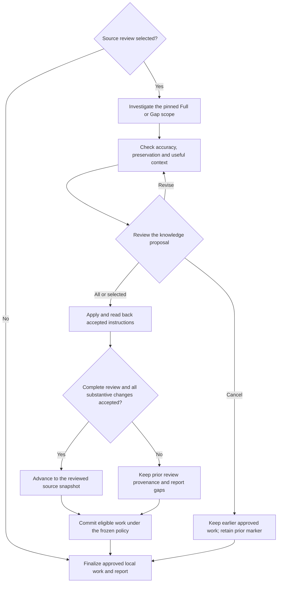

# log



Log helps agents pick up a project with useful context. It combines source evidence with lessons you confirm, then proposes focused changes to the instructions future sessions read.

## Flow

## Start the command

Run log on clean main or master when you want instruction updates. In a project without Git history, it can prepare instructions and leave them uncommitted. A source review and a shared-file setup are separate choices: you can connect the clients without requesting a new investigation.

An already-current result names the local commit it checked. It does not claim to have fetched the remote or tested the running application.

## Shared project instructions

The usual arrangement is `AGENTS.md` for shared knowledge and `CLAUDE.md` for its import plus Claude-specific additions. Log first follows the actual instruction files, imports and overrides. It preserves custom layouts, adopted rule pointers and confirmed settings; missing standard headings do not make an existing file broken.

For a new setup, you choose missing settings such as local auto-commit and future shipping preferences. The exact file changes are shown before they are applied. Existing settings are not silently replaced with defaults.

For example, a project may have a useful deployment warning in a custom section. Log keeps it even if the current scan does not rediscover why it was added; removing or contradicting it needs evidence and a reviewed change.

## What the review covers

| Review | What you can expect |
|---|---|
| Full scan | Trace representative workflows across the project's first-party packages, covering setup, architecture, domain constraints and operational hazards. |
| Gap scan | Follow changes from a verified earlier review to the knowledge and consumers they affect. |
| Layout only | Connect or reconcile instruction files without claiming a new source assessment. |

A Gap scan needs a usable review baseline. If history was rewritten, log first tries to establish the equivalent earlier commit from permitted evidence. It does not invent a baseline or interpret an unavailable marker as proof of completed coverage.

Lessons from your conversation also count. The agent checks what is confirmed, distinguishes lasting project guidance from a one-off preference, and includes the useful changes in the proposal.

## Review and apply the proposal

The proposal explains what to add, update or remove and why it matters to future work. You can accept all, choose specific changes, revise or cancel. Project-specific safety restrictions need your explicit agreement.

Approved layout work is verified separately from knowledge changes. Cancelling a later source update preserves an earlier layout change you already approved. Log does not install or refresh adopted rules; use [adopt](../adopt.html#available-rules) for that.

## Your result

The final report separates updated instructions, completed review coverage and unresolved knowledge. It also reports instruction size so you can notice growing context costs.

A review marker identifies the source snapshot actually assessed. Layout repairs and incomplete acceptance do not advance it as if a full review finished. Eligible changes follow your local commit policy and stay on the current branch; [ship](../ship.html) handles later publication.

## Explore the source

For implementation details, read [guides/log.md](https://github.com/myowinthein/agent-helm/blob/main/guides/log.md).
