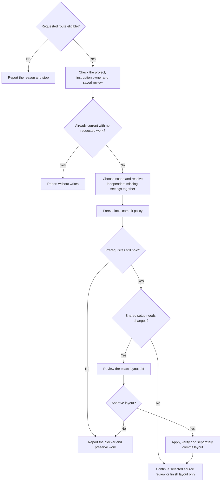
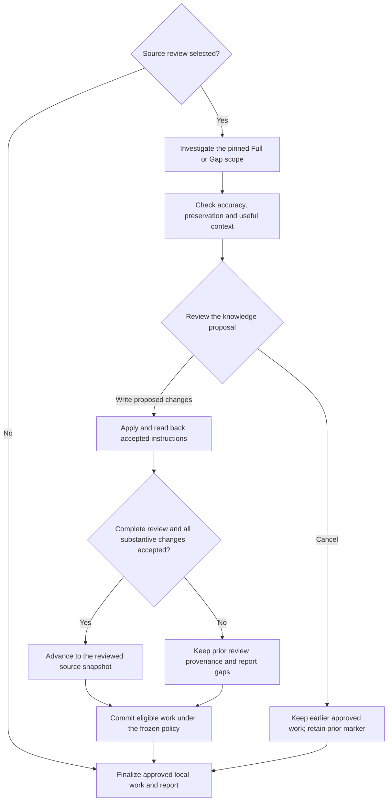

# Log



Log helps agents pick up a project with useful context. It combines source evidence with lessons you confirm, then proposes focused changes to the instructions future sessions read.

## Flow

## Start the command

Log validates clean main or master before reading review history, offering scan choices or investigating source. In a project without Git history, it can prepare instructions and leave them uncommitted. A source review and a shared-file setup are separate choices: you can connect the clients without requesting a new investigation.

An already-current result names the local commit it checked. It does not claim to have fetched the remote or tested the running application.

An established blocker ends the run before further investigation or proposals. Later failures preserve earlier verified setup work and actual drafts, with the prior review marker retained. An unanswered workflow question pauses the run; it does not authorize independent investigation while you decide.

## Shared project instructions

The usual arrangement is `AGENTS.md` for shared knowledge and `CLAUDE.md` for its import plus Claude-specific additions. Log first follows the actual instruction files, imports and overrides. It preserves custom layouts, adopted rule pointers and confirmed settings; missing standard headings do not make an existing file broken.

For a new setup, missing settings such as local auto-commit and future shipping preferences can share a question batch with scan depth when the choices are independent. Existing settings are not silently replaced with defaults, and cancelling the work discards pending preferences.

When the existing instruction files can be reconciled without an unresolved policy choice, you see the recommended merge diff directly. A baseline question is reserved for real ambiguity; it does not replace approval of the resulting changes.

For example, a project may have a useful deployment warning in a custom section. Log keeps it even if the current scan does not rediscover why it was added; removing or contradicting it needs evidence and a reviewed change.

## What the review covers

| Review | What you can expect |
|---|---|
| Full scan | Trace representative workflows across the project's first-party packages, covering setup, architecture, domain constraints and operational hazards. |
| Gap scan | Follow changes from a verified earlier review to the knowledge and consumers they affect. |
| Layout only | Connect or reconcile instruction files without claiming a new source assessment. |

A Gap scan needs a usable review baseline. If history was rewritten, log first tries to establish the equivalent earlier commit from permitted evidence. It does not invent a baseline or interpret an unavailable marker as proof of completed coverage.

Lessons from your conversation also count. The agent checks what is confirmed, distinguishes lasting project guidance from a one-off preference, and includes the useful changes in the proposal.

## Review and apply the proposal

Existing entries are assessed for accuracy and their value to future agents. An accurate implementation walkthrough may be too detailed for always-loaded instructions; a temporary task report may no longer belong there. Log can propose condensing or consolidating these passages, linking existing documentation or removing material with no durable value. It explains the reason and what useful knowledge remains. Missing source evidence for an old warning is not grounds to discard it, and custom sections are not converted to a standard outline automatically.

A Full scan assesses all existing knowledge alongside the project investigation. A Gap scan applies this review to affected passages and concerns selected for the run, while preserving unrelated content. The initial document check can identify a concrete problem even without new source commits; it does not establish source coverage or turn wording preferences into mandatory work.

The proposal explains what to add, update, condense or remove and why it matters to future work. For existing files, a diff grouped by file and section shows the exact removed lines with `-` and added lines with `+`, including settings and any review-marker change. A clean **Proposed result after approval** preview then shows the affected passages as they would read, or the complete content for a proposed whole-file replacement. Removed sections are identified explicitly. Unrelated unchanged sections do not need to be repeated.

A new file is shown in full once under its path. It does not also need an all-additions diff or a repeated safety section. When new safety rules need explicit approval, the question identifies the relevant file, heading and entries in that displayed content. A proposal that edits AGENTS.md and creates CLAUDE.md therefore uses a diff for the former and one complete preview for the latter. This changes presentation, not the approvals required for creating or editing instructions.

The preview appears in the conversation before files are changed. Colors and word-level highlighting depend on the client; the text and symbols still identify the changes. Layout reconciliation receives the same preview treatment. Both layout and content reviews offer **Write proposed changes** and **Cancel**. Project-specific safety restrictions need your explicit agreement. Editorial cleanup by itself does not advance the source-review marker.

There is no separate Apply some or Revise button. You can type the exact changes you accept, a specific correction or replacement wording. The agent handles that bounded request while preserving the remaining proposal. It does not automatically repeat the scan or rewrite unrelated content. If new wording still needs approval, you see the affected preview again with the same two actions; an already-approved exact selection is not asked again.

With auto-commit off, writing approval alone does not authorize committing. A specific request covering the exact changes, paths and commit subject can already authorize both; otherwise the missing commit decision follows verification. Unknown later knowledge changes need their own approval, and an uncommitted layout checkpoint leaves dependent scanning pending.

Approved layout work is verified separately from knowledge changes. Cancelling a later source update preserves an earlier layout change you already approved. Log does not install or refresh adopted rules; use [adopt](../adopt.html#available-rules) for that.

## Your result

The final report separates updated instructions, completed review coverage and unresolved knowledge. It also reports instruction size so you can notice growing context costs.

A review marker identifies the source snapshot actually assessed. Layout repairs and incomplete acceptance do not advance it as if a full review finished. Eligible changes follow your local commit policy and stay on the current branch; [ship](../ship.html) handles later publication.

During ordinary development, a needed AGENTS.md correction comes as a [proposed change before any edit](../../rules/safety/detailed.html#maintaining-command-outputs). You can approve a bounded correction under log’s authoring standards or run log for its source review. Reading those standards does not invoke log, and an approved direct edit preserves the existing review marker.

## Explore the source

For implementation details, read [guides/log.md](https://github.com/myowinthein/agent-helm/blob/main/guides/log.md).
