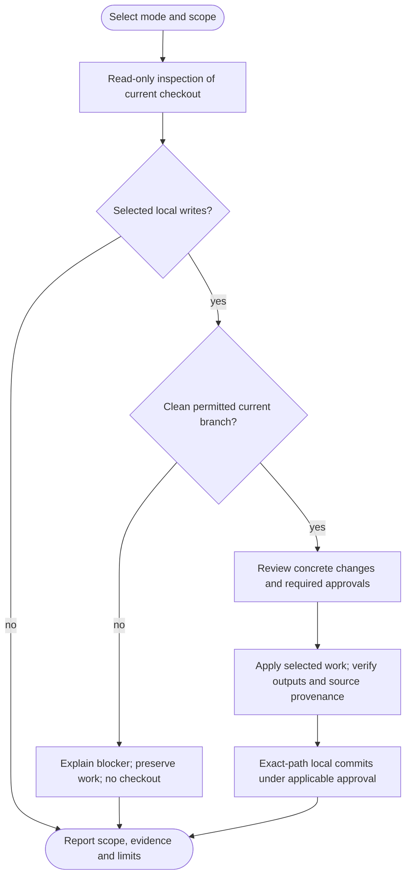

# /helm:manifest

Keep a project's README useful to people evaluating, using or contributing to it. Review the current project, update reader-facing changes since a saved review, or repair specific content/structure gaps. Full scans preserve existing writing and propose a reviewed diff instead of replacing the file automatically.

Command names below use Claude notation. In Codex, select the same Helm workflow from the skill picker. Both hosts use the same workflow and existing instruction owner; see [compatibility notes](../setup/compatibility.html).

## Investigation depth and coverage

Full scan traces existing README claims to source/docs/manifests or confirmed human context, then sweeps reader-facing requirements, setup/configuration, usage, interfaces and help/policy surfaces for omissions. Gap scan maps actual changes to affected claims/workflows, reading relevant patches and surrounding contracts rather than relying on filenames. Large independent claim/package groups may use permitted read-only workers; the parent reconciles shared setup, evidence and unread areas. This is not a detailed whole-code audit or log's lesson history.

Follow the [shared investigation and exclusion rules](../setup/investigation.html). Inventories and worker evidence remain transient; inaccessible required material is not silently excluded or marked complete. Finding counts, duration and reasoning effort do not prove coverage.

## Flow

The diagram summarizes the main routes. New factual generation is authorized by the selected mode/style or approved custom outline; a style-only save has its own explicit setting diff. Unknown policy facts still need a decision. Declined or blocked writes/publication preserve actual work and report the pending state.

## Before starting

Manifest requires an existing resolved project-instruction owner. If neither `AGENTS.md` nor `CLAUDE.md` exists, or the selected owner is missing, it directs you to run [log](log.html) first. It never creates/migrates instruction files or invokes another workflow automatically. Bridges, overrides, conflicts and missing imports still follow the shared runtime.

Selected writes require a clean actual main/master current branch under the [local-edit procedure](../setup/git-and-ci.html). Read-only preflight may inspect another checkout, but cannot certify it as stable base. Wrong-branch writes block; no checkout, branch creation or upstream update occurs. Manifest never uses log's pending-policy overlay or initializes Git.

## 1. Find the target and choose style

Root `README.md` remains the default, preserving an existing filename's actual casing. Manifest also discovers README candidates in `.github/` and `docs/`, alternative formats, translations and package siblings. It reports GitHub's effective entry-point priority, `.github` before root before `docs`, without guessing between ambiguous candidates.

If another location overrides root, root is missing while another candidate exists, or the target is ambiguous/explicitly changed, you choose the target before work begins. The choice applies to this run only. It does not silently maintain every README, translate siblings, rename files or save another configuration flag. Long candidate lists use a grouped selection with at most four choices.

Alternative formats retain their own syntax. Unsupported formats/checkpointing, unsafe or outside-project symlinks and generator-owned targets need a reviewed target/format decision. Editable READMEs retain generated blocks. If the target is itself the memory owner or is imported as active agent instructions, ordinary README rewriting stops for a separate target or explicit instruction reconciliation.

Manifest records the current structure, unique human context, language, frontmatter/permalink, banners, badges, assets, HTML, comments, reference definitions, generated blocks and link conventions. It preserves these across GitHub, documentation-site and package rendering contexts.

### Two styles

- **Standard Readme spec** uses the applicable [specification](https://github.com/RichardLitt/standard-readme/blob/main/spec.md), with proposed repairs/conversions reviewed before changing existing content.
- **Custom** preserves the existing section names/order. Adding, removing, renaming or reordering sections requires approval of the exact change and placement.

An existing `readme-style: standard|custom` is reused. If missing, manifest asks once and holds the choice pending. An explicitly requested style change follows the same pending-write rule. Skip/Cancel saves nothing.

Only an approved setting is written into the existing owner's recognized configuration block, preserving Helm declarations or Compass-style fences. If no block exists, manifest may add a minimal `## Project Config` section containing only `readme-style`, preserving the owner's content and review marker. Normally this updates `AGENTS.md`; `CLAUDE.md` remains the import adapter with its own additions. Existing owners remain in place until a reviewed log migration.

### New custom README from an outline

When custom style has no existing content, supply an outline or reference. Manifest adapts it into proposed section names/order for your approval before drafting from this project's evidence. It does not copy the reference project's facts, branding, license or commands, or silently invent your custom structure.

Without an outline, you can provide one, cancel, or explicitly **Save style only** if the setting changes. Style-only saves use normal Git finalization, need no source scan and never advance a README marker. You no longer have to hand-write the entire README to start custom mode.

## 2. Assess and choose scope

Manifest checks existence/content, applicable structure and the saved `<!-- last-reviewed: {hash} -->` anchor. An anchor must be one unambiguous literal hexadecimal ID resolving to a commit that is an ancestor of the candidate source HEAD. Missing, malformed, unavailable or divergent history is reported as unknown; unvalidated marker text is never executed as Git syntax.

A cheap index of changed paths, commit range, packages and reader-facing surfaces guides mode selection before deep investigation. Changes are judged by their impact on setup, usage, examples, requirements, availability and policy. Fixes, styling, dependencies, CRUD and README-only changes are not categorically excluded.

At the existing Full scan/Gap scan choice, use the [shared scan-depth selection](../setup/compatibility.html#shared-scan-depth-selection) with this target's already permitted request, anchor, source snapshot and reader-impact evidence. Bounded changes normally favor Gap; credible broad reader-facing changes favor Full. An unusable anchor within otherwise valid inputs recommends Full, while ownership conflicts remain blockers. Age/counts alone do not trigger Full, and unknown Full-scan history is not never-Full. Honor explicit supported scope: Full preserves existing material, and a valid Gap covers every affected reader surface even when broad. Repair structure and Style-only gain no helper or baseline prerequisite. No source gap alone does not waive target/style/structure checks or the marker acceptance gate.

| Mode | What it does |
|---|---|
| Full scan | Review the current README-facing project snapshot, retaining existing material and proposing focused changes. Appropriate for new content, unknown history or broad changes. |
| Gap scan | Use a validated anchor to investigate affected reader workflows and edit relevant sections. |
| Repair structure | Investigate specific missing/inaccurate content or headings, without forcing a full project scan. Available without an anchor. |
| Skip | Exit without README or pending style writes. |

Only applicable options appear, at most four at once. Explicit style-only saving is separate from Skip. A missing heading alone does not require Full scan: equivalent content is considered before adding duplicate sections or renaming anything. Content coverage and strict spec conformance are reported separately.

A narrow no-op can avoid writes when the selected base is clean, the target/style are settled with no pending style change, structure needs no repair and a valid anchor shows no intervening commits or only inspected maintenance already represented. It does not override an explicit scan request or dismiss commits based on their names. The report names the exact local SHA and states that no remote fetch occurred. Dirty/feature checkouts are not certified as the stable base, and local currency is not remote currency.

## 3. Prepare the base and investigate

Once real work is selected, validate current-base eligibility and pin the actual source snapshot without creating/updating/switching a branch. Recheck target, owner/configuration and source inputs; changed assumptions refresh the assessment rather than applying stale approval.

The workflow pins the actual source SHA after preparation and before style/README writes. It records target/owner inputs and relevant source state, then rechecks them before applying and committing. Unexpected drift stops dependent work for a fresh proposal; it never resets, stashes or includes someone else's changes.

A full scan inventories relevant first-party packages/services, entry points, docs, task/build manifests and contribution/license evidence. It covers the purpose, prerequisites, smallest working path, representative usage and relevant behavior the README claims to describe. Each custom section gets its own subject-specific investigation, retaining human context that source cannot rediscover. It does not regenerate unchanged paragraphs or erase unfamiliar sections.

A gap review reads relevant patches and current code/docs, following history for migrations, releases, reverts or ambiguous results. A path/net-diff index alone is not proof of coverage. Relevant uninspected or blocked surfaces are disclosed. This reviews the current README-facing snapshot; it does not copy log's audit of every historical development lesson.

A repair investigates only enough to correct the selected content/structure. A style-only save prepares only the setting diff. Neither becomes a full scan implicitly.

## 4. Keep the README useful and accurate

Lead readers to the purpose, prerequisites, smallest copyable getting-started example, common usage, help, contribution and license facts. Link detailed docs instead of accumulating API inventories or deployment manuals. Badges are not required.

Before writing, review changed content and its dependencies for:

- Commands/examples supported by actual interfaces/scripts, correct working directory and prerequisites, language-tagged code fences without shell prompt characters, and evidenced expected results.
- Accurate availability/version/package claims and environment key names/placeholders, without invented releases, promises or real secrets.
- Valid links, anchors and assets for the actual renderers, retaining deliberate absolute/relative conventions and protected content.
- Verified contribution/help/license policy, retained human context and unresolved facts.

This is a static evidence review. Drafting an example does not run installs, tests, migrations or operational commands, and unexecuted examples are never described as tested. Later required publication checks remain required; unavailable checks are not passes.

### Standard Readme details

The order is Title, optional Banner/Badges, Short Description, optional Long Description, Table of Contents, optional Security/Background, Install, Usage, relevant extra sections, optional API/Maintainers/Thanks, Contributing, License.

Use the real display title and disclose naming/metadata differences. The short description is under 120 characters and consistent with the applicable package-manager description when present, including non-Node projects. Manifest does not rename repository/package metadata to make it match.

The specification makes a table of contents optional below 100 lines and expects it at 100 or more. Generator-owned contents stay protected; renderer navigation or intentional deviations are disclosed. Install and Usage normally apply but are optional for documentation-only repositories. CLI/import examples depend on the project's real interfaces.

Useful additional sections are allowed after Usage and before API, such as configuration, development or limitations. They are named for their subject, not literally "Extra Sections". Contribution/license sections need real policy/license evidence or a maintainer decision, never an invented license or contribution/support promise.

Title/short description are not mandatory H2 headings. Equivalent content can avoid duplicate repairs, but synonyms/custom order do not prove strict conformance. Locale, frontmatter and rendering requirements remain protected; any conflict with strict compliance gets a reviewed choice rather than a silent conversion or false compliance claim.

## 5. Approve and write

For an existing README, review one consolidated section-level diff covering retained content, updates, additions/removals, structural changes, pending style and marker eligibility. Choose Apply all, Apply some, Revise or Cancel. Full scan alone does not authorize whole-file replacement; that requires an explicit reviewed choice showing retained/protected content. Targeted edits preserve unaffected bytes.

For a new/empty README, selected factual generation with standard style or an approved custom outline can write directly. Unknown policy/license facts and scope changes still need decisions. A style-only save shows its exact setting diff.

### Marker eligibility

The marker records a complete static assessment of this README's relevant source snapshot, using the pinned source SHA. It does not certify all code/history, runtime behavior or external services.

- Complete full/gap assessment, all substantive findings accepted/applied and unchanged inputs: advance/create the marker.
- Complete assessment with no prose changes: an explained marker-only update is allowed without an extra prose-change question.
- Own-output-only maintenance or no new source: avoid recurring marker churn.
- Partial acceptance, rejection, unresolved substantive findings or incomplete investigation: retain the old marker; a new incomplete README gets none.
- Bounded repair, style-only or outline-only work: retain provenance unless a separate complete snapshot review actually occurred.

Never replace provenance with a later docs/integration/publication tip. Existing marker placement is preserved; eligible new Markdown generation places it at the end. Alternative formats do not silently receive an incompatible HTML-comment marker.

Accepted content and an eligible marker are applied together, after approval and a final input check. Readback verifies each changed section, protected content, setting and provenance, plus the instruction/adapter chain. Errors are reported per section and stop dependent Git actions. Other READMEs, generators, metadata and operational state are outside scope.

## 6. Finalize and report

Both README edits and explicit style-only saves count as real work. Stage only exact approved literal paths, inspect the proposed index and honor normal auto-commit policy. Declined or failed commits preserve drafts/index/branch. A genuine no-write/no-commit exit performs no cleanup.

Finish on the same permitted branch after verifying local outputs and eligible commits. No push/PR question, branch creation/switch/update, integration, environment promotion, return checkout or branch cleanup follows. Remote/provider access and published source IDs are not prerequisites merely to finish locally. Invoke [ship](ship.html) separately when the whole selected work is ready to publish. See [Git and CI behavior](../setup/git-and-ci.html).

Return only with a clean index/tree, no in-progress Git operation and a safe valid original checkout, checking ignored/untracked collisions too. If unsafe or failed, preserve work and report the pending return. Leave local or a partial push/PR failure may still allow an independently safe return, while the branch remains retained and the missing step stays explicit. Opening a PR does not update the original branch's README. Genuine empty-branch no-op cleanup is separate.

Report local content completion, exact target/effective GitHub entry, untouched siblings, style saved/discarded, changed sections, unresolved facts, source SHA/marker eligibility, current branch and verified local commits/drafts. Publication was not performed. A preflight exit discloses unchecked remote freshness; unperformed runtime checks remain unverified.

## Stop conditions

- Missing/conflicting instruction owner, unsafe/ambiguous target, imported instructions needing reconciliation or unsupported format/generator handling.
- Missing custom outline until supplied/approved, unless an explicit style-only save is selected.
- Skip/Cancel before writing, which also discards pending style.
- A qualifying local no-op, reported at its actual SHA without a remote currency claim.
- Dirty/unsafe Git preparation, changed inputs, incomplete evidence, failed readback or declined/blocked finalization. Actual work stays intact and provenance is not falsely advanced.
