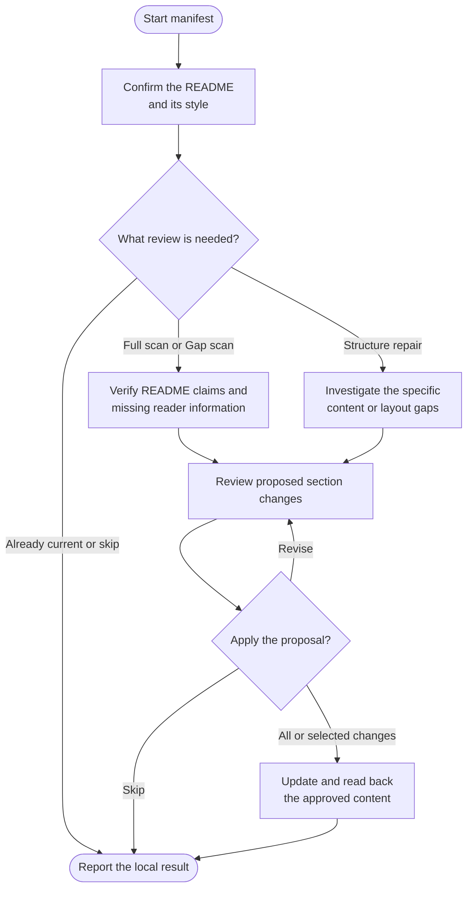

# manifest

Create a useful README or keep an existing one accurate. Manifest checks what readers need to understand and start using the project, while preserving its existing voice, structure and supported information.

## Start the command

```text
manifest
```

Use the prefix for your app or terminal from [Setup]({{ '/docs/setup/' | relative_url }}#run-a-command).

Run [log](log.html) first if the project has no shared instruction owner. Updates require a clean **main or master** branch; manifest does not switch branches for you.

## Flow



## Choose the README and style

The default target is the root README, using its existing filename and casing. Manifest also checks `.github/` and `docs/`: if another file takes precedence on GitHub or the target is ambiguous, it asks which one to maintain. Translations and package READMEs are not silently rewritten together.

| Style | How it works |
|---|---|
| **Standard** | Use the applicable [Standard Readme specification](https://github.com/RichardLitt/standard-readme/blob/main/spec.md), covering the project's purpose, installation, usage and relevant contribution/license facts. Useful when you do not have a custom layout in mind. |
| **Custom** | Preserve an existing outline. For a new README, supply an outline or reference and approve the adapted section order before drafting. |

The choice is stored as `readme-style` in the shared instruction owner only after an approved write. Selecting a Full scan does not authorize replacing a custom structure or removing unique human context.

Generated files need their generator's workflow or another agreed target. A README that also supplies active agent instructions needs separate reconciliation before ordinary prose maintenance.

## What the review covers

A **Full scan** reviews the project's README-facing workflows: prerequisites, installation, configuration, representative use, interfaces and help/policy information. It checks existing claims and looks for missing reader information across relevant packages.

A **Gap scan** follows changes since the valid saved review point to the affected sections and reader workflows. New or unusable review history calls for a Full scan. Broad changes can also justify one; the command does not force rescans from elapsed time or commit counts alone.

You can instead choose **Repair structure** for specific missing or inaccurate entry-point content without claiming a complete source review. An explicit style-only change is also possible. Already-current and Skip outcomes leave content untouched.

## Review the update

Manifest checks proposed examples, commands and links against the source and preserves frontmatter, banners, assets, generated blocks and intentional rendering conventions. It links to detailed documentation instead of copying it into the README. Unknown contribution, support or license facts need confirmation rather than invented text.

For existing content, you see a consolidated section-level proposal and choose all, selected changes, revision or cancellation. Only approved edits are written and read back. This is a static review; example commands are not executed merely to write the README.

## Your result

You get the maintained README, any approved style-setting change and a report of unresolved facts. A `last-reviewed` comment records the inspected source snapshot only after a complete accepted Full or Gap review. Partial edits, structure repairs and style-only changes keep prior review provenance.

Eligible changes follow your local commit policy and stay on the same branch. Use [ship](ship.html) when ready to publish. Manifest creates no separate ledger and leaves the Claude import file alone.
