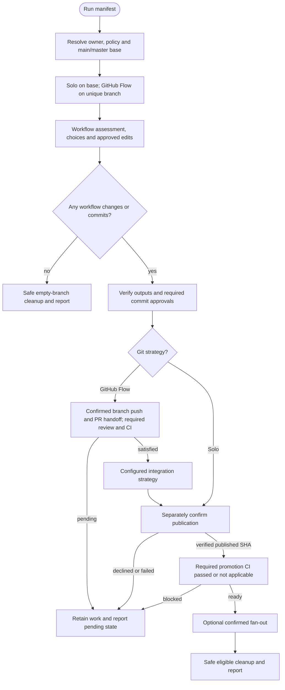

# /helm:manifest

Keep `README.md` in sync with the codebase. Full scan on first run, gap update on subsequent runs. Supports two styles: Standard Readme spec (enforced structure) or custom (preserves the developer's existing structure).

Command names below use Claude notation. In Codex, select the same Helm workflow from the skill picker. Configuration comes from the existing memory owner, including through a bridge; [compatibility notes](../setup/compatibility.html) describe host-specific behavior.

## Flow

## Steps

### Before starting

Resolves the existing configuration and project-knowledge owner through the shared runtime first. If that file does not exist, including a project with neither `AGENTS.md` nor `CLAUDE.md`, stops before any Git mutation or file write and directs the developer to run `log`, then re-run `manifest`. It does not create instruction files or automatically invoke another workflow. Existing bridge, override, conflict, and missing-import rules still apply.

Rewrites `README.md` from the project's state, so it needs the full merged, stable state, never an in-progress feature branch. Use the [shared Git and CI flow](../setup/git-and-ci.html): resolve the actual main/master base and invocation policy, require a clean setup, use a unique GitHub Flow branch (unused suffix on collisions), and revalidate destination ownership/configuration after checkout. Solo stays on the base without a temporary branch. Preserve real drafts/commits on failure; only a genuine no-write/no-commit exit safely returns before deleting its empty branch.

## Scope

README.md is human-facing documentation for contributors, GitHub visitors, and new users; not a changelog, not a technical spec, not a deployment manual. Write clear, scannable explanations for people reading the project. Shared agent instructions for Claude and Codex belong in the resolved project-memory owner. Whenever writing to README.md, in any step: use em-dashes sparingly, only when no other punctuation (comma, semicolon, colon, or a new sentence) works as well. When in doubt, restructure the sentence instead.

### 1. Assessment

First determines the README style by reading `readme-style` from the resolved owner's recognized configuration block. If the flag is absent, checks whether README.md already exists with content and asks accordingly: the question and the Custom option's description differ depending on whether there's an existing README to be "custom" relative to, since a brand-new project has nothing yet. Saves the choice (`readme-style: standard` or `readme-style: custom`) to that same owner before continuing, preserving the block's existing layout, including a recognized Compass-style fenced block.

If the existing owner has no recognized configuration block, adds a `## Project Config` section containing only the chosen `readme-style` declaration. Preserves existing content and any end-of-file review marker, and does not invent other settings. In the shared layout, this updates `AGENTS.md` while leaving `CLAUDE.md`'s import and Claude-specific additions intact. An existing legacy owner remains the owner until a reviewed `log` migration; configuration is never duplicated in a wrapper or a second owner.

Then reads the current `README.md`, checks for a saved `<!-- last-reviewed: {hash} -->` marker, and if found, runs `git log {hash}..HEAD --oneline` to measure the gap. Ignores noise commits.

When `readme-style: standard` and a hash exists, also checks whether all mandatory sections are present. If any are missing, recommends a full scan regardless of gap size and states which sections are missing.

### 2. Pick mode

Four outcomes, default depending on assessment:

- **No file or no hash**: Full scan or skip.
- **Standard style, structure broken**: Full scan (recommended), gap update, or skip.
- **Structure intact (or custom) and no meaningful commits since the last review**: exits cleanly ("README.md is up to date"), no prompt shown.
- **Structure intact (or custom) and meaningful commits since the last review**: Gap update or Full scan, recommended option first based on gap size, or skip.

### 3. Full scan

**Custom mode with no existing README exits immediately, before investigation runs.** Custom mode preserves structure, it doesn't author it; if there's nothing to preserve, there's nothing worth investigating the project for either. Reports that there's no README.md yet and asks the developer to write one in whatever structure they prefer; a future run then preserves it. No project scan or README write; any earlier approved style-setting write still reaches finalization.

Otherwise, investigates: business purpose and target audience, stack and dependencies, installation steps, core usage patterns and CLI commands, public API surface, license, contributing model, maintainers, and project motivation/limitations worth surfacing.

If `readme-style: standard`: writes `README.md` following the Standard Readme spec section order.

Mandatory sections: Title (matches repo name), Short Description (under 120 chars, matches `package.json` description), Table of Contents (if README exceeds 100 lines), Install, Usage, Contributing, License (last section before the comment tag).

Optional sections when relevant: badges, long description, background, API, limitations (only if the project has meaningful limitations worth surfacing to users evaluating adoption).

Skipped unless specifically needed: banner, security, thanks, maintainers, extra sections.

If `readme-style: custom` (the only way to reach this point is with an existing README, per the early exit above): reads the existing structure first, rewrites content within each section based on the project scan, and does not add, remove, or rename sections without explicit approval.

Appends the current HEAD hash as `<!-- last-reviewed: ... -->`. Writes directly.

### 4. Gap update

Reads commit messages first. Reads file changes only for significant commits. Focuses on new features, API changes, new install steps, changed usage, changed CLI commands, new env vars, and removed functionality.

For each significant change, identifies the affected README section. Updates only those sections. Does not rewrite unaffected sections.

If no significant changes are found despite the initial gap estimate: reports that no update is needed (the equivalent of [`/helm:log`](log.html)'s Outcome A) and skips the proposal and confirmation below; only the hash advances.

If `readme-style: standard`: sections remain in spec order after updates. A significant change can also add a newly-relevant optional section (e.g. a first public API) in its spec position, or remove one whose justification went away (e.g. the API was removed), never inventing a section outside the spec.
If `readme-style: custom`: preserves existing section order and naming, and, matching Step 2, does not add, remove, or rename sections without explicit approval. If a significant change doesn't fit any existing section, asks whether to add a new one or fold it into the closest existing section rather than deciding silently.

Proposes the changes per section, asks for confirmation, then writes. Bumps the saved hash to HEAD.

### 5. Commit and finalize

Count both README edits and any approved owner `readme-style` change. Custom mode with no README may still have a configuration write; it is not automatically a no-op. Verify approved outputs and marker, stage exact paths and honor auto-commit. A failed/declined commit leaves drafts intact.

Follow the [shared Git and CI flow](../setup/git-and-ci.html) after the command's own output verification and commit approvals. GitHub Flow offers separately confirmed branch publication and PR creation, or a local/manual handoff, until required review/checks pass. Integration uses the configured squash/rebase/merge strategy and actual main/master base. Solo requires no PR unless explicit project policy says otherwise. Base publication always has its own confirmation.

Before fan-out promotion, verify configured/applicable CI for the exact published source SHA with complete provider-aware coverage. Missing/failed/pending/unknown results stop or defer promotion; target selection cannot waive the gate. Use at most four target options or Yes/Skip for one, explicitly describing merge and push. Verify each operation and report completed/pending targets separately.

Declined/failed commits, unsafe local edits or incomplete checkpoints preserve actual work and stop dependent operations. Safe cleanup uses ancestry checks and `git branch -d`; squash/rebase branches outside ancestry are retained, never force-deleted. Remote deletion needs its own push confirmation. Report PR URL/review status, actual branch, commits, integration/publication, CI, and promotions separately. Summarize output verification captured before publication, not a different original checkout after cleanup.

### 6. Confirm completion

If a scan or gap update wrote anything this run, first verifies it: reads README.md back and confirms the `<!-- last-reviewed: {hash} -->` comment and the claimed section changes actually landed, reporting per-section errors instead of a false-clean outcome, mirroring adopt.md's and legal.md's own write-verification pattern. Then reports the outcome (up to date / full scan written / gap update written / skipped), the style used (standard or custom), which sections were updated, and which environments were promoted. Under GitHub Flow, also reports the temporary branch's fate and which branch you were returned to. Runs even when nothing was written, since that's still an outcome worth reporting.

## Stop conditions

- **No existing instruction owner.** Run `log` first, then re-run `manifest`. Stops before Git mutations or file writes.
- **Solo Mode, not on main/master.** Switch to main or master and re-run.
- **README.md is up to date.** Structure intact and no meaningful commits since the last review; clean exit, no prompt.
- **User picks Skip.** Clean exit, no changes.
- **User cancels at the proposed-changes confirmation.** No write.
- **No significant changes found during Gap Update.** Only the hash advances.

Only a genuine no-write/no-commit exit uses safe empty-branch cleanup. Drafted configuration or committed work instead follows finalization or its pending-work path.

## See also

- [`/helm:log`](log.html) - same lifecycle for `AGENTS.md` (the agent-facing version)
- [`/helm:ship`](ship.html) - typically run before shipping so the manifest reflects the release
