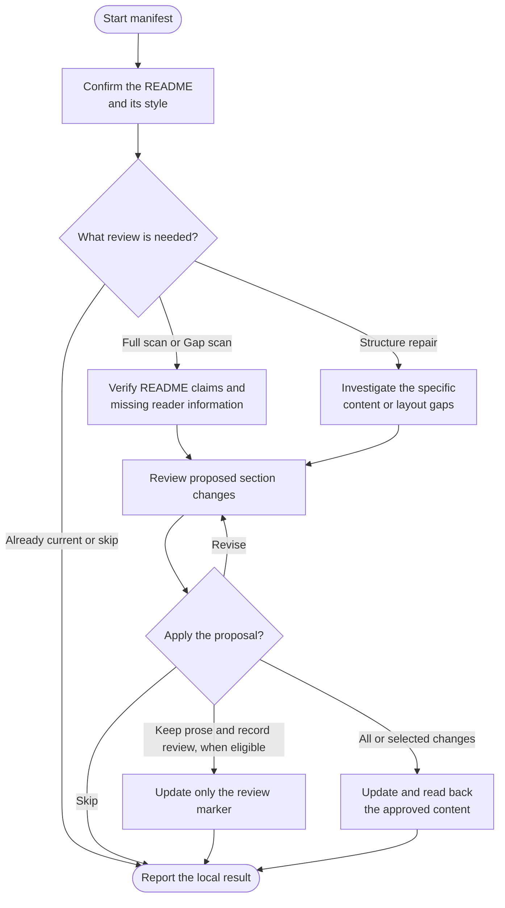

# manifest

Create a useful README or keep one accurate. Manifest checks what readers need to understand and use the project while preserving its voice and useful content.

## Start the command

```text
manifest
```

Use the prefix for your app or terminal from [Setup]({{ '/docs/setup/' | relative_url }}#run-a-command).

Run [log](log.html) first if there is no shared instruction owner. Updates require a clean **main or master** branch.

## Flow



## Choose the README and style

Manifest normally maintains the root README. It checks GitHub's precedence and asks if the target is ambiguous. Translations and package READMEs are not rewritten together automatically.

| Style | Approach |
|---|---|
| **Standard** | Follow the applicable [Standard Readme specification](https://github.com/RichardLitt/standard-readme/blob/main/spec.md). |
| **Custom** | Preserve the existing outline. For a new README, approve an outline or adapted reference before drafting. |

An approved choice can be saved as `readme-style`. Full scan does not authorize replacing a custom structure. Generated content follows its producer; active agent instructions embedded in a README need reconciliation before prose maintenance.

## What the review covers

- **Full scan:** check existing claims and missing reader information across relevant project workflows, from prerequisites and installation to use and support.
- **Gap scan:** follow changes since the saved review point to affected sections. Missing or unusable history calls for Full scan.
- **Repair structure:** address specific content or layout gaps without claiming a complete source review.

An explicit style-only change is also possible. Skip and already-current outcomes leave content untouched.

## Review the update

Manifest checks commands, examples and links against source, preserving banners, frontmatter, custom context and generated blocks. It links to detailed guides instead of copying them. Missing policy or support facts need confirmation.

For existing content, choose all proposed section changes, a subset, revision or cancellation. Only approved edits are written and read back. Example commands are not executed merely to write the README.

When a complete review finds only optional improvements, the same question also offers **Keep README unchanged and record review**. This preserves the prose and records the reviewed source commit without another approval gate.

## Your result

You get the README, any approved style preference and unresolved facts. The `last-reviewed` comment records a complete Full or Gap assessment of the relevant source snapshot. Declined optional suggestions do not block it, including when only some edits are accepted. Incomplete review or unresolved inaccuracies and material gaps retain earlier provenance; declining a factual correction does not resolve it. Repairs and style-only changes do not establish a new review baseline. Cancellation writes nothing.

Changes follow your local commit policy and stay on the same branch. Use [ship](ship.html) to publish.
