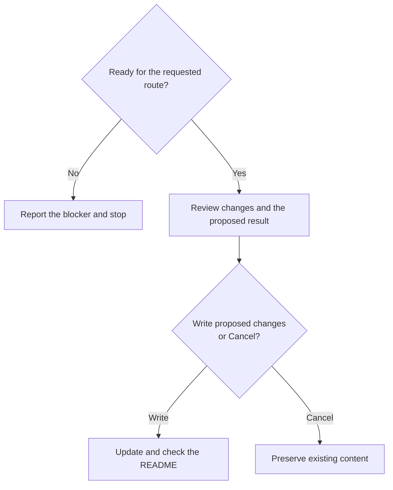

# Manifest



Use manifest to create a README or keep an existing one accurate. It checks the project, proposes changes and preserves the voice and useful structure you already have.

## Flow



## Start the command

```text
Codex → $manifest    Claude → /manifest
```

Use your client's [command prefix]({{ '/docs/setup/' | relative_url }}#run-a-command). Manifest checks for clean **main or master** before README discovery or style and scan choices. Run [log's shared setup](log.html#shared-project-instructions) first if there is no shared instruction owner.

An established blocker ends the run before further reading, proposals or approval questions. Missing review history can still lead to Full scan when the other prerequisites hold.

## Choose the README and style

Manifest normally works on the root README. If the target is ambiguous, it asks; translations and package READMEs are not rewritten together automatically.

| Style | What happens |
|---|---|
| Standard | Follow the applicable [Standard Readme specification](https://github.com/RichardLitt/standard-readme/blob/main/spec.md). |
| Custom | Preserve the existing outline, or agree one before drafting a new README. |

A missing style preference and scan choice can be asked together when independent. Your approved preference can be saved as `readme-style`. Choosing Full scan does not authorize replacing a custom structure.

## What the review covers

- **Full scan:** check the README's claims and missing reader information across relevant project workflows.
- **Gap scan:** follow changes since a valid saved review to the affected sections.
- **Repair structure:** address a particular layout or content problem without claiming a complete source review.

You can also request a style-only change. If history was rewritten, manifest tries to recover the earlier review point before falling back to Full scan.

Manifest checks [contribution and licensing]({{ page.detailed | relative_url }}#contribution-and-licensing) separately: what help is accepted, where to send it and what reuse terms apply. It preserves different terms for code and assets when relevant. Standard READMEs keep the sections separate; custom layouts follow your approved outline. Missing or conflicting policies stay visible for review.

When issue forms are configured, general reporting links use their chooser and leave reporting details to the forms. When no project-wide reuse license exists, the README says so in plain language; any departure from the selected spec is disclosed.

## Review the update

Manifest checks reader value as well as factual accuracy. Correct but excessive detail, repeated explanations or an unsuitable section can receive a concrete shortening, consolidation or removal proposal. Custom section changes still need your exact approval; useful human context and generated blocks remain protected.

For an existing README, you see additions and removals followed by the clean proposed result for affected passages. A new README appears once in full. Choose **Write proposed changes** or **Cancel**; you can type an exact selection or correction directly. A new draft also waits for content approval after its style or outline has been agreed.

Commands, examples and links are checked against source without running example commands just to write documentation. Full scans assess all sections; Gap scans address affected passages and selected concerns. A bounded content repair alone does not establish a complete source review. When a complete review finds only optional improvements, you can type **Keep README unchanged and record review**; this approves only the disclosed marker.

## Your result

You get the README, approved preferences and unresolved facts. A complete Full or Gap review can advance its review marker even when optional suggestions are declined. Unresolved factual gaps, partial repairs and style-only work do not establish a complete new review.

Ordinary coding does not automatically rewrite or expand the README. It presents a [concrete proposal for your approval](../rules/safety.html#maintaining-command-outputs), or you can use manifest. Approved direct edits follow manifest’s authoring standards, preserve the selected standard or custom format and retain the review marker.

With auto-commit off, approving the content permits writing it; a local commit needs its own approval unless your exact request already covered it. Changes stay on the same branch. Use [ship](ship.html) to publish.
