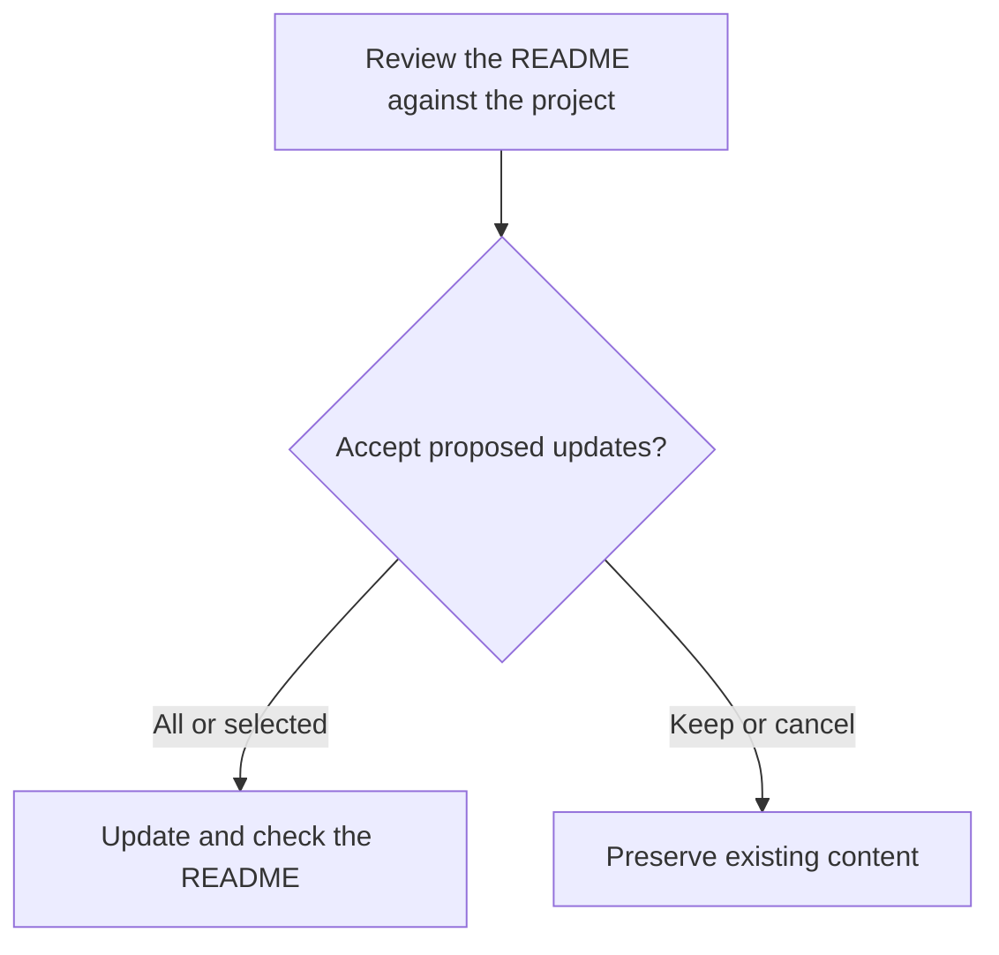

# manifest



Use manifest to create a README or keep an existing one accurate. It checks the project, proposes changes and preserves the voice and useful structure you already have.

## Flow



## Start the command

```text
Codex → $manifest    Claude → /manifest
```

Use your client's [command prefix]({{ '/docs/setup/' | relative_url }}#run-a-command). Updates require clean **main or master**. Run [log's shared setup](log.html#shared-project-instructions) first if there is no shared instruction owner.

## Choose the README and style

Manifest normally works on the root README. If the target is ambiguous, it asks; translations and package READMEs are not rewritten together automatically.

| Style | What happens |
|---|---|
| Standard | Follow the applicable [Standard Readme specification](https://github.com/RichardLitt/standard-readme/blob/main/spec.md). |
| Custom | Preserve the existing outline, or agree one before drafting a new README. |

Your approved preference can be saved as `readme-style`. Choosing Full scan does not authorize replacing a custom structure.

## What the review covers

- **Full scan:** check the README's claims and missing reader information across relevant project workflows.
- **Gap scan:** follow changes since a valid saved review to the affected sections.
- **Repair structure:** address a particular layout or content problem without claiming a complete source review.

You can also request a style-only change. If history was rewritten, manifest tries to recover the earlier review point before falling back to Full scan.

Manifest checks [contribution and licensing]({{ page.detailed | relative_url }}#contribution-and-licensing) separately: what help is accepted, where to send it and what reuse terms apply. It preserves different terms for code and assets when relevant. Standard READMEs keep the sections separate; custom layouts follow your approved outline. Missing or conflicting policies stay visible for review.

## Review the update

Review all proposed changes or a subset, ask for revision, or cancel. Commands, examples and links are checked against source without running example commands just to write documentation. Custom content and generated blocks are preserved.

When a complete review finds only optional improvements, you can **keep the README unchanged and record the review**.

## Your result

You get the README, approved preferences and unresolved facts. A complete Full or Gap review can advance its review marker even when optional suggestions are declined. Unresolved factual gaps, partial repairs and style-only work do not establish a complete new review.

Changes follow your local commit policy and stay on the same branch. Use [ship](ship.html) to publish.
