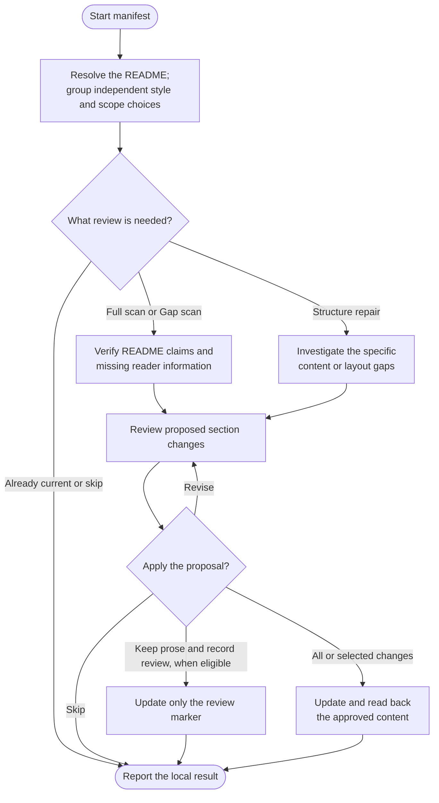

# manifest



Manifest keeps a README useful to someone evaluating or using the project. It checks claims against source, preserves the project's voice and proposes changes at the depth readers need.

## Flow

## Start the command

Updates require clean main or master and an established shared instruction owner. If that setup is missing, start with [log](../log.html#shared-project-instructions). Manifest does not create agent instructions as a side effect of README work.

## Choose the README and style

The root README is the normal target. GitHub can prefer a README under `.github/` or `docs/`; if candidates compete, you choose the file to maintain. Translations, package READMEs and generated documents are not all rewritten automatically.

| Style | What stays consistent |
|---|---|
| Standard | The applicable Standard Readme structure and required reader information. |
| Custom | Your existing outline, voice, front matter, banners and useful sections. A new empty README needs an agreed outline. |

A missing style preference and review depth can share one question batch when neither answer changes the other's options. Ambiguous targets and a new custom outline are resolved first when needed. Choosing a Full scan expands investigation, not permission to replace a custom document. Generated blocks stay with their actual generator.

## What the review covers

A Full scan checks purpose, setup, use and other reader-facing claims across relevant workflows. A Gap scan follows changes since a verified review to affected sections. Structure repair addresses a bounded problem; a style-only change saves a preference without claiming a fresh assessment.

History markers are evidence of an earlier review, not a reason to discard writing. Rewritten history can require recovering the earlier source snapshot before an incremental review is possible.

## Contribution and licensing

These answer separate questions: how can someone help, and what may they reuse? A public repository or an MIT license does not automatically mean pull requests are accepted.

Contribution instructions usually fit in one short paragraph. When issue forms are configured, a general reporting link opens the chooser and the form asks for the details. A specific Report a problem action can still open its matching form directly. Existing questions channels, PR restrictions and contribution requirements remain in place; without forms, the README uses the established intake channel and essential reporting guidance.

License summaries name the actual terms and link their text. When no project-wide reuse license is provided, a short statement saying so is enough. Existing rights-reserved wording and verified attribution are preserved, without automatically adding an `UNLICENSED` label.

Standard Readme requires that identifier for unlicensed repositories. Manifest flags the plain wording as a presentation deviation in the same content review. It does not claim strict conformance, change your saved style or edit package metadata to make the wording fit. An explicit request for strict compliance is resolved in that review too.

Different terms for code, images or other assets remain distinct. Missing terms and conflicting declarations are reported for a decision; manifest does not choose a new license or create a contribution policy to fill a heading.

## Review the update

The proposal shows section-level changes and any structure or preference change. You can apply all, select changes, request revision or cancel. Existing legal wording, custom content, anchors and generated material remain protected.

With auto-commit off, the review can include Apply and commit or Apply without committing when the exact diff, paths and subject are known. The approved result still needs readback and required checks; materially changed content needs a refreshed review.

Examples and commands are checked against source; they are not executed merely to write instructions. If a complete review finds only optional improvements, you can keep the prose and record that review instead.

## Your result

A completed source review can advance the marker to the snapshot actually checked. Partial repairs, unresolved factual gaps and a saved style preference do not establish complete coverage. Declining optional wording alone need not invalidate a completed factual review.

The final result identifies the chosen README, actual changes, retained uncertainties and local commit status. Use [ship](../ship.html) for publication.

## Explore the source

For implementation details, read [guides/manifest.md](https://github.com/myowinthein/agent-helm/blob/main/guides/manifest.md).
