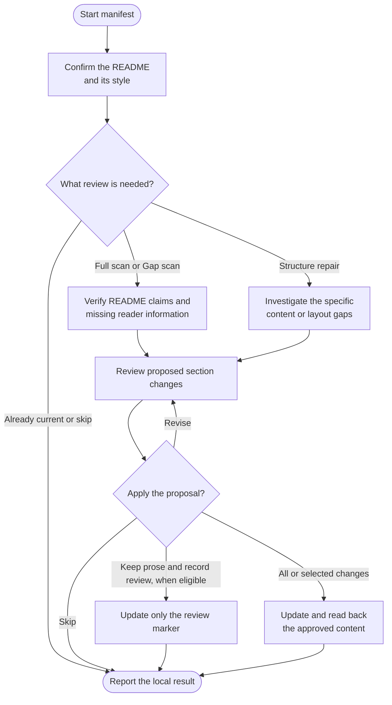

# manifest



Use manifest to create a README or keep an existing one accurate. It checks the project, proposes changes and preserves the voice and useful structure you already have.

## Flow

The complete procedure follows, including conditions and exceptions within each phase.

{{ page.guide_source | guide_intro }}

{{ page.guide_source | guide_body }}
