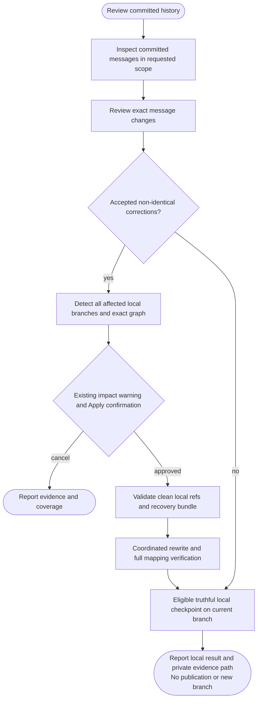

# /helm:normalize

Review commit messages against your project's convention, review exact replacements, and optionally rewrite all affected local branches together after approval. Message review and coordinated branch rewriting have separate scopes. Existing tags retain their exact objects; remote-tracking refs, stashes, notes and unaffected refs stay outside the rewrite.

Command names use Claude notation. In Codex, select normalize from the skill picker to start the same workflow. Both hosts resolve the existing instruction owner, normally shared `AGENTS.md` with `CLAUDE.md` importing it, including applicable overrides and existing owners. Normalize never creates, migrates or edits instructions/settings. See [compatibility](../setup/compatibility.html).

## Investigation depth and coverage

Inspect every unique commit in the frozen requested audit set through full raw messages/metadata, with supporting diffs where intent requires them. Reconcile exact classified IDs, including accepted/no-change/unresolved messages, rather than counts or recent samples. Large independent message batches may use permitted read-only workers; the parent reconciles shared-SHA intent, graph/ref decisions, approvals and all mutations. Existing per-branch evidence remains; no new watermark-prefix assumption or generic Full/Gap mode is added. Audit scope does not expand automatically to messages on rewrite-only branches.

Follow the [shared investigation and exclusion rules](../setup/investigation.html). Inventories and worker evidence remain transient; inaccessible required material is not silently excluded or marked complete. Finding counts, duration and reasoning effort do not prove coverage.

## Usage

```text
/helm:normalize
```

Review committed messages and exact correction proposals, then inspect the affected-branch scope and impact before separately approving a local rewrite or eligible checkpoint. To continue prior work, identify its private evidence or verified own record branch/commit; the workflow validates current facts and offers only missing actions without automatically repeating the rewrite.

Initial committed-history review can inspect dirty or detached checkouts. It reads committed objects at frozen IDs, excluding uncommitted work, and discloses dirty policy inputs. Detached review needs explicitly named refs or an explicitly requested detached commit; an empty repository reports no committed history. This review does not run tests, hooks, project configuration code, the filter backend or its dry-run, fetch, refresh the index, load/write ledgers, write files/refs, create a recovery bundle or migrate state. Inspection disables external diff/textconv and other executable Git helpers/lazy fetching, stopping if local-only reads cannot be guaranteed. Output stays in conversation. Missing objects or unresolved policy remain coverage limits. Later impact/checkpoint preparation separately accesses own state under its existing gates; Apply revalidates inputs and obtains its own authorization.

## Flow



## 1. Resolve the actual convention and scope

Explicit project/user policy takes priority, followed by statically inspectable compatible configuration, then Helm's scoped Conventional Commits default for gaps. Existing commitlint types, scopes, case and length rules matter. Arbitrary JavaScript configs and unresolved `extends` are not executed to discover rules; material uncertainty is raised before dependent changes.

Conventional Commits allows optional scopes and custom types. A message may be valid under the specification yet outside the project's chosen convention. Findings distinguish accepted, spec-valid but nonpreferred, spec-invalid and unresolved messages. Already accepted messages are not rewritten merely to perfect their style.

The current local branch is the default **message-review scope**. Explicit requests can name other branches or all local branches; there is no routine current/chosen/all branch picker. This determines which messages receive proposals, not a limit that leaves affected related branches on old history. Detached review requires explicit refs/commit scope, and Apply requires named local branch refs.

You can audit complete requested histories and limit proposed message changes to an unpublished tail or a confirmed product/stream release boundary; full-history migration remains explicit. Older findings outside that boundary stay visible. Once message decisions are settled, affected descendants require coordinated ID changes even where their messages stay unchanged. Missing/shallow objects and replace/graft interpretation must be resolved before a rewrite, without automatic fetch or cleanup.

### All affected local branches, one existing confirmation

For the exact non-identical message corrections you accept, normalize detects every frozen local branch whose tip can reach at least one changed original commit. A branch pointing directly to that commit is included. It rewrites all these affected branches together using one consistent original-SHA mapping. Main/master is included only when affected; changing a feature-only commit does not rewrite main or unrelated siblings. Branches sharing only earlier unchanged ancestors are unaffected. This rule is independent of ship-method and git-merge-strategy.

For example, if main, feat-A and feat-B all contain `B`, correcting it gives all three the same new `B′` and consistent rewritten shared descendants. If only feat-A's unique `D` changes, main and feat-B need no rewrite. Additional branches' unique messages remain byte-identical unless separately reviewed/accepted; their IDs can change through rewritten parents. That consistency work does not certify those messages as compliant or recursively create more correction proposals.

The existing impact plan shows the complete affected branch list, old tips, exact graph, consistency-only additions/unaudited messages and other history effects. It then asks the existing **Apply reviewed rewrite / Cancel/keep review only**. No extra warning screen, all-versus-chosen question or rewrite multi-select is added. Detection alone grants no rewrite. Explicit contradictory exclusions must be reconciled rather than silently ignored. With no selected corrections, no rewrite or rewrite-scope prompt occurs.

Proving a branch unaffected requires complete ancestry across the entire local inventory. A shallow boundary or unavailable parent anywhere blocks Apply. Partial/promisor clones must prove that local commit-parent closure without lazy fetch. Existing replace refs/effective grafts block Apply until resolved outside normalize, without deletion/rewriting by the command. Parent walks can be deduplicated without auditing every unique message.

The graph contains the changed original commits and all their descendants reachable from affected tips. Its unchanged boundary includes **every outside parent** of those graph commits, including merge second parents and parents of changed roots. Freeze affected tip refs plus exclusions for all those boundary IDs and prove the exact union; excluding only changed commits' parents can accidentally include imported side-history. Do not add unrelated ancestors, drop affected branches through per-branch exclusions or correct unreviewed messages. Recheck the complete local inventory before Apply; new/deleted/moved branches require reassessment and renewed approval when scope changes. Unsafe/elsewhere-checked-out/unsupported/policy-forbidden affected branches stop the coordinated rewrite. The developer resolves blockers externally and replans; normalize never deletes old bookkeeping branches or changes protection to unblock itself.

Proven old bookkeeping-only branches can stay outside default message review, but are still included when affected; branch names never establish an exemption. Remote-only branches are not auto-created, and remote-tracking refs, tags, notes/stashes and other clones are not rewritten. Report known old-history holders, including detached other worktrees, and unknown coverage from local evidence without fetch or reattaching/moving another checkout. Check available tracking refs across branches before calling a correction unpublished; a private review branch alone proves no such thing. Preserved tags can lose ancestry. Local consistency is not a promise that every future merge or remote/clone history is reconciled; publication remains separately approved.

## 2. Infer intent and preserve existing information

Read full original messages and relevant parent-relative diffs. Infer the change's purpose rather than mapping filenames to types. A Markdown file can implement functionality, a new test need not be a feature, and a dependency correction can fix a bug. Performance intent does not require executing a new benchmark. Merges, reverts, generated/fixup messages, opaque changes and binary-only diffs receive explicit contextual treatment; uncertain intent is not filled with invented explanations.

Use the project's language, accepted types and scope conventions, including supported multi-scope. Default to subject-only edits. Preserve message bytes/newlines outside the exact edit, body, trailers, issue references, sign-offs, existing coauthors, Change-Id and encoding. A necessary body/footer change must be visible in the complete reviewed replacement. No attribution is invented. Unsupported encoding or metadata handling blocks the affected rewrite.

Formal breaking markers are `!` immediately before the header colon on any type/optional scope, or an uppercase `BREAKING CHANGE:` / `BREAKING-CHANGE:` footer. Ordinary punctuation and phrases such as "avoid breaking links" do not establish breaking behavior. Preserve genuine information without duplicating a footer. Newly inferred incompatibility requires evidence and explicit message approval. The review explains potential effects on [ship](ship.html)'s future version proposal when a type/breaking marker changes.

## 3. Review exact decisions and impact

Findings identify full original SHAs/messages, evidence/confidence and affected refs. Each proposed correction includes complete before/after messages bound to that exact original. Choose **Accept**, **Edit**, **Keep** or **Defer**, individually or in coherent visible batches. Accept selects a replacement; separate confirmation still governs rewriting. Edits are revalidated. Kept/deferred noncompliant messages remain findings, with no false full-branch compliance checkpoint. Byte-identical proposals are discarded; no selected replacements means no backend run or rewrite-publication gate.

The complete plan shows message-review versus automatically affected rewrite scope, boundaries, selected edits, consistency-only additions, excluded/retained findings, backend, recovery location and ledger/publication dependencies. With corrections selected, inspect existing own-ledger anchors before this plan; show each proposed remap/date preservation or exact invalidation/reason here, even with auto-commit enabled. Missing/unavailable/malformed state leaves bookkeeping limits/pending actions explicit, never a false completion claim. Examples in the existing confirmation are capped at five; all exact changes and the complete branch list remain available. One shared commit receives one consistent decision and mapped ID across every affected branch. Unreviewed unique messages on added branches remain outside compliance claims.

The existing impact report separates changed messages from descendant IDs and exported commits whose signatures may be lost even if their messages are unchanged. It explains old history retained by remote-only/tracking refs, other clones and preserved refs, notes still pointing at old objects, and potentially stale Helm/submodule/external SHA anchors without reading or editing another workflow's state or external pins. No local branch containing a changed original may be labelled unaffected merely because it was excluded from message review.

Every relevant release tag receives an ancestry assessment. Keeping a tag's object unchanged can leave it outside rewritten branch ancestry; ship may then lose its previous reachable release boundary. After rewriting, actual old/new per-branch reachability is verified, rather than inferred from a commit-map entry. Existing tags are never moved to compensate.

The existing Apply/Cancel confirmation approves the exact corrections, complete affected branch set, graph and disclosed effects together. Cancel writes no ledger, migration or recovery artifacts. Keep/Defer may leave unrelated accepted edits eligible, but cannot be hidden behind an advanced watermark. Changed policy, local inventory, graph or approved content invalidates dependent approval; recompute affected scope rather than silently widening or shrinking it.

## 4. Prepare supported rewriting and recovery

Apply requires an attached local branch, a clean worktree/index including untracked project files, no active merge/rebase/cherry-pick/revert, and safe worktrees for every affected branch. Pending user work is never stashed, reset or committed to make room. A shared ref checked out elsewhere blocks the coordinated rewrite, including when that branch was added only for consistency; never silently skip it or change another checkout.

Git filter-repo and Python are required for rewriting. There is no automatic filter-branch fallback or installation. Missing capability leaves the review/manual handoff available. Trees, ordered parent topology, author/committer identities and dates, encoding and unapproved metadata must be preserved. Signature loss is disclosed; unsupported extended headers or transformations block the graph rather than being silently discarded or re-signed.

Normalize completes locally without contacting a provider or requiring a publication destination. Preserve original local tips/history and available remote configuration/tracking evidence privately, without treating it as fresh remote proof. Ship's later history publication procedure reads authoritative remote tips and proves containment against that original history before reviewing publication.

Recheck the whole frozen local inventory, affected-set/graph proof and all other frozen inputs before mutation. Create a private recovery directory outside the checkout containing the reviewed plan/policy, raw original objects/graph evidence, exact refs/tag/symref and remote-config snapshots, expected remote tips and a verified self-contained bundle of every affected old branch tip and existing tags. Inspect bundle prerequisites and heads as well as verification results. A source-repository verification alone does not prove self-containment. Failed recovery preparation stops the rewrite. Credentials in configuration stay private and are not printed.

The bundle does not back up worktree/index/config by itself. Retain its companion private records for verification and resume. This does not introduce a tracked ledger schema or change any existing operational state.

## 5. Filter the exact graph and verify every commit

The filter-repo callback uses a full-SHA-to-complete-message map, loaded once per process, with exact original-message binding. It never interpolates messages into shell code. The workflow's example is UTF-8 only; other encodings require a reviewed supported byte-preserving path or stop.

One filter operation uses explicit affected branch `--refs` and frozen range arguments proven to match the complete approved descendant graph. Partial mode preserves origin, tags and excluded refs, disables automatic unrelated cleanup, and retains recovery history. Commit-message hash substitution and empty/degenerate commit pruning are disabled. A tail correction plan must not become extra message corrections or an all-history rewrite. `--force` only bypasses the fresh-clone check after approval and verified backup; it bypasses no project/provider rule.

Verification covers every exported commit and boundary parent: exact approved messages, unchanged unselected message bytes, per-commit trees, ordered mapped parents, identities/dates/encoding, declared signature effects, unique counts and selected branch tips. Independently derive an unambiguous current-run old-to-new map and cross-check backend output. Existing filter-repo metadata may compose a prior A-to-C map instead of this run's B-to-C correspondence; do not delete metadata or trust it blindly. Ambiguous matches or coalescing block completion.

Verify every affected tip and the identical mapped ID of each shared original across affected branches; reprove that no excluded local branch was actually affected. All excluded refs/symrefs and remote configuration must match their snapshots. All tag names and exact object IDs, including signed/annotated objects, stay unchanged with no additions or deletions. Verify actual per-branch ancestry and planned release effects separately. A sample, tip-tree comparison or successful backend exit is insufficient. Failure stops checkpointing/publication and retains the actual state, bundle and private evidence; no automatic ref/tag restoration or destructive retry.

## 6. Record truthful checkpoints without churn

Only default/apply loads current schema-1 `.helm/normalize-log.json` through the shared canonical-state procedure. Validate branch coverage/provenance before using anchors; preserve unknown fields and unaffected records. Unsupported paths/versions stop with upgrade guidance and no reader/converter/reset. Private rewrite bundles/maps remain separate recovery evidence, not ledger inputs for ship.

A watermark's existence/ancestry does not prove current-policy coverage. Revalidate full reachable messages when that proof is missing, deduplicating shared history and loading diffs only for findings. Do not use another branch's watermark as an exclusion for unproven history.

Advance only through a fully audited accepted reachable prefix after a completed clean scan or verified rewrite. A bounded review, unresolved policy or Keep/Defer finding cannot certify the full tip. Preserve only a proven safe previous anchor and map it through the verified current-run correspondence when needed. With no safe anchor, explicitly review removal of the affected branch entry, never create null/partial records or new exception fields. Handle merge DAGs by actual reachable coverage. A previously stored checkpoint must not continue hiding a newly discovered retained finding. Preserve unaffected branch entries and carried unknown fields; remove deleted-branch entries only as explicitly reviewed. Partial results and original/mapped unresolved IDs remain in the report/private evidence.

Consistency-only added branches receive no new/full-tip compliance entry or later date just because their history was remapped. Remap an existing anchor only when its prior coverage is still proven valid, retaining date/coverage; otherwise use the existing reviewed invalidation rule. Show each actual affected-entry delta/reason in the existing pre-commit review/report regardless of auto-commit, reusing the maintenance scope already disclosed before Apply and refreshing materially changed actions. Normal commit approvals remain separate; no new routine screen is added. No new schema fields or unreviewed compliance claims are permitted. Historical ledger blobs inside rewritten commits stay unchanged; old anchors require ancestry/coverage revalidation before future use.

Checkpoint the verified source before a later ledger commit. On the next run, recognize an own-bookkeeping-only tail from its complete diff, state transition, policy and provenance. A familiar branch name or commit subject is insufficient. Do not rewrite the ledger for a date change, its own commit changing HEAD, an old bookkeeping branch, equivalent JSON formatting or cleanup-only migration. Revalidation with no meaningful checkpoint change creates no write/commit.

### Local destination and commit

Write eligible records on the same attached current branch, whether base, feature or environment, subject to actual project instructions. Never switch/create a bookkeeping branch or require remote reachability of local source anchors. If policy forbids the current-branch commit, leave bookkeeping pending rather than changing branches or expanding the rewrite scope.

Recheck canonical bytes/source and the unsupported-path tripwire; write/read back/validate only the exact reviewed schema-1 file under its local commit policy. Preserve coverage/history/unknown fields. No alternate-file reading or retirement occurs. Rewrite approval is separate from commit approval. Failed/declined work retains drafts and private recovery evidence.

## 7. Finish locally; publish later through ship

Normalize never pushes, prompts to publish, opens a PR, creates/selects/switches/deletes a branch or tags/promotes. Finish on the same current branch at its verified rewritten tip with actual local checkpoint/commit status and recovery path. A clean scan or record-only run does not create a recovery directory merely for handoff. A verified local checkpoint may refer to unpublished source commits.

When the work is ready, run `/helm:ship` and retain the reported private recovery path. Ship recognizes that handoff or asks for its exact evidence, then validates the identified old/new graph/map and bundle, reviews all included work and exact remote mappings, and checks fresh remote history against the approved originals. Already committed unfinished work on a selected branch would also be published, so it remains visible in that review. The live normalize ledger stays outside ship's access; identified committed record deltas are narrow provenance only.

Ship's specialist route is independent of ordinary direct/pr preference. Replacing published IDs requires explicit fixed-lease force approval; only-unpublished corrections may permit normal updates. A PR cannot replace remote history. Prefer a bounded atomic multi-ref push with no follow-tags, use fixed per-ref expectations, stop moved/uncontained refs and never refresh a rejected lease to overwrite new work. Sequential fallback needs separate approval. Read back every destination, retain partial successes/recovery evidence and leave protected/unknown targets pending. The history procedure creates no tag or version. After fully verified publication, ship can separately offer a main release using the proven mapped prior-release boundary; normalization-only IDs are not unreleased product changes.

## 8. Resume and report

Local resume verifies the identified plan, complete affected graph, recovery/map, current local refs and record dependencies, then completes only missing eligible local work on the same branch. It never filters again to reconstruct missing evidence, guesses old approval, switches to a legacy bookkeeping branch, repeats a commit or resumes remote pushes/PRs. Those are separate ship/project actions. Changed inputs need reconciliation.

Report scope versus all affected branches, shared-ID mapping, exact counts/retained findings, signature/tag ancestry effects, verified local record/migration status, actual branch/drafts, recovery paths and limitations. Publication was not performed and other clones/remotes remain unchanged. After later publication, collaborators need deliberate reconciliation preserving their work; never prescribe generic hard resets or tag replacement.

## See also

- [Git rules](../rules/git.html): effective configuration, commit policy and required checks.
- [Ship](ship.html): version proposals and reachable release boundaries.
- [Conventional Commits specification](https://www.conventionalcommits.org/en/v1.0.0/): syntax versus project preferences.
- [Commitlint rules](https://commitlint.js.org/reference/rules.html): configurable message policy.
- [Git filter-repo manual](https://github.com/newren/git-filter-repo/blob/main/Documentation/git-filter-repo.txt): partial/range filtering, callbacks and composed commit maps.
- [Git bundles](https://git-scm.com/docs/git-bundle): self-contained recovery versus prerequisites.
- [Git push](https://git-scm.com/docs/git-push): fixed leases, follow-tags and atomic support.
