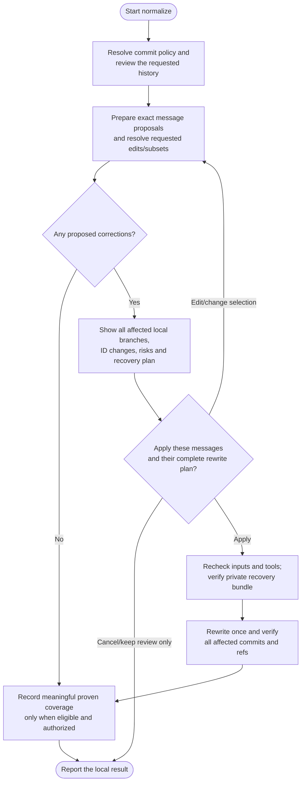

# normalize

Review commit messages and correct approved ones using the project's commit convention, with one final approval of the exact messages and complete rewrite impact. Normalize rewrites affected local branches together so a shared original commit maps to the same new commit across those branches.

## Start the command

```text
normalize
```

Use the prefix for your app or terminal from [Setup]({{ '/docs/setup/' | relative_url }}#run-a-command).

Read-only review can inspect committed history with a dirty or detached checkout. Applying a rewrite or saving its record requires a clean attached branch, no ongoing Git operation and safe access to every affected local branch. The command never switches to main/master to do the work.

## Flow



## Review messages first

The default message-review scope is the current local branch. You can explicitly request other named branches, all local branches, a bounded range or a full-history reassessment. Policy comes from project instructions and compatible statically inspected commitlint configuration before Helm's defaults. No project config or custom lint plugin is executed to discover rules.

Accepted messages stay unchanged. Proposals distinguish valid messages outside project policy, invalid messages and unresolved intent. There is no mandatory wording-approval round before the action review. If you request edits/subsets or clarification is needed, **Accept**, **Edit**, **Keep** or **Defer** can settle individual messages first. Those choices alone authorize no rewrite. Changes normally affect only the subject; bodies, trailers, references and breaking information are preserved unless their edits are explicitly shown.

The final **Apply reviewed rewrite** accepts the displayed messages and authorizes their complete local rewrite plan together. Corrections that could affect a later [ship](ship.html#optional-versioned-release) version proposal are explained in that review.

### Code-assisted checks and incremental review

A packaged standard-library Python helper checks supported formatting rules locally and returns bounded commit IDs and diagnostics. It receives JSON through stdin and has no Git, file, network or state-writing access. A formatting pass never means the message is semantically correct.

The agent still reads every full message requiring new semantic review, including bodies and trailers, and relevant changes when intent needs them. A valid-looking message such as `feat(auth): fix login typo` still needs that assessment. Syntax failures, keywords and file paths cannot filter away the remaining messages.

The first review covers the requested history. Later reviews can reuse a schema-2 baseline only when its full ancestor coverage, effective policy and review contract match. Newly reachable commits, including merged side-history, still need review. Missing, incompatible or invalidated baselines require full review. Shared commit IDs are reviewed once, while one branch's baseline cannot hide another branch's unproven coverage.

Results distinguish **syntax checked**, **newly semantically reviewed**, **reused semantic coverage** and **not reviewed**. A bounded range leaves older history explicitly unreviewed unless a proven baseline covers it; it cannot create a full-history checkpoint by itself. An explicit full-history request reassesses the history. A formatting-only request creates no semantic checkpoint. No extra routine picker or project setting is added.

If Python or helper execution is unavailable, equivalent bounded tooling or manual review preserves the same coverage requirements without automatic installation. Savings depend on actual reusable coverage or an explicitly narrower request; the first full semantic review still requires reading its messages.

## Which branches change?

Message review and rewrite scope are different:

- Review chooses which messages may be corrected.
- The final corrections determine every existing local branch containing those original commits.
- All affected local branches are rewritten together in one coordinated operation. Shared originals receive the same new IDs, while unique messages outside the reviewed scope stay unchanged.

A correction unique to a feature branch does not automatically rewrite main or its siblings. If a shared ancestor changes, its descendants need new IDs too, even when their messages stay the same. Merge strategy and `ship-method` do not alter this affected set.

Remote-only branches, remote-tracking refs, tags, stashes, notes and other clones are preserved. Their histories are not reconciled by a local rewrite. Existing tags can lose ancestry from rewritten branches even though the tag objects remain unchanged; this effect appears in the impact report.

## Approve and verify the rewrite

The impact plan lists all affected branches, exact message changes, descendant IDs, possible signature loss, tag ancestry, recovery location and checkpoint/commit effects. These headline effects appear beside the final Apply choice, with the complete message plan available. Read-only checks identify known blockers before offering Apply. If a required branch is held by another worktree, ancestry is incomplete or policy forbids the rewrite, the coordinated apply stops rather than omitting that branch.

Choose **Apply reviewed rewrite**, **Edit or change selection**, or **Cancel/keep review only**. Edits/subsets refresh the text and relevant impact before Apply. After Apply, normalize revalidates the approved inputs and proceeds without another confirmation when they match. A changed replacement message or other material plan change requires showing the revised plan and obtaining fresh approval; repeating the same effects in a shorter summary does not. Existing checkpoint commit policy and stronger required approvals remain separate, and cancellation writes no record or recovery files.

Apply requires **git-filter-repo and Python**; missing tools leave a manual setup handoff and are not installed automatically. After approval, normalize creates a verified self-contained Git bundle and retains private plan/mapping evidence outside the checkout.

Verification checks messages, trees, topology, metadata, shared mappings and preserved refs. A backend exit code alone is not completion. Failed or interrupted work keeps actual results and recovery evidence for reconciliation rather than blindly rerunning the rewrite.

## Your result and later publication

You get the local old/new branch tips, message results, tag-ancestry effects and the exact private recovery path. Keep that path: a fresh ship session may need you to identify it.

`.helm/normalize-log.json` uses schema 2 to record a full semantic baseline, effective-policy fingerprint and review-contract version on the same current branch under your local commit policy. Only normalize may validate its own record early to select reusable coverage. Rewriting a branch for consistency does not claim its unique messages were reviewed. Kept or deferred findings cannot be hidden by a new checkpoint. Reusing a baseline without new coverage leaves its anchor/date unchanged and creates no housekeeping commit.

Schema 1 is unsupported, with no compatibility reader, conversion or automatic reset. An unsupported record blocks reuse and dependent mutation; independent full read-only message review remains available. Updating the plugin's source never inspects or changes live records. Existing tags and historical ledger blobs remain unchanged.

Normalize never pushes or opens a PR. When ready, run [ship](ship.html#publish-normalized-history) with the identified private evidence. It separately reviews all included committed work and any required history replacement. Unfinished work already committed on a published tip would travel too; a PR cannot substitute for replacing remote history.
