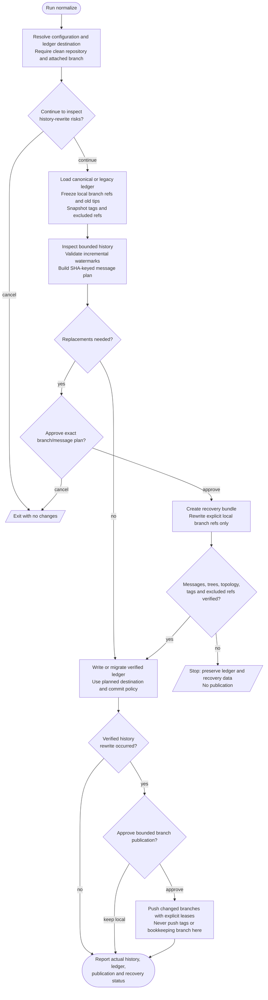

# /helm:normalize

Normalize non-conventional commit messages on a frozen, reviewed set of local branches. Existing tags stay on their original objects, including published releases. Remote-tracking refs, stashes, notes and unrelated backup refs are excluded. Inspection, local rewriting, ledger commits and remote publication have separate authorization rules.

Command names use Claude notation. In Codex, select the same Helm workflow from the skill picker. Both hosts read settings from the resolved memory owner, normally shared `AGENTS.md` through the Claude adapter or directly in Codex, while preserving legacy owners and override precedence. The command does not create or edit Helm settings in `AGENTS.md` or `CLAUDE.md`. [Compatibility notes](../setup/compatibility.html) describe ownership and host boundaries.

## Flow

## Before starting

History inspection can start from any attached local branch. Requires a repository with HEAD, no in-progress merge/rebase, a clean index/working tree, and the required Git/filesystem capabilities. Pending user work is never automatically committed, stashed or discarded. Detached HEAD stops the workflow.

Resolve `git-strategy` and `git-auto-commit` before mutations and plan where the ledger change will go:

- **Solo:** main/master, switching there only after rewrite verification when necessary.
- **GitHub Flow:** a new unique `chore/normalize-ledger-{date}` branch from main/master, created after verification and left for normal PR review. No ledger commit directly on main/master or an environment branch, no automatic merge, and no inclusion of this bookkeeping branch in the frozen rewrite/publication set.

Resolve conflicts with the base branch's configuration or project-specific placement rules before rewriting. Rewrite approval never substitutes for ledger-commit or push approval.

## 1. Risk warning

The initial question authorizes inspection only. It explains changed SHAs, possible loss of commit signatures, preserved tags and excluded refs, and disruption to other clones if rewritten branches are later published. Cancel leaves history and both ledger paths untouched.

Preserving tags means tagged releases deliberately retain their original history. The command never moves or force-pushes an existing tag, whether the repository is private or public.

## 2. Load ledger and scan

Both agents use `.claude/helm/normalize-log.json`. If absent, load `.claude/normalize-log.json` and queue migration for the later authorized ledger write. Do not delete or migrate during inspection. If both files exist with identical data, the later migration can deduplicate them; conflicting data requires explicit resolution. Malformed or unsupported schemas stop with both files preserved. A missing schema version means version 1; the schema remains unchanged.

The ledger stores `branches` keyed by local branch name, each with `last_checked_commit` and `last_checked_date`. With neither file, scan full history over the frozen local branches. Validate each watermark exists and is an ancestor of the corresponding branch tip; invalid entries cause a disclosed full re-scan. New branches are scanned, removed branches are dropped only in the eventual ledger update, and shared history is deduplicated.

Enumerate and freeze fully qualified `refs/heads/...` names and old tips. Use this same list for scanning, approval, rewriting and verification. Never use an unbounded `--all`, wildcard, or a newly enumerated list during execution. Materializing a remote-only branch requires a fresh scan and plan. Snapshot all existing tag/excluded ref object IDs and remote configuration, and record expected origin branch tips read-only for later push leases. Never delete stashes or backup refs as cleanup. Grafts or replace refs that change interpreted history require separate resolution first.

Check backend/Python prerequisites before mutation. Classify commits using messages and relevant diffs. Infer type and scope from affected code and preserve breaking-change information. Keep the full original SHA and exact message, and key proposed replacements by SHA so identical text on unrelated commits cannot collide. Uncertain classifications are resolved before rewriting.

## 3. Review the plan

A clean scan has nothing to rewrite: it can update the ledger under the normal commit policy, then reports without a force-push gate.

Otherwise present the full replacement plan, with up to five examples in the confirmation question and all remaining changes available for review. Include frozen branches/tips, preserved tags/excluded refs, backend, recovery-backup location and ledger destination. Approval covers only that exact local transformation. Cancel leaves the ledger unchanged so pending findings are not hidden by an advanced watermark. Changed inputs require a fresh plan and approval.

## 4. Rewrite and verify

Create a recoverable bundle outside the checkout before rewriting. Stop if the backup cannot be created, and retain it through verification/publication. Message data lives in a private temporary JSON file rather than being interpolated into shell code.

The preferred backend uses `git filter-repo` with an explicit `--refs` list and a SHA-keyed commit callback. Partial mode keeps origin and excludes tag/remote-tracking refs. Automatic commit-message hash substitution and empty/degenerate commit pruning are disabled so results remain within the approved message-only plan. Unselected messages pass through unchanged. `--force` bypasses the fresh-clone check only after approval, clean-tree checks and backup; host permissions still apply.

If filter-repo is unavailable, the fallback uses `git filter-branch` with the same explicit positive branch refs and a SHA-keyed Python message filter. No `--all` or tag-name filter. It creates backups under a new declared namespace without overwriting existing recovery refs; no destructive retry flags or automatic backup deletion.

A backend error stops ledger advancement and publication. Verify every planned message replacement and unselected message, commit count, tip trees, parent topology and unaffected metadata, accounting for signature effects. Compare excluded refs and remote configuration with their snapshots; only approved branch updates and declared new fallback backups may differ. Samples alone do not prove correctness. Report failures with the actual state and recovery path rather than silently restoring refs or claiming success.

## 5. Verify preserved tags

Compare every pre-existing tag name and exact object ID, including annotated/signed tags. No tag may be added, deleted or replaced. A preserved tag can remain on old history outside the rewritten branches; reachability from the new branches is not the criterion. A mismatch blocks ledger advancement and publication. Never repair it by replacing a published tag.

## 6. Update or migrate the ledger

Only a complete clean scan or verified rewrite advances the ledger. Capture inspected branch tips before a later ledger commit, using post-rewrite SHAs when applicable. Preserve schema version 1, add new scanned branches and drop removed ones. A newly created bookkeeping branch is not a scanned branch in this run. Skip serialization/commit when no data or migration change is needed.

Use the ledger destination planned before rewriting and recheck its inputs before overwriting. Write and read back the canonical ledger, then remove a queued legacy file only after canonical verification. Stage the canonical change and legacy removal together using explicit paths; never stage unrelated edits. Commit cancellation leaves both changes pending together and is reported accurately.

Honor `git-auto-commit`: true permits the ledger commit automatically; false or absent asks explicitly. Earlier rewrite or publication approval does not answer that commit question. Use `chore(normalize): update ledger after {scan / rewrite}`. Under Solo, an authorized ledger commit can travel with an explicitly approved publication of that branch. Under GitHub Flow, leave the bookkeeping branch for a separately approved normal push/PR; no automatic merge or force-push. Return to the starting branch only when safe and report pending work otherwise.

A no-rewrite run ends after ledger handling and reporting, without any force push or tag push.

## 7. Publish rewritten branches

Determine which frozen branches actually changed using verified pre/post-filter tips, before counting any ledger commit. Present only those branches and intended new tips for separate approval. Missing origin/access leaves the rewrite local. Keep-local is a supported outcome with the backup and exact bounded publication instructions retained.

Push only approved changed branch refspecs with explicit `--force-with-lease=refs/heads/{branch}:{expected_remote_sha}` expectations captured before rewriting. An explicitly approved new remote branch uses an empty expected SHA. Recheck intended local tips before pushing. If the remote advanced, stop and report partial results; never replace the expectation just to override new work or retry with plain `--force`. Do not push tags, all branches, mirror refs, or the GitHub Flow bookkeeping branch in this loop. Normal local tracking-ref updates caused by an approved push are reported as publication results; excluded refs must remain unchanged during filtering itself.

## 8. Report

Report actual scan/rewrite/verification outcomes, frozen scope and changed/pushed branches, unchanged tags/excluded refs, ledger migration/commit/destination status, unresolved work, and retained recovery data. Distinguish clean scan, local rewrite, completed or partial publication, cancellation and failure. Never report proposed work as completed.

Other clones need deliberate reconciliation only after publication. Preserve their local work and coordinate first; do not prescribe an unconditional hard reset or branch deletion as generic recovery. Preserved release tags intentionally remain on old history.

## Stop conditions

- Risk warning or rewrite-plan approval declined: no history or ledger changes.
- Dirty worktree, detached HEAD, unsupported inputs, changed frozen refs, or missing required capability: stop the affected path.
- Backend or verification failure: retain recovery data; do not advance the ledger or publish.
- Ledger commit declined: preserve pending files and report the actual branch; never commit implicitly later.
- Publication declined/unavailable or a push lease rejected: retain local work and report actual remote results.
- Clean scan: handle an eligible ledger update under the commit policy, then report without force-pushing.

## See also

- [`git.md`](../rules/git.html): shared configuration, commit policy and Conventional Commits.
- [`/helm:ship`](ship.html): calculates versions from commit history.
- [`/helm:adopt`](adopt.html): installs the Git rules.
- [git-filter-repo manual source](https://github.com/newren/git-filter-repo/blob/main/Documentation/git-filter-repo.txt): explicit refs and callback behavior.
- [Git filter-branch documentation](https://git-scm.com/docs/git-filter-branch): positive revision scope and backup namespaces.
