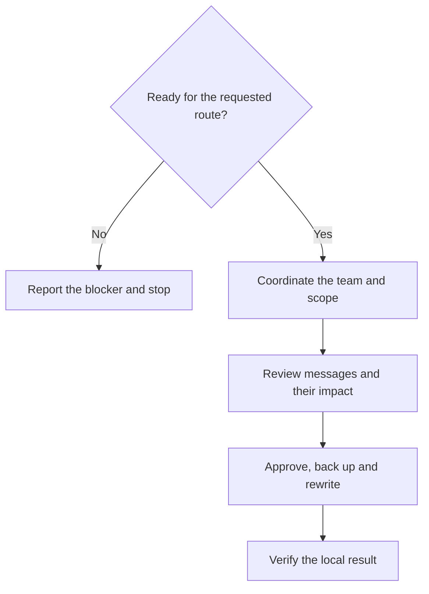

# Normalize



Use normalize to review commit messages and correct the ones you approve. Applying corrections rewrites Git history, so it includes team coordination, an exact impact review and private recovery evidence. You can also request a read-only review.

## Flow

For a rewrite, the main phases are:



## Start the command

```text
Codex → $normalize    Claude → /normalize
```

Use your client's [command prefix]({{ '/docs/setup/' | relative_url }}#run-a-command). Normal normalize checks for a clean attached branch and no ongoing Git operation before the coordination question or history review. An explicitly requested read-only review can use a dirty or detached checkout. Rewriting also needs safe access to every affected local branch.

A failed prerequisite stops the run without further history reading, planning or writes. Later failures preserve successful preparation and recovery evidence; they do not trigger an automatic read-only continuation.

## Before history review

An ordinary run shows the full coordination notice before inspecting history, then waits for **Team ready / Stop**. Read-only review remains available through an explicit request, without an extra menu option; it bypasses this question and writes nothing.

The notice asks collaborators to push unpublished work on branches intended for the coordinated rewrite, then pause pushes, merges and branch creation through publication and synchronization afterward. Private branches need not be published. Readiness approves neither a rewrite nor a push.

After readiness, normalize checks for branches pushed during preparation. Fetching or preparing an agreed local branch needs its own concrete **Prepare listed branches / Stop** approval before the review scope is frozen; it continues in the same run.

## Review messages

The current local branch is the default. You can request named branches, all local branches, a range or full history. Project policy takes precedence over [Helm's message conventions](../rules/git.html#conventional-commits).

The report leads with how many commits were reviewed and how many messages need changes, followed by compact before/after messages. A short reason explains a misleading original title when needed. Bodies, trailers and breaking information are preserved unless their changes are shown. Published history can be reviewed, but your explicit scope limits still apply. Message choices alone do not authorize a rewrite or [release](ship.html#optional-versioned-release).

### Code-assisted checks and incremental review

Python checks formatting; the agent reviews meaning against the actual changes. A syntax pass is not semantic approval. Later runs reuse earlier review only while its evidence remains valid.

## Which branches change?

The impact block lists every affected local branch and its current tip, including branches that share corrected history. Every local branch containing a corrected commit joins the rewrite. Descendant IDs change too, even when their messages stay the same. A blocked branch stops the coordinated rewrite.

Tags and excluded refs remain fixed. Tags can lose ancestry from rewritten branches, and signatures may be lost. Other clones are not updated automatically.

## Approve and verify the rewrite

Choose **Rewrite all proposed changes / Cancel** after reviewing the exact messages, complete branch list, ID/tag effects and recovery plan together. “All” means the proposed corrections and their affected history, within the displayed plan. You can type a wording or selection change without another menu option; the updated plan is shown before rewriting. The same unchanged rewrite plan is not asked twice.

Applying needs **git-filter-repo and Python**. Fixed code shipped with Helm applies the approved corrections; no helper program is generated during the run. Recovery bundles are verified before rewriting and stored outside the checkout under your OS user's home at `Agent Helm/normalize/<run-id>/`. Continuing a run reuses its folder; earlier backups remain. After rewriting, normalize checks messages, file contents and history structure before reporting success.

## Your result and later publication

You get old/new tips, actual verification results and the recovery location. Private pointers let ship find the evidence in another session in the same clone; backups and pointers stay after publication. Another clone or machine may need the files transferred and an explicit path.

Normalize finishes locally. [Ship](ship.html#publish-normalized-history) separately verifies the evidence and asks for publication approval. Review-only runs create no recovery artifacts.
