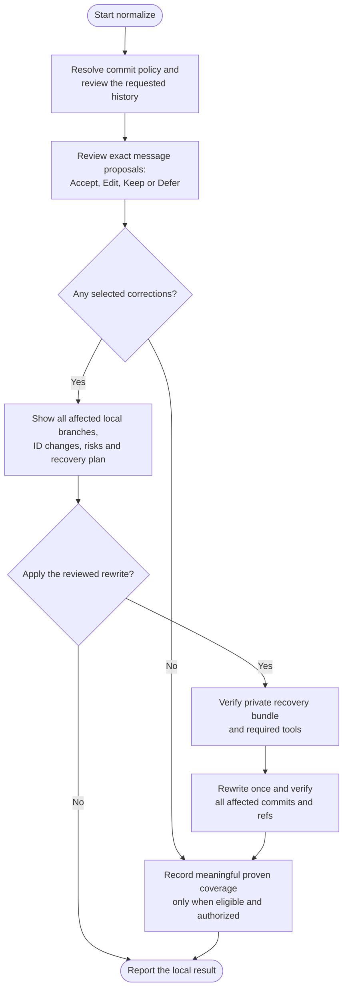

# normalize

Review commit messages and correct approved ones using the project's commit convention. Normalize rewrites affected local branches together so a shared original commit maps to the same new commit across those branches.

## Start the command

```text
normalize
```

Use the prefix for your app or terminal from [Setup]({{ '/docs/setup/' | relative_url }}#run-a-command).

Read-only review can inspect committed history with a dirty or detached checkout. Applying a rewrite or saving its record requires a clean attached branch, no ongoing Git operation and safe access to every affected local branch. The command never switches to main/master to do the work.

## Flow



## Review messages first

The default message-review scope is the current local branch. You can explicitly request other named branches or all local branches. The review inspects full messages and relevant supporting changes, using project instructions and compatible commitlint configuration before Helm's Conventional Commits defaults.

Accepted messages stay unchanged. Proposals distinguish valid messages outside project policy, invalid messages and unresolved intent. You see exact replacements and choose **Accept**, **Edit**, **Keep** or **Defer**. Changes normally affect only the subject; bodies, trailers, references and breaking information are preserved unless their edits are explicitly shown.

Approving a message is separate from approving the history rewrite. Corrections that could affect a later [ship](ship.html#optional-versioned-release) version proposal are explained during review.

## Which branches change?

Message review and rewrite scope are different:

- Review chooses which messages may be corrected.
- The final corrections determine every existing local branch containing those original commits.
- All affected local branches are rewritten together in one coordinated operation. Shared originals receive the same new IDs, while unique messages outside the reviewed scope stay unchanged.

A correction unique to a feature branch does not automatically rewrite main or its siblings. If a shared ancestor changes, its descendants need new IDs too, even when their messages stay the same. Merge strategy and `ship-method` do not alter this affected set.

Remote-only branches, remote-tracking refs, tags, stashes, notes and other clones are preserved. Their histories are not reconciled by a local rewrite. Existing tags can lose ancestry from rewritten branches even though the tag objects remain unchanged; this effect appears in the impact report.

## Approve and verify the rewrite

The impact plan lists all affected branches, exact message changes, descendant IDs, possible signature loss and recovery location. If a required branch is held by another worktree, ancestry is incomplete or policy forbids the rewrite, the coordinated apply stops rather than omitting that branch.

After approval, normalize requires **git-filter-repo and Python**, creates a verified self-contained Git bundle and retains private plan/mapping evidence outside the checkout. Missing tools leave a manual setup handoff; they are not installed automatically.

Verification checks messages, trees, topology, metadata, shared mappings and preserved refs. A backend exit code alone is not completion. Failed or interrupted work keeps actual results and recovery evidence for reconciliation rather than blindly rerunning the rewrite.

## Your result and later publication

You get the local old/new branch tips, message results, tag-ancestry effects and the exact private recovery path. Keep that path: a fresh ship session may need you to identify it.

`.helm/normalize-log.json` records truthful message-review coverage on the same current branch under your local commit policy. Rewriting a branch for consistency does not claim its unique messages were reviewed. Kept or deferred findings cannot be hidden by a new checkpoint. A genuine no-change review creates no housekeeping commit.

Normalize never pushes or opens a PR. When ready, run [ship](ship.html#publish-normalized-history) with the identified private evidence. It separately reviews all included committed work and any required history replacement. Unfinished work already committed on a published tip would travel too; a PR cannot substitute for replacing remote history.
