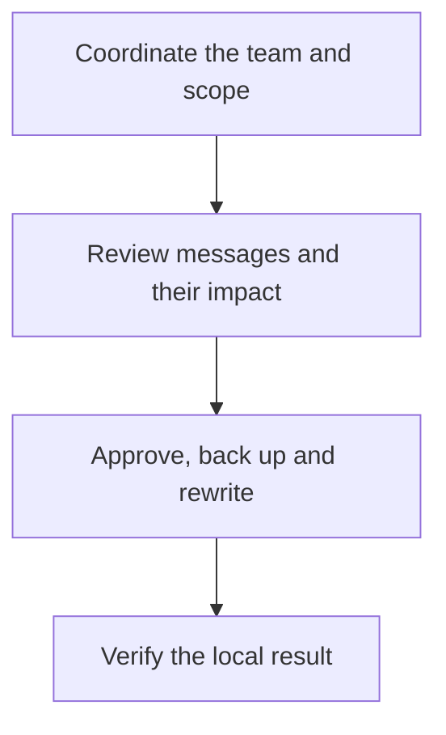

# normalize

Use normalize to review commit messages and correct the ones you approve. Applying corrections rewrites Git history, so it includes team coordination, an exact impact review and private recovery evidence. You can also request a read-only review.

## Flow

For a rewrite, the main phases are:



## Start the command

```text
normalize
```

Use your client's [command prefix]({{ '/docs/setup/' | relative_url }}#run-a-command). Read-only review can use a dirty or detached checkout. Rewriting needs a clean attached branch, no ongoing Git operation and safe access to every affected local branch.

## Before history review

An ordinary run shows the full coordination notice before inspecting history, then waits for **Team ready / Review only / Stop**. An explicit read-only request bypasses this question and writes nothing.

The notice asks you to coordinate included branches, pause conflicting work and plan how other clones will sync afterward. Readiness is not enforcement on teammates or devices, and it approves neither a rewrite nor a push.

After readiness, normalize checks for branches pushed during preparation. Fetching or preparing an agreed local branch needs its own concrete approval before the review scope is frozen; it continues in the same run.

## Review messages

The current local branch is the default. You can request named branches, all local branches, a range or full history. Project policy takes precedence over [Helm's message conventions](../rules/git.html#conventional-commits).

You review exact proposed messages and their impact. Bodies, trailers and breaking information are preserved unless their changes are shown. Published history can be reviewed, but your explicit scope limits still apply. Message choices alone do not authorize a rewrite or [release](ship.html#optional-versioned-release).

### Code-assisted checks and incremental review

Python checks formatting; the agent reviews meaning against the actual changes. A syntax pass is not semantic approval. Later runs reuse earlier review only while its evidence remains valid.

## Which branches change?

Every local branch containing a corrected commit joins the rewrite. Descendant IDs change too, even when their messages stay the same. A blocked branch stops the coordinated rewrite.

Tags and excluded refs remain fixed. Tags can lose ancestry from rewritten branches, and signatures may be lost. Other clones are not updated automatically.

## Approve and verify the rewrite

Approve the exact messages, affected branches, ID/tag effects and recovery plan together. You can revise or cancel. The same unchanged rewrite plan is not asked twice.

Applying needs **git-filter-repo and Python**. Recovery bundles are verified before rewriting and stored outside the checkout under your OS user's home at `Agent Helm/normalize/<run-id>/`. Continuing a run reuses its folder; earlier backups remain. After rewriting, normalize checks messages, file contents and history structure before reporting success.

## Your result and later publication

You get old/new tips, actual verification results and the recovery location. Private pointers let ship find the evidence in another session in the same clone; backups and pointers stay after publication. Another clone or machine may need the files transferred and an explicit path.

Normalize finishes locally. [Ship](ship.html#publish-normalized-history) separately verifies the evidence and asks for publication approval. Review-only runs create no recovery artifacts.

[Read the full workflow](https://github.com/myowinthein/agent-helm/blob/main/workflows/normalize.md).
