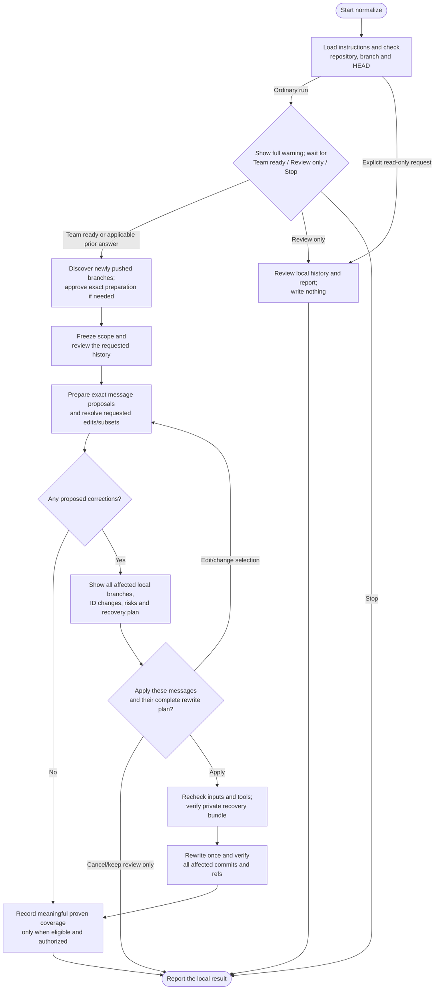

# normalize

Review commit messages against project conventions and correct approved messages across affected local branches.

## Start the command

```text
normalize
```

Use the prefix for your app or terminal from [Setup]({{ '/docs/setup/' | relative_url }}#run-a-command).

Read-only review permits a dirty or detached checkout. Rewriting and record writes need a clean attached branch, no ongoing Git operation and safe access to every affected branch.

## Flow



## Before history review

After basic repository checks, normalize displays the complete coordination warning, then asks **Team ready / Review only / Stop**. It waits before reading commit messages, checking formatting, loading assessment records or delegating review. Ordinary runs show the warning even for private history or when the later scan finds no corrections; an explicit read-only/formatting-only request bypasses the question. Applicable answers are reused.

The warning asks you to inform the team, push unpublished branches intended for inclusion, pause pushes/merges/new branches, finish normalize then ship promptly in the same terminal/project folder, check that rewritten branches can be published and sync other clones afterward. These are coordination recommendations. Another terminal in the same clone still works; private work need not be published. Review only performs a local report without writes. Stop ends the run.

After Team ready, fresh remote discovery notices branches pushed during team preparation. Agreed remote-only branches need exact fetch/local-branch preparation approval, or developer preparation, before the local inventory is frozen. Continue within the same run; no second normalize invocation is required. Readiness alone grants no Git writes. Existing local branches are not silently overwritten or merged, and unavailable discovery or missing agreed branches stays explicit.

## Review messages

Default scope is the current local branch. Request named branches, all local branches, a bounded range or full history when needed. Preparing a branch does not automatically expand its message audit; affected local branches still join the consistency rewrite. Project policy and compatible commitlint rules take precedence over Helm defaults.

Accepted messages stay unchanged. Corrections normally affect subjects; bodies, trailers and breaking information are preserved unless their edits are shown. Unclear intent needs clarification.

Within the reviewed scope, normalize prepares corrections for published and unpublished history without a separate permission-to-prepare question. Explicit edit limits, such as unpublished-only or a release boundary, are respected. Missing or conflicting scope facts still need clarification.

Wording and subset choices authorize no rewrite. Final approval covers exact messages and their complete impact, including effects on [ship](ship.html#optional-versioned-release)'s version proposal.

### Code-assisted checks and incremental review

A Python helper checks formatting. The agent reviews full messages and relevant changes for meaning: `feat(auth): fix login typo` can pass syntax while using the wrong type.

Later runs reuse proven semantic coverage only while history, policy and review requirements remain compatible. Reordering the same allowed types/scopes does not change the policy fingerprint; actual constraints and semantic rules still matter. Existing unmatched checkpoints retain the full-review fallback and are not rewritten automatically. New commits still need review; explicit full-history review reassesses everything selected. Formatting-only checks establish no semantic coverage.

Reports distinguish mechanical checks, new review, reused coverage and unreviewed history.

## Which branches change?

Every local branch containing a corrected commit joins the coordinated rewrite. Its other messages stay unchanged unless separately approved. Shared ancestors change descendant IDs; feature-only corrections need not affect main.

The rewrite preserves remote-tracking refs from after any approved preparation, plus tags, stashes, notes and other clones. Fixed tags can lose ancestry from rewritten branches; signatures may be lost.

## Approve and verify the rewrite

Review exact messages, affected branches, ID and tag effects, recovery location and record/commit changes. A blocked branch or incomplete history stops the coordinated rewrite.

The normal approval flow has two gates: team readiness, then **Apply reviewed rewrite / Edit or change selection / Cancel/keep review only** after the exact message and impact review. Readiness authorizes no rewrite or push. The unchanged rewrite plan is not asked twice; material changes return for review. Actual fetch/local-branch preparation retains its separate approval when needed. Cancellation creates no recovery artifacts or record.

Apply requires **git-filter-repo and Python**. After approval, verify a private recovery bundle outside the checkout, rewrite once and check messages, trees, topology, metadata and preserved refs. Failure leaves actual results for reconciliation, not a blind retry.

## Your result and later publication

You get old/new tips, message results, tag effects and the private recovery path. Before rewriting, normalize also registers a private local pointer so ship can find the evidence in another terminal or agent session. Each rewrite keeps its own pointer; backups and pointers remain after publication.

Eligible semantic coverage is saved in `.helm/normalize-log.json` under your commit policy. Coordinating another branch does not certify its unique messages as reviewed. Unsupported state remains preserved and blocks dependent work.

Normalize finishes locally. Use [ship](ship.html#publish-normalized-history) to publish reviewed replacement history. In the same clone, you normally do not need to supply a path. Missing/moved evidence or another clone/machine may need an explicit recovery path and transferred files. Other clones still need deliberate history coordination.
