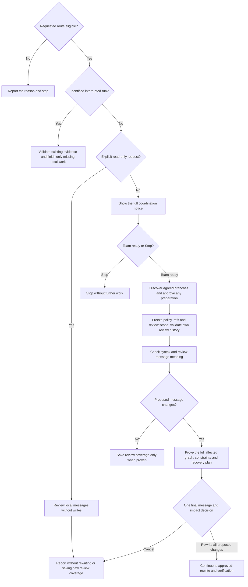
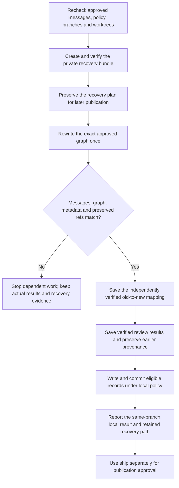

# Normalize



Normalize reviews commit messages and can apply the corrections you approve. Because a message change creates new commit identities, the workflow coordinates affected branches and preserves verified recovery evidence before rewriting.

## Flow

## Start the command

Explicitly request a read-only review from the outset for findings without writes; it can inspect a dirty or detached checkout without loading the review record. It is not a routine readiness or preparation menu choice. A normal run first requires a clean attached branch and no ongoing Git operation, before coordination or history reading. Applying corrections also needs safe access to every affected local branch.

A failed prerequisite stops the run without further history reading, planning or writes. Later failures preserve successful preparation and recovery evidence; they do not trigger an automatic read-only continuation. An unanswered workflow question pauses the run; it does not authorize independent investigation while you decide.

## Before history review

An ordinary run first shows the full coordination notice, then waits for **Team ready** or **Stop**. An explicitly read-only request skips that coordination question and creates no records or recovery artifacts.

Before answering, tell collaborators that history will change and have them push unpublished work on branches intended for this coordinated rewrite. Private branches need not be published. Pause pushes, merges and branch creation during normalize and ship, and keep the pause until affected clones have synced with the published history. Confirm that the affected remote branches permit history replacement. Do not merge old history back afterward.

Readiness acknowledges that coordination. It is not enforcement on teammates or devices, and approves neither rewriting nor pushing. Continue with ship in the same clone with retained recovery evidence; using another terminal or session in that clone is supported.

After readiness, the agent checks for newly pushed agreed branches. Any fetch or local branch preparation needs its concrete **Prepare listed branches / Stop** approval before the inventory is frozen. Preparation continues in the same run so a newly discovered branch is not quietly omitted. A separately explicit local-only review remains read-only and cannot advance to Apply.

## Review messages

The current local branch is the default, with named branches, ranges or broader history available when requested. Actual project policy comes first; otherwise [Helm's message conventions](../../rules/git.html#conventional-commits) guide the review.

Python can check message syntax, while the agent reads changes to assess meaning. A correctly formatted subject can still misdescribe a commit. Bodies, trailers and breaking-change information remain unless their proposed changes are shown explicitly.

The report starts with the reviewed scope and proposed change count, followed by compact before/after messages identified by commit. A short reason helps when the original title misdescribes the patch; routine prefix corrections need no repeated explanation. Small plans show every edit once. Larger plans can show representative examples with the complete exact plan available before approval, without cutting off undisplayed corrections. Earlier semantic review is reused only while its evidence still matches; an unchanged formatting result alone establishes no such coverage.

For example, a title such as `update README.md` could become `fix(navigation): update active-link highlighting` when the patch also corrects navigation behavior. The explanation should identify that mismatch, without describing every changed line or showing a table of successful checks.

## Which branches change?

The impact block always lists every affected local branch and its current tip. A branch included because it shares a corrected ancestor is identified briefly; its unique messages are not automatically audited or edited. Every affected existing or approved prepared local branch must be handled together. Changing an older commit also changes its descendants' IDs, even when their messages and file contents stay the same. A blocked affected branch stops the coordinated rewrite.

Tags and excluded refs remain fixed. Consequently, an old release tag can point to history that is no longer an ancestor of the rewritten branch. Commit signatures may also be lost. Other clones require deliberate synchronization afterward.

## Approve and verify the rewrite

The final actions are **Rewrite all proposed changes / Cancel**. “All” covers the exact proposed messages and complete affected local branch graph in the displayed plan; it does not expand the review to every commit in the repository. The impact block distinguishes message changes from all changed commit IDs, identifies published corrections and explains actual tag/signature effects, review-record changes and recovery. Remote refs stay unchanged until separately approved publication.

You can type a wording correction or narrower message selection without a separate menu action. The revised messages and branch impact are shown before approval. Uncertain findings remain outside the proposed rewrite. The unchanged plan is not asked twice, but changed scope or messages need the corresponding review again. Cancel or skip creates no new checkpoint or recovery artifacts and preserves any earlier approved branch preparation.

Applying requires Python and git-filter-repo. The approved message map is data; fixed code shipped with Helm applies replacements to exact commit IDs. The agent does not generate or edit a rewrite callback during the run. Unsupported replacement encodings require a separately reviewed implementation before rewriting. Before rewriting, the agent verifies recovery material under `Agent Helm/normalize/<run-id>/` in your OS user's home, outside every checkout. An interrupted continuation reuses its existing folder.

After the bounded rewrite, verification compares messages, file contents, graph relationships and preserved refs. A mismatch stops dependent work and retains the actual results and recovery evidence. It does not cause an automatic destructive retry or rollback.

## Your result and later publication

The report gives old and new tips, checks that actually ran and the recovery location. A clean result does not by itself establish a new complete assessment checkpoint; incomplete review and declined changes remain visible.

Private locators let [ship](../ship.html#publish-normalized-history) find the evidence later in the same clone. Another machine may need the retained files and an explicit path. Ship separately verifies that evidence and seeks publication approval with fixed lease expectations. Existing tags stay intact, and rewording released history alone does not create a release.

After that publication and any selected release finish successfully, Ship automatically keeps the newest three completed recovery cycles for this clone. Unfinished runs and evidence required for older release boundaries remain protected, so the count can exceed three. No cleanup approval is added. A new Normalize backup alone never triggers deletion; failed or partial publication preserves recovery. Unknown historical records and files changed after completion are retained rather than guessed safe to delete.

A later run can use the already-published history as its starting point. For example, after normalizing and publishing 50 commits, another 30 commits normally need only the new review and that cycle's own backup verification. Earlier backups are revisited when actual unpublished history or an older release boundary needs their correspondence, rather than as an automatic chain on every run.

## Explore the source

For implementation details, read [guides/normalize.md](https://github.com/myowinthein/agent-helm/blob/main/guides/normalize.md).
