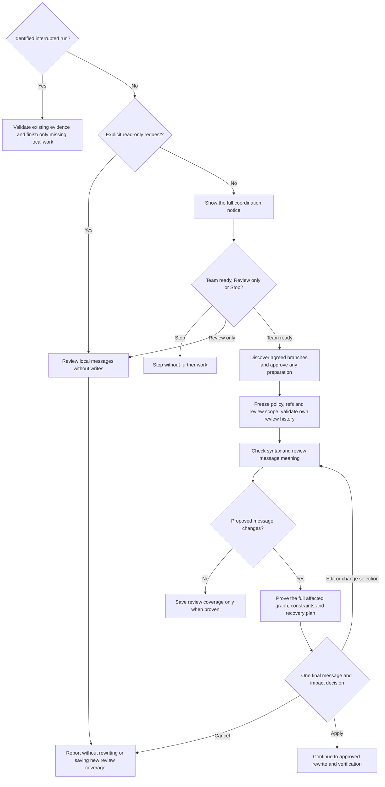
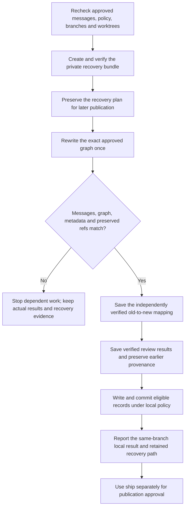

# normalize



Normalize reviews commit messages and can apply the corrections you approve. Because a message change creates new commit identities, the workflow coordinates affected branches and preserves verified recovery evidence before rewriting.

## Flow

## Start the command

Ask for Review only if you want findings without writes; that can inspect a dirty or detached checkout. Applying corrections requires a clean attached branch, no ongoing Git operation and safe access to every affected local branch.

## Before history review

An ordinary run first shows the full coordination notice, then waits for **Team ready**, **Review only** or **Stop**. An explicitly read-only request skips that coordination question and creates no records or recovery artifacts.

Readiness means you have coordinated included branches, conflicting work and later synchronization with other clones. It is not enforcement on teammates or devices, and approves neither rewriting nor pushing.

After readiness, the agent checks for newly pushed agreed branches. Any fetch or local branch preparation needs its concrete approval before the inventory is frozen. Preparation continues in the same run so a newly discovered branch is not quietly omitted.

## Review messages

The current local branch is the default, with named branches, ranges or broader history available when requested. Actual project policy comes first; otherwise [Helm's message conventions](../../rules/git.html#conventional-commits) guide the review.

Python can check message syntax, while the agent reads changes to assess meaning. A correctly formatted subject can still misdescribe a commit. Bodies, trailers and breaking-change information remain unless their proposed changes are shown explicitly.

Review exact old and new messages together with the impact. You can change the selection, revise wording or cancel. Earlier semantic review is reused only while its evidence still matches; an unchanged formatting result alone establishes no such coverage.

## Which branches change?

Every affected existing or approved prepared local branch must be handled together. Changing an older commit also changes its descendants' IDs, even when their messages and file contents stay the same. A blocked affected branch stops the coordinated rewrite.

Tags and excluded refs remain fixed. Consequently, an old release tag can point to history that is no longer an ancestor of the rewritten branch. Commit signatures may also be lost. Other clones require deliberate synchronization afterward.

## Approve and verify the rewrite

One final decision covers exact messages, affected branches, commit and tag effects, and the recovery plan. The unchanged plan is not asked twice, but changed scope or messages need the corresponding review again.

Applying requires Python and git-filter-repo. Before rewriting, the agent verifies recovery material under `Agent Helm/normalize/<run-id>/` in your OS user's home, outside every checkout. An interrupted continuation reuses its existing folder.

After the bounded rewrite, verification compares messages, file contents, graph relationships and preserved refs. A mismatch stops dependent work and retains the actual results and recovery evidence. It does not cause an automatic destructive retry or rollback.

## Your result and later publication

The report gives old and new tips, checks that actually ran and the recovery location. A clean result does not by itself establish a new complete assessment checkpoint; incomplete review and declined changes remain visible.

Private locators let [ship](../ship.html#publish-normalized-history) find the evidence later in the same clone. Another machine may need the retained files and an explicit path. Ship separately verifies that evidence and seeks publication approval with fixed lease expectations. Existing tags stay intact, and rewording released history alone does not create a release.

## Explore the source

For implementation details, read [guides/normalize.md](https://github.com/myowinthein/agent-helm/blob/main/guides/normalize.md).
