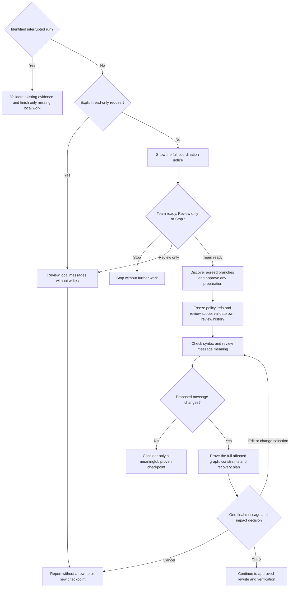
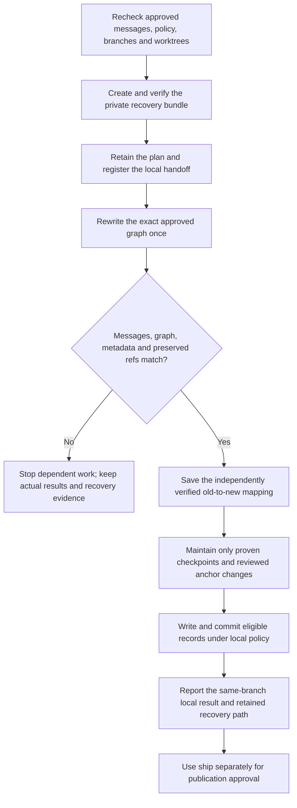

# normalize



{{ page.guide_source | guide_intro }}

## Flow

The first phase establishes coordination and a concrete message plan. Team readiness, any branch preparation and the final rewrite decision remain separate approvals.

The rewrite starts only with a safe, complete plan and verified recovery inputs. Failures preserve the actual state for reconciliation; they do not trigger a blind retry.

The complete procedure below is the same Markdown source loaded by the normalize skill. Read-only review, coordination, rewriting, checkpoint commits and publication each retain their stated boundaries.

{{ page.guide_source | guide_body }}
