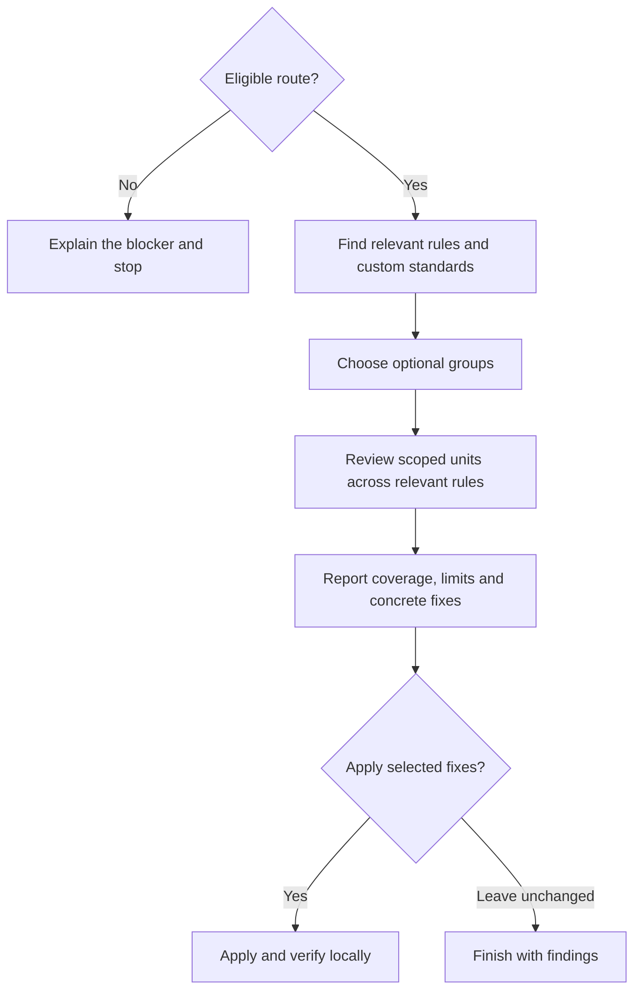

# Polish



Use polish when a page, component or document needs a focused review of its wording, appearance or behavior. It finds relevant project rules and custom standards, lets you choose optional ones, then proposes fixes that preserve the project's style.

## Flow



## Start the command

```text
Codex → $polish    Claude → /polish
```

Use your client's [command prefix]({{ '/docs/setup/' | relative_url }}#run-a-command), and name the page, component, document, directory or changes you want reviewed. The agent asks about scope only when it needs clarification.

Normal polish starts on a clean, eligible main/master, established feature or maintenance branch, or confirmed environment branch. An explicitly requested read-only review can inspect pending edits, but offers no Apply action and runs no project code. A required blocker stops the run before dependent investigation or fixes.

## Which rules apply

Polish follows project instruction references and checks existing rule locations for [Writing]({{ '/docs/rules/writing.html' | relative_url }}), [Design]({{ '/docs/rules/design.html' | relative_url }}) and [Interaction]({{ '/docs/rules/interaction.html' | relative_url }}). It also identifies relevant custom standards, such as a documentation or README guide, and shows a compact table of paths, suggested use and reasons. Git, Safety and other operational rules are excluded from the review.

For optional candidates, it asks **Use the suggested Helm rules?** and **Also use the suggested custom standards?**, each with **Yes / No**. Yes includes the whole named group; No declines that optional group. You can type file names, numbers, exclusions or another rule path instead. Empty or already-decided groups need no question, and required project standards remain binding.

At least one valid, applicable Writing, Design or Interaction rule must remain included; custom standards supplement it. A required or selected broken reference stops the run. These choices select review standards without installing files or changing rule loading. Git and Safety still govern operations.

## How the review works

After selection, Polish reads the rule bodies in full and identifies the pages, components, document sections or changes within your request. It reviews one coherent unit across all relevant selected rules before moving on. A checkout dialog, for example, can receive wording, layout and interaction review together.

Large targets can use batches while preserving the full agreed scope. Finding several issues does not end the review. If an actual limit prevents completion, the report identifies what was reviewed and the exact remainder; unread work is not treated as covered.

## Review the fixes

Findings explain the location, user impact and proposed change, with before/after text or readable diffs. Overlapping issues appear together. Intentional style choices are preserved, and optional suggestions stay distinct from demonstrated problems.

Choose **Apply recommended**, **Apply all proposed fixes** or **Leave unchanged**. Each Apply choice names its finding numbers; when both sets are identical, only Apply all proposed fixes appears. You can type a subset or an exact correction. No fixes are applied before approval.

## Your result

The report distinguishes **Complete** coverage of the agreed scope and depth from a **Partial** review with remaining work. **Unverified** identifies claims without sufficient evidence. A complete source-only review does not prove how the interface looks or behaves.

Polish verifies approved fixes using relevant existing checks. Finishing those fixes does not complete an unfinished broader review. Custom README and other command-maintained documents retain their authoring and approval boundaries.

Work finishes on the same branch, with a local commit according to project policy. No ledger or review checkpoint is kept, so unresolved issues may appear again. Use [ship](ship.html) separately to publish changes.
