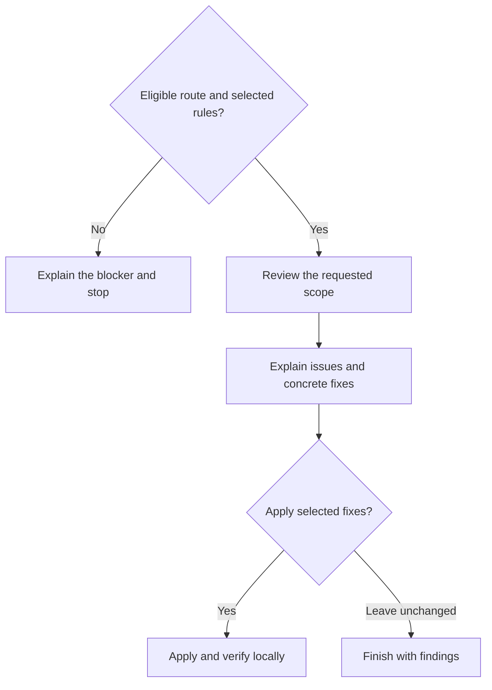

# Polish



Use polish when a page, component or document needs a focused review of its wording, appearance or behavior. It uses your project's selected Writing, Design and Interaction rules, then proposes fixes that preserve its style.

## Flow



## Start the command

```text
Codex → $polish    Claude → /polish
```

Use your client's [command prefix]({{ '/docs/setup/' | relative_url }}#run-a-command), and name the page, component, document, directory or changes you want reviewed. The agent asks about scope only when it needs clarification.

Normal polish starts on a clean, eligible main/master, established feature or maintenance branch, or confirmed environment branch. An explicitly requested read-only review can inspect pending edits, but offers no Apply action and runs no project code. A required blocker stops the run before dependent investigation or fixes.

## Which rules apply

At least one of [Writing]({{ '/docs/rules/writing.html' | relative_url }}), [Design]({{ '/docs/rules/design.html' | relative_url }}) or [Interaction]({{ '/docs/rules/interaction.html' | relative_url }}) must be selected by your project. Polish uses that subset and skips unselected rules. A broken selected reference stops the review, even if another rule is available.

It does not install rules or replace your selected versions with bundled copies. Git and Safety still govern operations. Only relevant provisions apply: a prose document does not need interface checks.

## Review the fixes

Findings explain the location, user impact and proposed change, with before/after text or readable diffs. Overlapping issues appear together. Intentional style choices are preserved, and optional suggestions stay distinct from demonstrated problems.

Choose **Apply recommended**, **Apply all proposed fixes** or **Leave unchanged**. Each Apply choice names its finding numbers; when both sets are identical, only Apply all proposed fixes appears. You can type a subset or an exact correction. No fixes are applied before approval.

## Your result

Polish verifies approved changes using relevant existing checks and reports anything it could not test. Source review alone does not prove how an interface looks or behaves. Custom README and other command-maintained documents retain their authoring and approval boundaries.

Work finishes on the same branch, with a local commit according to project policy. No ledger or review checkpoint is kept, so unresolved issues may appear again. Use [ship](ship.html) separately to publish changes.
