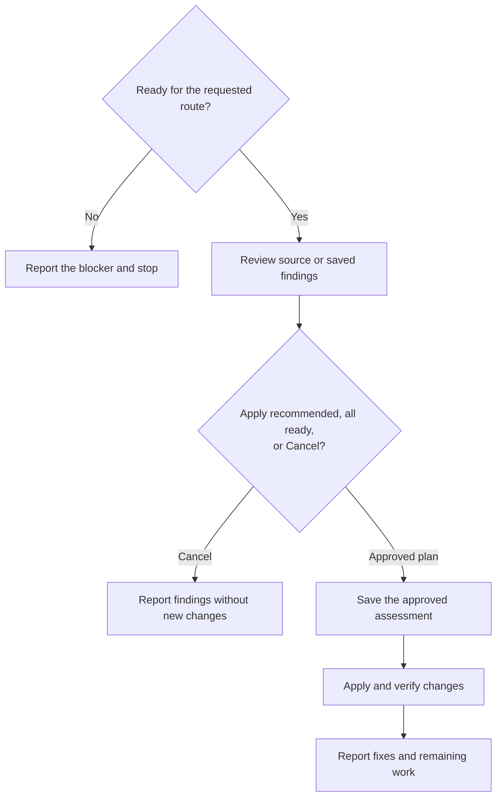

# Refactor



Use refactor when code has become harder to understand or maintain. It finds worthwhile improvements, then applies the ones you choose while preserving behavior and existing test guarantees.

## Flow



## Start the command

```text
Codex → $refactor    Claude → /refactor
```

Use your client's [command prefix]({{ '/docs/setup/' | relative_url }}#run-a-command). Normal refactor checks for a clean, eligible **main/master, feature or existing refactor branch** before previewing source. Request source-only advice explicitly for another checkout, including a confirmed environment branch named `refactor/*`.

A failed prerequisite stops the run before further reading or planning. It does not switch automatically to source-only advice; earlier verified work remains preserved.

A project without a saved assessment record needs no Python setup merely to begin source assessment; saving results still requires valid records.

## Choose the review scope

| Choice | Use it to |
|---|---|
| Full scan | Read every eligible implementation and test file in full and reassess all open findings within scope. |
| Gap scan | Follow changes and affected consumers since a valid saved review, reassessing related findings. |
| Revisit open findings | Investigate selected saved findings against current source, contracts and tests. |
| Skip | End without starting the assessment. |

Broad changes or an unusable baseline may need Full scan. Revisit follows relevant evidence until the judgment is supported or missing evidence is identified, without new discovery or advancing scan baselines. Older findings outside a Gap scan remain visible as not freshly reviewed. Explicit source-only advice is still available on request, without a routine menu option.

## The six review perspectives

The review considers architecture, contracts/state, code clarity, performance, existing test quality and dependency boundaries. A suggestion needs an evidenced benefit in this project; a preferred pattern alone is insufficient.

Bugs, new features, behavior-changing security fixes, upgrades and migrations remain separate work.

<a id="priority-risk-and-your-selection"></a>

## Review findings and choose changes

Numbered findings explain the current burden, the proposed improvement and what behavior must stay unchanged, usually in one or two sentences. New and reassessed findings appear together by behavior, without priority tiers or a status grid. A small before/after example can clarify a structural change when needed.

Recommendations weigh concrete benefit against effort, regression risk, complexity and future upkeep. Choose **Apply recommended**, **Apply all ready changes**, or **Cancel**, with exact finding numbers shown. Hide Recommended when it matches All and omit empty Apply choices. Type subsets, exclusions or revisions directly; their resulting changed plan needs review before work.

Paths, dependencies, preserved behavior, checks and record effects are shown before approval. The approved assessment is saved before code or guard work begins. Cancel before recording makes no changes; later cancellation preserves earlier accepted work. Saving only findings remains available through an explicit request, without another routine menu option.

## Apply and verify

Changes proceed in small, checked units. Failed, unavailable or deferred required checks keep work pending; approved unverified drafts stay uncommitted. Expected performance gains are not reported as measurements.

## Refactor vs test

Refactor can maintain existing tests and add guards needed for a chosen change. [Test](test.html) owns missing or stronger protection and independent tooling or strategy work. Neither command invokes the other automatically.

## Your result and finding history

You get verified local changes, actual check results and remaining findings. Saved history supports later runs; skipped, deferred or accepted-risk findings are not treated as fixed.

Relevant findings are reconsidered across open, resolved and obsolete states. The same continuing problem keeps its identity despite new wording or moved files. A genuine later recurrence gets a new linked finding while preserving the earlier verified closure; repeated descriptions alone do not establish recurrence. Records stay concise and are retrieved in bounded pages, without deleting useful history or reassessing the whole ledger on every Gap scan.

Work finishes on the same branch under your local commit policy. Use [ship](ship.html) separately to publish.
