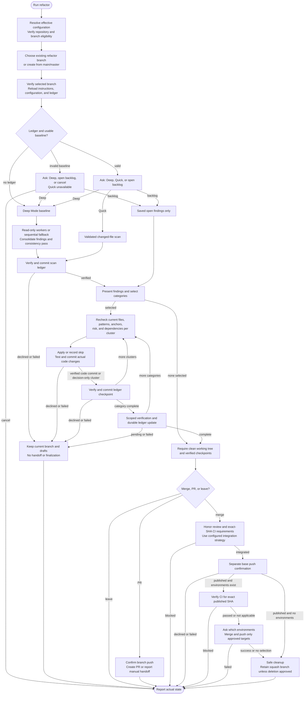

# /helm:refactor

Branch off `main`, scan the project for refactoring opportunities, apply selected categories one at a time with tests passing after each, then merge, open a PR, or leave the branch for review. A persistent ledger (`.helm/refactor-log.json`) tracks findings across runs so the same issue never surfaces twice and progress is visible over time.

Command names below use Claude notation. In Codex, select the same Helm workflow from the skill picker. Configuration comes from the existing memory owner, including through a bridge; [compatibility notes](../setup/compatibility.html) describe host-specific behavior.

## Flow

## Steps

### Before starting

Resolve the effective configuration owner before Git actions, following the shared runtime through imports, overrides, and recognized fenced configuration. Read `git-strategy` (default: GitHub Flow), `git-auto-commit` (default: false), and GitHub Flow's `git-merge-strategy` (default: squash). Configuration remains in its existing owner, normally `AGENTS.md` reached through the Claude adapter; this command does not create, move, or edit those settings or instruction-entry ownership.

Runs from `main`, `master`, or an existing `refactor/*` branch. Require a repository with HEAD and a clean working tree/index before switching; reconcile pending work on its current branch first. Resolve the main/master destination as the base branch, stopping on ambiguity. Do not reset, stash, or silently commit user work.

The dedicated `refactor/*` branch and Merge/PR/Leave choices remain available in both Git modes. Integration still honors each mode's configuration, review, and CI requirements. This is a documented exception in [`git.md`](../rules/git.html#solo-mode): a refactor session is multi-wave and resumable by design (see The ledger below), and a branch is what makes leaving work between runs possible, the same reasoning as `/helm:ship`'s release-commit exception, applied to a different command.

### 1. Select the working branch

Choose the actual refactor branch before reading its ledger or recommending a scan mode. Ask whether to continue the existing branch or start fresh; with multiple branches, ask which exact one rather than silently choosing a match. Pickers remain within four choices, with other names available for free-text selection. New `refactor/{YYYYMMDD-HHMMSS}` branches come from the resolved main/master base, never from an old refactor branch.

Verify the selected branch and HEAD, then reload its active instructions and effective configuration. Resolve conflicting policy before work. Step 3 reads only this branch's canonical/legacy history; any unexpected branch/history change invalidates previously loaded state, scope, and recommendations and requires reassessment. Resumed branches retain their actual name throughout finalization rather than reconstructing a timestamp.

### 2. Scan boundaries

Reads the project but skips `vendor/`, `node_modules/`, `public/`, `storage/`, `__pycache__/`/`.venv/`/`dist/`/`build/` (Python), `tmp/`/`log/` (Ruby), `bin/` (Go), migration files, `.env` files, generated or compiled files, and operational state in `.helm/`, `.claude/helm/`, and the four known flat legacy state files in `.claude/`, never treated as source. Tests are included on purpose because test quality degrades fastest.

### 3. Load history and choose mode

Uses `.helm/refactor-log.json` as persistent memory and checks both legacy locations, `.claude/helm/refactor-log.json` and `.claude/refactor-log.json`. All existing copies are validated and compared before use. Equivalent copies can be deduplicated; differing histories require explicit reconciliation. Migration happens only with a successful authorized ledger write, with canonical verification before legacy removal in the same commit. Inspection and cancellation do not migrate state; a declined commit preserves legacy sources and reports any canonical draft as pending. Other commands' files are untouched.

**First run (no ledger):** skips the mode question and runs Deep Mode automatically to build a baseline. Capture the selected branch's inspected HEAD for every scan. Before writing scan results, recheck branch, HEAD, configuration, ledger inputs, and source contents; unexpected changes require reassessment. Successful scans record that inspected HEAD, without mistaking later verified workflow commits for external changes.

**Later runs:** first validate `last_scanned_commit` as an existing commit object and ancestor of the selected branch's inspected HEAD. Stored values are commit IDs, never arbitrary revision expressions or shell arguments. A missing, unavailable, or non-ancestor baseline offers Deep Mode, Fix Backlog when open findings exist, or Cancel; Quick Mode is unavailable until a successful scan establishes a usable baseline. Preserve findings and scan metadata on cancellation; never substitute `HEAD~1`. A failed comparison stops dependent work instead of counting as zero changes. Keep historical finding/resolution IDs as provenance.

With a valid baseline, computes commits, days elapsed, and the real changed-file count (`git diff --name-only`) since the last scan, plus the number of open findings, then recommends a mode:
- **Fix Backlog** if there are open findings and zero commits since last scan: nothing new to scan for
- **Deep Mode** if 40+ commits, 60+ days, two Quick Mode scans in a row (`consecutive_quick_count >= 2`), or more than 50 files changed: commit count alone is a weak proxy for diff size, so the real file count is checked upfront rather than discovered as a surprise after Quick Mode is already chosen
- **Quick Mode** otherwise

The Fix Backlog option only appears when open findings exist. With a valid baseline and unchanged inputs, the recommendation remains a suggestion: a large diff does not prohibit Quick Mode. Invalid baselines and changed branch inputs require reassessment rather than bypassing validation.

**After mode is confirmed**, scanning uses the branch already selected in Step 1. It never carries a different branch's ledger or changed-file list into this scan.

### 4. Scan

**Deep Mode**: splits the project into folder/module chunks (keeping related files together), uses available read-only workers within the host's concurrency limit, or the same complete sequential scan when delegation is unavailable, and reads each full chunk in a single pass across five per-file categories: **Architecture**, **Code Quality**, **Performance**, **Tests**, and **Dependencies**. **Tests** findings are about existing test *code quality*, never about missing coverage: that's [`/helm:test`](test.html)'s job exclusively, and a file lacking tests is never itself a Tests-category finding here. What it does flag: 3+ test cases sharing the same input → assertion shape (e.g. one expected output per entry in a dictionary or lookup table) that could collapse into a single parametrized test with zero coverage loss. A chunk-scoped sub-agent can't see the sixth category, **Consistency**, by design (it only has visibility into its own folder), so Consistency runs as a separate, dedicated pass: it maps the codebase's key persisted/synced state and the features that should react to each (sync, cache invalidation, notifications, audit logging), traces every site that writes that state to check the expected reactions are wired up consistently everywhere, and separately looks for related data handled with mismatched rigor in the same flow (e.g. one gets conflict review before being overwritten, a related one is silently replaced). This pass is scoped by feature or data flow rather than by folder, and every finding it produces is always `needs-review`: never auto-applied, since deciding whether a missing connection is intentional needs product judgment. The main agent then consolidates everything: merges reports (including the consistency pass), spots cross-chunk patterns, checks new findings against the ledger to avoid duplicates, auto-resolves stale entries, assigns `risk` (`safe` / `needs-review`), groups related findings into `cluster_id`s, and records `depends_on` order where one fix must precede another.

**Quick Mode**: reuses Step 3's validated changed-file list only while the branch, inspected HEAD, configuration, and ledger inputs still match. Otherwise re-resolve and recompute scope. Size recommendations introduce no extra restriction. Re-validates all open ledger entries, Consistency findings included: a deleted or heavily rewritten file auto-resolves its findings; an untouched file carries its findings forward unchanged; a file touched but not heavily rewritten (the common case) gets each finding's `line` re-verified and refreshed before carrying it forward, since line numbers drift with any unrelated edit above them and `risk: safe` findings apply with no human review to catch a stale one. Then scans just the changed files in a single pass for new issues in the five per-file categories only: it does not look for new Consistency findings, since that needs the whole-codebase, cross-feature visibility only Deep Mode's dedicated pass provides.

**Fix Backlog**: skips discovery of new findings and presents saved `open` findings. Before editing, targeted reads must verify the selected findings' current files, patterns, anchors, dependencies, and risk. This is not a fresh scan. Scan metadata (`last_scanned_commit`, `last_mode`, `last_scan_date`, `consecutive_quick_count`) remains untouched.

Deep and Quick Mode verify and commit the updated ledger before moving on: `chore(refactor): update ledger after {deep/quick} scan`, per [git.md's Auto-Commit rule](../rules/git.html#auto-commit). A declined or failed scan, cluster, verification, or integration commit stops subsequent edits, handoffs, and finalization. Preserve the actual branch, drafts, verified commits, canonical copy, and remaining legacy sources; report any staged removals. Pending work never triggers merging, publication, promotion, branch deletion, or an automatic checkout.

### 5. Present findings

Builds a structured report. For Deep and Quick Mode, findings are split into three sections:

- **New**: found for the first time this run
- **Still Open**: carried over from a previous run, still valid
- **Auto-Resolved**: previously open, file since deleted or rewritten

For Fix Backlog mode, only **Still Open** is shown: no New or Auto-Resolved sections, since no scan was performed.

Each finding is tagged `[New]`/`[Still Open]`, priority (`High`/`Medium`/`Low`), and risk (`Safe`/`Needs Review`). Total count at the bottom shows new vs still-open separately.

Then presents a category-selection prompt scaled to how many of the six categories (Architecture, Consistency, Code Quality, Performance, Tests, Dependencies) actually have at least one `new` or `still open` finding: none qualifying means nothing to apply: informs the user and skips straight to Merge and cleanup; exactly one qualifying means a direct yes/no confirmation, since a multi-select needs at least 2 options; two or more qualifying is the normal multi-select (max 4 options: smallest two merge if more than four qualify). Categories with only auto-resolved findings are excluded. Selecting nothing (or Skip, in the single-category case) is a clean skip with no harm done.

### 6. Apply category by category

For each selected category in turn:

1. **Order by dependency**: findings with `depends_on` entries are applied after their prerequisites. Findings sharing a `cluster_id` (touching the same or related files) are handled together in one pass, never split across parallel agents.
2. **Validate current code, then apply safe findings**: re-read selected primary/related files, locate actual issue patterns, refresh moved anchors, and check risk and dependencies before editing, including after earlier clusters or a session change. A verified absent issue is auto-resolved. An uncertain issue identity/location stays open for clarification; never guess a replacement location or infer safety from a missing legacy risk label. Current `safe` findings need no extra prompt; consistency findings remain `needs-review`.
3. **Needs-review findings**: presented one at a time (or batched if closely related) for the user to approve or skip. Skipped findings are marked `skipped-by-user` in the ledger and stop resurfacing unless the surrounding code changes significantly enough to warrant a second look.
4. **Test, lint, commit per cluster**: run tests after each edited cluster; halt on failure. Then lint, format, and commit actual code changes: `refactor({scope}): {summary}`, where scope is the primary module/feature/domain touched by the cluster (e.g. `orders`, `auth`) per git.md's Conventional Commits convention, not the category name itself, which is a report/selection grouping, not a commit scope. Update ledger statuses using the verified code commit for actual fixes and the decision context for skips. Skip-only or auto-resolution-only clusters need no empty code commit. Persist, read back, and commit the ledger checkpoint as `chore(refactor): checkpoint cluster {cluster_id}` before continuing; preserve all previous records and include applicable tracked legacy removals under the shared state procedure.

**Wave handoff**: hand off only after a verified durable ledger checkpoint. A supported fresh Claude session reloads runtime, branch instructions/configuration, exact branch, and ledger; its handoff includes selected finding/cluster IDs, dependency order, existing approvals, and remaining scope. Codex keeps the parent as the sole code/Git/ledger writer and continues sequentially. If fresh sessions are unavailable, continue locally or report an exact resume point without claiming a handoff. An old open ledger status after a failed checkpoint must be reconciled with committed code before applying that fix again.

**Scoped verification pass (Step 6.4)**: after the current category's clusters are checkpointed, re-check only touched files. Confirm fixes, reopen unresolved issues with notes, and append new findings without rebuilding history. Persist changed verification state through a verified `chore(refactor): record scoped verification` commit under the existing policy; unchanged data needs no extra write. A declined/failed checkpoint reports pending state instead of finalizing.

### 7. Merge, PR, or leave

Require verified code/ledger checkpoints and a clean index/working tree before offering Merge/PR/Leave. Pending work stays on its actual branch and goes straight to reporting. A completed scan's ledger commit remains a real change even if no categories were selected. Only a genuine no-op may clean up an empty branch created by this invocation; never delete a resumed session branch as empty cleanup.

- **Integrate into the resolved main/master base:** re-read destination configuration and resolve conflicts before mutation. GitHub Flow must satisfy its PR/review requirements and configured CI; an unmet or unavailable requirement leaves the committed branch for review. Its integration uses `git-merge-strategy`, defaulting to squash. Solo keeps the existing merge-commit behavior unless explicit project instructions choose otherwise, without acquiring a mandatory PR. Obtain any required integration-commit approval before mutation. Merge uses `--no-ff`; squash uses `--squash` plus the approved commit; rebase is limited to this session's private unpushed branch, followed by `--ff-only` integration. Shared/pushed branches require an explicit rewrite plan. Conflicts or failed commands stop publication. Verify integration includes code, canonical ledger checkpoints, and tracked legacy removals. Preserve historical IDs after squash/rebase and validate them on the next run.
- **Publish and promote after integration:** push the base only on its separate confirmation. Declining or failing the push skips promotion and cleanup. For qualifying environments, enforce the CI gate below for the exact published SHA before presenting promotion choices. Keep existing fan-out behavior, at most four environment options, and Yes/Skip for one environment; describe both merge and push in the choice. Recheck SHA/CI before each approved target and stop on failure, reporting completed and pending targets separately.
- **Open PR:** separately confirm publishing the exact committed refactor branch. Only a successful push reaches PR creation. On GitHub, use an authenticated provider interface or verified `gh` access; otherwise provide manual instructions and report actual publication status. A created PR targets the resolved base and links `.helm/refactor-log.json`; attach it when the host supports that. PR creation does not merge, promote, or delete the branch.
- **Leave as-is:** retain the actual branch and verified checkpoint, reporting remaining finding/cluster IDs and review requirements.

**Required CI gate:** follows the [shared Git and CI policy](../setup/git-and-ci.html#ci-gates). Gate the reviewed tip only on CI required for that specific integration. Solo with no pre-integration remote requirement may integrate after applicable local checks; CI merely existing does not make an unpublished-tip check mandatory. Explicit required remote checks in either mode never become optional: offer separately confirmed branch publication for checks or a manual/review handoff, without forcing a PR in Solo. Check trigger filters and the exact SHA. Before promotion, configured/applicable CI for the exact published base must still pass. Use complete authenticated provider-aware results, pagination and current attempts; unknown/missing/failed/pending results block. No environment selection or timeout waives the gate. Preserve published commits and remaining work when blocked. Actual scan provenance and conservative Deep/validated Backlog fallback for rewritten resumed branches remain unchanged.

**Cleanup:** delete the local refactor branch only when its tip is an ancestor of the base and `git branch -d` succeeds. Squash may leave its original commits outside base ancestry; retain and report the branch instead of silently forcing deletion. Remote deletion requires that the branch was pushed and its deletion has its own push confirmation. Never clean up pending or unverified work.

### 8. Confirm completion

Closes with a structured summary: branch, mode, scan scope (new / carried-over / auto-resolved findings this run, omitted for Fix Backlog, since no scan occurred), changes per category, ledger state (still open / auto-resolved / newly fixed / skipped by user), verification result (confirmed resolved / newly introduced), commits made, tests passing, outcome. Include the actual current branch, resolved configuration owner and integration strategy, loaded/canonical state paths, migration and checkpoint commit status, baseline validation, targeted backlog checks, exact-SHA CI results or blocking reason, and remaining files/checkpoints/IDs/actions. Distinguish drafts from verified commits and report partial promotions accurately. Ends with a sample of up to 5 applied fixes (description and file) so the closing report shows what was actually done, not just how many.

## Stop conditions

- **Not on `main`, `master`, or an existing `refactor/*` branch.** Switch to one first.
- **Tests fail mid-apply.** Resolve before the next category continues.
- **No categories selected.** No code fixes; a completed Deep/Quick scan may already have committed or migrated its ledger. Pending ledger work stops finalization.
- **Invalid scan baseline.** Offer Deep Mode, an open backlog with targeted validation, or Cancel; no invalid incremental diff.
- **Commit declined/failed or checkpoint incomplete.** Preserve current branch and pending work; no further edits, handoff, or finalization.
- **Required review/CI missing or unsuccessful.** Block affected integration/promotion and report the exact remaining action.

## The ledger

`.helm/refactor-log.json` is committed alongside code changes on the refactor branch and travels with the branch to `main` on merge. It tracks every finding ever surfaced: when it was first found, when it was resolved (and in which commit), whether the user skipped it, and whether it auto-resolved because the code was rewritten. This is what makes progress visible across runs instead of repeating the same flat list every time.

It also carries a `schema_version` field, bumped only if this structure changes in a future release, so a future version of the command can detect and handle an older-shaped file explicitly rather than misreading it. A missing `schema_version` means `1`.

## See also

- [`/helm:test`](test.html): the test framework setup that this command relies on between categories
- [`/helm:ship`](ship.html): ship the merged refactor as a release
