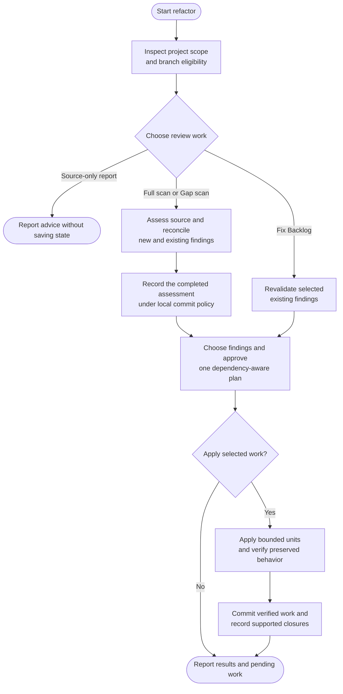

# refactor

Find worthwhile code improvements and apply the ones you choose while preserving behavior.

## Start the command

```text
refactor
```

Use the prefix for your app or terminal from [Setup]({{ '/docs/setup/' | relative_url }}#run-a-command).

Source-only review works on any checkout. Recorded scans and edits need a clean, eligible **main/master, feature or existing refactor branch**. Confirmed non-base environment branches remain report-only, including those named `refactor/*`.

## Flow



## Choose the review scope

- **Full scan:** read every eligible implementation and test file in full, including scripts or workflows that implement the product.
- **Gap scan:** review changed logical units and affected consumers, tests and configuration since a valid saved baseline.
- **Fix Backlog:** revalidate selected existing findings without a discovery scan.
- **Source-only report:** give advice without code or record writes.

Broad or uncertain impact can call for Full scan. Unusable history cannot supply a Gap baseline; malformed state needs resolution before recorded work.

## The six review perspectives

| Perspective | Focus |
|---|---|
| Architecture and boundaries | Responsibilities and coupling. |
| Contracts and state consistency | Related representations of confirmed shared behavior. |
| Code clarity and maintainability | Names, flow, indirection and duplicated knowledge. |
| Performance and resource use | Evidenced avoidable work or cost. |
| Test quality and maintainability | Existing cases, fixtures, helpers and isolation. |
| Dependency and integration boundaries | Coupling to libraries, frameworks and workspace packages. |

Recommendations follow the actual stack and conventions. Each needs a concrete benefit; a preferred pattern alone is insufficient. Bugs, new features, behavior-changing security fixes, upgrades and migrations remain separate work.

## Priority, risk and your selection

| Priority | Present burden or benefit |
|---|---|
| **High** | Substantial demonstrated maintenance, change, verification or resource cost. |
| **Medium** | Meaningful localized cost. |
| **Low** | A small concrete benefit beyond cosmetic preference. |
| **Unknown** | A material fact is needed before ranking. |

Transformation risk is separate: **safe** needs evidence of mechanical equivalence and suitable checks; **needs review** involves unresolved intent, evidence or tradeoffs. Neither authorizes edits.

For larger reports, choose **Recommended**, **All listed ready**, **Choose findings or groups**, or **None**. IDs and filters let you select a precise subset. Blocked and uncertain work stays visible; None leaves findings open.

Before editing, review one plan covering dependencies, companion changes, preserved behavior and checks. Selection does not add unselected findings automatically.

## Apply and verify

Changes proceed in bounded sequential units with a baseline and relevant verification before each fix is committed. Expected performance gains stay distinct from measurements.

Failed, unavailable or deferred required checks leave work pending. Approved unverified drafts stay uncommitted; existing protection is not weakened to accommodate them.

## Refactor vs test

Refactor maintains existing test code without losing guarantees and can include explicit guards or mechanical companions for a selected change. Replacements must be verified before old protection is retired.

[Test](test.html) owns missing or stronger protection and independent changes to tools, layers or strategy. Neither command invokes the other automatically.

## Your result and finding history

You get verified local changes, checks and remaining findings. `.helm/refactor-log.json` retains findings and decisions for later work. Skip, defer and accepted risk remain open work, not fixes. A completed assessment does not prove implementation or runtime success.

Changes follow your local commit policy on the same branch. Reruns reconcile actual code before resuming. Use [ship](ship.html) for publication.
