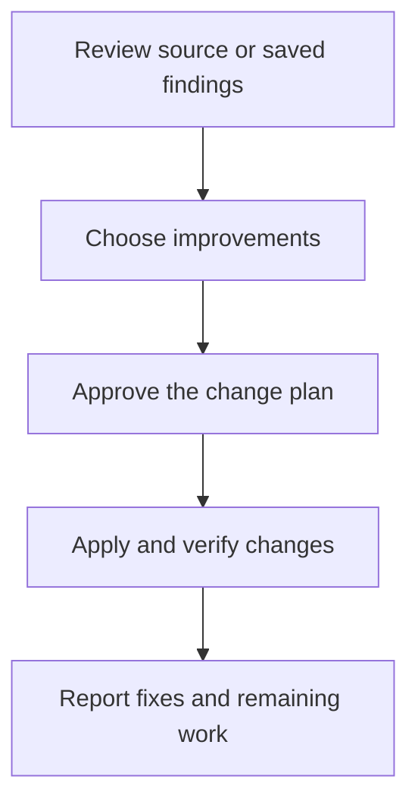

# refactor



Use refactor when code has become harder to understand or maintain. It finds worthwhile improvements, then applies the ones you choose while preserving behavior and existing test guarantees.

## Flow



## Start the command

```text
refactor
```

Use your client's [command prefix]({{ '/docs/setup/' | relative_url }}#run-a-command). Source-only advice works on any checkout. Saved scans and edits need a clean, eligible **main/master, feature or existing refactor branch**. Confirmed environment branches remain report-only, even when named `refactor/*`.

## Choose the review scope

| Choice | Use it to |
|---|---|
| Full scan | Read every eligible implementation and test file in full. |
| Gap scan | Follow changes and affected consumers since a valid saved review. |
| Fix Backlog | Recheck and work on selected existing findings. |
| Source-only report | Get advice without code or record writes. |

Broad changes or an unusable baseline may need Full scan.

## The six review perspectives

The review considers architecture, contracts/state, code clarity, performance, existing test quality and dependency boundaries. A suggestion needs an evidenced benefit in this project; a preferred pattern alone is insufficient.

Bugs, new features, behavior-changing security fixes, upgrades and migrations remain separate work.

## Priority, risk and your selection

Priority describes the present cost or benefit. Transformation risk describes how confidently behavior can be preserved. A high-priority finding can still need clarification before it is ready.

Choose recommended work, all ready findings, a subset or none. Before edits, approve one plan covering dependencies, preserved behavior and checks. Unselected findings are not added automatically.

## Apply and verify

Changes proceed in small, checked units. Failed, unavailable or deferred required checks keep work pending; approved unverified drafts stay uncommitted. Expected performance gains are not reported as measurements.

## Refactor vs test

Refactor can maintain existing tests and add guards needed for a chosen change. [Test](test.html) owns missing or stronger protection and independent tooling or strategy work. Neither command invokes the other automatically.

## Your result and finding history

You get verified local changes, actual check results and remaining findings. Saved history supports later runs; skipped, deferred or accepted-risk findings are not treated as fixed.

Work finishes on the same branch under your local commit policy. Use [ship](ship.html) separately to publish.
