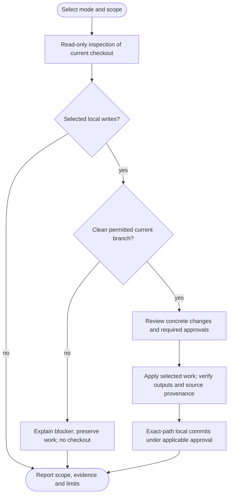

# /helm:refactor

Find worthwhile code improvements, review concrete transformations, and apply selected behavior-preserving work locally on the permitted current branch with resumable checkpoints. Audit and Plan offer static review without execution or writes. A persistent finding history supports continuation, prior decisions and genuine recurrence; it does not prove that an issue can never return.

Command names below use Claude notation. In Codex, select the same Helm skill and provide the mode/scope in your request. Both hosts follow the same [configuration ownership and compatibility rules](../setup/compatibility.html).

## Investigation depth and coverage

Full scan reads every eligible human-maintained first-party implementation and test file in full through bounded sections, including scripts/Markdown that implement the product, and inspects relevant configuration/contracts. Gap/Targeted assesses complete affected logical units and evidenced consumers with sufficient surrounding context, without a mandatory whole-file reread for every small change. Full scans prefer permitted read-only subagents for substantial scope; exact assignments, section/depth evidence, no-finding areas and unread remainder return to the parent for reconciliation and cross-module review. No incomplete scan checkpoint becomes eligible merely because coverage was divided among workers.

Follow the [shared investigation and exclusion rules](../setup/investigation.html). Inventories and worker evidence remain transient; inaccessible required material is not silently excluded or marked complete. Finding counts, duration and reasoning effort do not prove coverage.

## Modes and scope

| Invocation | Result |
|---|---|
| `/helm:refactor audit` | Static findings, evidence and coverage. No edit plan required. |
| `/helm:refactor plan` | Also propose specific edits, invariants, tradeoffs, dependency order and verification. |
| `/helm:refactor` | Preview first, then choose a recorded assessment/Apply path or report-only/Skip. |
| `/helm:refactor ./api` | Target a path, package, module or clearly identified feature, with relevant contract/dependency context. |
| `/helm:refactor plan -- ./web` | Plan targeted work without running tools or changing files. |

Only an initial `audit` or `plan` token selects that mode. Use `./audit`, `./plan`, `-- audit` or `-- plan` for literal paths; quoted paths with spaces are supported. Ambiguous scopes are resolved before dependent work, never expanded silently.

Audit/Plan can inspect any branch, an explicitly selected dirty/staged/untracked snapshot, or detached/committed inputs. They identify exactly what was inspected. Without Git HEAD, static review remains available. They do not check out, fetch, create branches, refresh the index, load ledgers, execute project configuration/analyzers/checks/dry-runs, install tools, or write files/reports/state. Output stays in conversation. A later Apply revalidates the actual branch/source/policy and obtains any missing approval.

## Flow

Pending writes, declined/failed commits or readback failures stop subsequent edits and finalization, even after earlier successful work. Actual drafts, index, branch and verified checkpoints are preserved; nothing is reset or stashed to continue.

## Preview and current-branch eligibility

A cheap static preview identifies project shape, likely scope, native commands and the current snapshot before a first-run Full scan or writes. Report-only/Skip and true no-ops create no state.

After normal current-branch preparation, the parent prefers the [Python ledger helper](../setup/python-helpers.html) to validate the complete native schema-2 file, then retrieve digest-bound pages across relevant open and closed history. The bundled implementation needs Python 3.11+. If Python/execution is unavailable, offer/reuse Set up Python / Continue without Python / Stop once per run. Approved equivalent tools may meet the same full validation, safe-path, resource, retrieval and preservation checks, including canonical readback. Without equivalent evidence, independent assessment/planning can continue while ledger-dependent edits/writes remain pending. Invalid data, unsafe paths, drift and broken packages still block dependent work. Audit/Plan never invoke it, load state or ask about runtime setup. No helper writer or migration is added. Index rows/pages cannot reconstruct the document; disclose the actual validation method and unperformed automation. Structural success proves no semantic judgment, source currency or passing verification.

Recorded scans/edits need HEAD, a clean attached current main/master base, an established existing current feature branch or an existing current refactor/* branch, no ongoing operation and applicable worktree safety. Establish non-base roles/environment status from actual project/deployment evidence or developer classification; reuse known evidence and ask only when unresolved. Names alone prove neither ownership nor safety. Confirmed non-base environment branches remain Audit/Plan only even with a refactor/* name; unresolved/unsupported roles also block writes. Unrelated untracked files and dirty tracked input remain blockers; no old-ledger preservation/conversion exception exists. Refactor never creates/selects/switches branches or fetches/updates the base. If another branch is needed, the developer changes it outside the command. Revalidate source/policy on the same branch and use only that branch's proven assessment/checkpoints, never transplant a different snapshot.

Recommend targeted cleanup of the feature's relevant areas to keep review scope clear and reduce conflicts, without forcing targeted mode or narrowing an explicit broader request. Preserve behavior and coherent commit boundaries; functionality changes need a separate reviewed scope. Actual script/hook/runtime-target checks and stronger project policy remain binding. Feature checkpoints describe the inspected snapshot/scope, not integrated base; keep the targeted global-field rules and revalidate ancestry/context after later integration or history changes, without fabricated IDs or automatic state merging.

## Source boundaries

Inventory real packages, stacks, source graphs, native verification tools and public contracts. `bin/`, `public/` and `storage/` can contain important source. Vendor/generated/runtime/secret exclusions require evidence; filenames, headers and lockfiles alone are not universal classification rules. Relevant manifests, lockfiles, schemas and migrations provide read-only context without automatic upgrades or migration changes/execution. All operational Helm state remains excluded from source discovery; only the owning refactor history procedure can access its permitted records.

Preserve applicable API/results/errors/order/formats, side effects, state/transaction and async contracts. Security, reliability, observability and accessibility are preservation context where applicable, not new full-audit promises. Public imports/exports, serialized data, platform behavior and external consumers can make an apparently internal move observable. Bugs, security behavior changes, features, upgrades, indexes and migrations stay separately scoped follow-ups.

## Stack-aware review

Refactor builds a transient context for every selected package/service, including mixed-stack workspaces and web, UI, libraries, CLIs, native/mobile/desktop apps, data jobs, scripts and instruction/configuration plugins. It discovers actual capabilities and relevant guidance across the selected project, with conditional checks suited to each stack and project type.

1. Establish language/runtime/framework/library versions, supported targets and package boundaries from static manifests, lockfiles, imports, runtime constraints, configuration and documented commands. Distinguish declared ranges, resolved versions, local capabilities and unknowns. Do not execute imports, configuration, package-manager probes or discovery to populate the context.
2. Read project instructions, architecture decisions, configured lint/formatter rules and actual local conventions. Reuse supplied/local docs. Majority or minority usage alone does not prove intent; a configured check does not prove execution or adequate coverage.
3. Investigate guidance for actual surfaces, including request/authorization/validation flow, data access, components/state/effects, injection, events/jobs/caches, errors, concurrency, resource ownership, public packaging and tests. Consult version-applicable official documentation for material unfamiliar/uncertain points. No exhaustive browsing, latest-version upgrade or vendor tooling installation is required.
4. Identify the basis of a proposed framework-specific change: project requirement, mandatory framework constraint, optional documented pattern or inference, citing relevant paths/docs/version in report/native assessment evidence. Project policy governs authorized changes but cannot alter runtime/compatibility facts. Conflicts with mandatory behavior or intended contracts need clarification or a separate proposal, not silent enforcement.
5. Explain the current burden, smallest useful remedy, alternatives and preserved contracts. Prefer equivalent existing/native facilities over new wrappers. No stack profile, settings, report artifact or new schema field is created; missing evidence remains an explicit limit. Refresh affected context after material changes without repeating still-valid investigation.

The coverage guide is conditional and extensible, not a fixed framework catalog:

| Actual surface | Relevant checks and preserved behavior |
|---|---|
| Web/API backends | Handler/service boundaries, validation/authorization order, queries, transactions, serialization, jobs/events/caches and response/errors. |
| Browser/mobile/desktop UI | Components, state/effect dependencies, lifecycle/cleanup, rendering/data boundaries, cancellation, platform and accessibility/focus contracts. |
| Libraries/CLIs/packages | Public symbols/imports/exports, signatures, errors/exit codes/output, packaging/install boundaries and supported runtimes/OSs. |
| Async/concurrent/native code | Ownership/lifetimes, cancellation, ordering, locks, resource release, side effects and blocking work. |
| Data/batch/ML jobs | Data/schema/output meaning, ordering, checkpoints/retries, IO and resources, without silently changing model behavior. |
| Scripts/configuration/instruction plugins | Invocation/discovery, path/config precedence, shell/data boundaries and consumer-facing instructions. |

Full scan covers all first-party components with applicable checks; Gap scan/targeted retain the evidenced affected surface. No lens is compulsory for every file, no finding quota applies, and no findings is a valid result. Report inapplicable, unknown and incomplete scope honestly.

## Six defined perspectives

Each perspective defines purpose/applicability, inspection responsibilities, qualifying evidence/invariants, permitted remedies and separate follow-ups. The contracts apply within Full scan, Gap scan and targeted scope; Backlog uses them to revalidate selected items without a discovery scan. These are clearer display names for existing category identities; former labels remain accepted filters. Historical raw category values, IDs, decisions and unknown fields are preserved; display renaming alone never authorizes bulk conversion or migration.

| Perspective (former label) | Purpose and inspection | Permitted scope and boundary |
|---|---|---|
| **Architecture and boundaries** (Architecture) | Reduce responsibility/coupling costs: modules, layers, dependency direction/cycles, interfaces, paradigm fit and production testability. | A bounded helper/module/seam or extraction needs demonstrated benefit and preserved interfaces/side effects. New architectural styles, services/deployments, speculative factories and public contract changes are separate scope. |
| **Contracts and state consistency** (Consistency) | Compare confirmed related contracts across state readers/writers, errors/results, caches, events, transactions, resources and logs/metrics. Always needs review. | Consolidate duplicated representations of an agreed cross-flow contract while preserving intentional differences. Divergence is a signal, not authority to normalize behavior; bugs and policy changes are follow-ups. Gap scan makes no global consistency claim. |
| **Code clarity and maintainability** (Code Quality) | Reduce comprehension/change burden from names, control flow, duplicated knowledge, indirection, stale adjacent docs and apparently unused code. | Propose concrete clarity gains; removal requires dynamic/config/template/plugin/public-use evidence. Configured native tools can help within scope, but neither declarations nor cosmetic preferences justify fix-all or certify completion. |
| **Performance and resource use** (Performance) | Investigate evidenced algorithm, IO/query, allocation/buffering and resource-lifetime costs with reviewed tradeoffs. | Bounded equivalent changes preserve results, errors, numeric meaning, ordering, hooks, transactions and ownership. Query work also preserves scopes/tenant filters, soft deletes, casts/accessors, eager loading, pagination/cursors and connections. Hypotheses are not measured gains; batching/caching/parallelism is not automatically equivalent. |
| **Test quality and maintainability** (Tests) | Improve case/helper/fixture structure, meaningful parameterization, isolation, deterministic async/time handling and necessary production-refactor companions. | Preserve scenarios/asserted behavior, fixture duties, effective layer/environment and regression protection. Minimal explicit additive guards are allowed. Missing/stronger protection, test strategy/layer or independent runner/framework changes belong to test. |
| **Dependency and integration boundaries** (Dependencies) | Examine usage, SDK/framework coupling, wrappers, existing seams, deep/internal imports, workspace cycles and native alternatives. | Simplify an evidenced boundary or use equivalent installed facilities. Proved-unused cleanup needs actual runtime/build/script/optional/dynamic/public/transitive-consumer and restore-effect evidence plus approved verification. No automatic install/uninstall; upgrades, replacements, CVE/license work and behavior-changing/unproved removal remain separate. |

One logical issue gets one finding, categorized by its main remedy/benefit; mention other relevant lenses in prose. Local simplification generally belongs to Code Quality, responsibility moves to Architecture, confirmed cross-flow coordination to Consistency and package/vendor seams to Dependencies. These are tie-breaks, not quotas or a reason to merge unrelated work. Keep unchanged consumers and cross-file context in scope; category, priority and risk views never duplicate counts or become execution queues.

## Principles, paradigms and architecture styles

KISS, DRY, YAGNI, separation of concerns and relevant SOLID ideas guide the six perspectives. A principle name is not evidence. DRY targets duplicated knowledge/intent, rather than forcing look-alike code into shared abstractions; KISS preserves necessary complexity; YAGNI avoids speculative capabilities while allowing present maintainability improvements. SOLID does not require interfaces/factories/repositories everywhere. See the [authors' DRY explanation](https://media.pragprog.com/titles/tpp20/dry.pdf) and [YAGNI](https://martinfowler.com/bliki/Yagni.html).

Procedural, OOP, functional, reactive and generic styles can coexist. Refactor evaluates actual costs and language/framework fit instead of converting the project to a preferred paradigm. Web architecture is a conditional Architecture investigation, not a new compulsory perspective. Architecture choices need workload-specific tradeoffs rather than purity, as discussed in [Microsoft's architecture guidance](https://learn.microsoft.com/en-us/azure/architecture/guide/architecture-styles/#architecture-styles-as-constraints).

## Examples of contextual guidance

These examples illustrate the process; the command inspects all relevant capabilities and the project's actual versions, not only these examples. The Laravel links describe 13.x and never pin a consumer to that version.

| Situation | How the review handles it |
|---|---|
| Laravel queries scattered across handlers | Investigate duplicated query knowledge and project architecture. A scope, helper, existing repository or other small remedy depends on actual cost and semantics. Reviewed docs establish no universal repository requirement; [Laravel permits flexible organization](https://laravel.com/framework/docs/13.x/structure#introduction). |
| Complex/reused Laravel validation | Consider FormRequest extraction only while preserving authorization, preparation, validation and failure order, status/redirect/error bags and accepted data. Simple inline validation remains valid; [both approaches are documented](https://laravel.com/framework/docs/13.x/validation#form-request-validation). |
| Slow synchronous work proposed for a Laravel queue | Report a behavior/operations proposal: error/result timing, ordering, transactions, retries/duplicates and workers can change. Restructuring an already queued implementation can qualify. See [queues and transactions](https://laravel.com/framework/docs/13.x/queues#jobs-and-database-transactions). |
| Eloquent per-model saves replaced by one bulk update | Check event/observer and query semantics, not just fewer calls. The [mass-update docs](https://laravel.com/framework/docs/13.x/eloquent#mass-updates) explain skipped model events; a shorter implementation is not equivalence proof. |
| UI state/effect cleanup | Trace state ownership, lifecycle, cancellation and supported interactions rather than forcing a component pattern. Preserve platform/focus/accessibility behavior. |
| Python CLI or native library cleanup | Use local/version-applicable conventions, public output/API and resource-lifetime contracts; do not add web layers or classes for appearance. [PEP 8](https://peps.python.org/pep-0008/#a-foolish-consistency-is-the-hobgoblin-of-little-minds) illustrates why compatibility and contextual conventions matter. |
| Batch/data-pipeline simplification | Trace schemas, ordering, retry/checkpoint meaning and deterministic intended results before proposing streaming or consolidation. Runtime/data migrations remain separate effects. |

## Refactor vs test

Refactor owns guarantee-preserving test-code maintenance and necessary selected-refactor companions. Test owns missing/stronger protection, changed layer/strategy and independent runner/framework work. Weak/tautological assertions, fragile mocks and flaky tests are investigation signals: an equivalent restructuring can be a refactor, while changing what is proved needs an explicit test task or a narrowly approved guard for this refactor. Real-to-fake boundaries or one passing run do not establish equivalence or a fixed flake.

Minimal additive characterization/regression guards stay tied to selected invariants and the existing whole-unit plan. Broad coverage expansion remains a separate [test](test.html) task, never a prerequisite workflow invocation. Production testability changes may belong to Architecture, while product bugs exposed by tests remain behavior follow-ups.

Report test-owned gaps in conversation with exact paths/case names where known, the missing guarantee and why a later test task is useful. Refactor can persist its own maintenance remedy, with the protection gap kept separate; it does not persist a test-only gap as refactor work, access test-log or create cross-ledger IDs. Each invoked workflow deduplicates only its own history; rediscovery across separate tasks is acceptable. A separate follow-up alone does not block recording a complete refactor assessment; incomplete inspection still blocks its scan checkpoint, while genuine fully assessed unclear refactor-owned findings can be recorded as unknown with clarification blockers.

## Recorded assessment modes

| Mode | Assessment | Schema-2 root anchors |
|---|---|---|
| Full scan | Complete project inventory, bounded chunk queue and cross-file synthesis across six lenses. | Set `assessed_commit` and `full_scan_commit` only after the entire intended scope is assessed. |
| Gap scan | Valid baseline changes plus evidenced callers/consumers/tests/configuration/contracts, including bounded local consistency checks. | Advance `assessed_commit` after the defined incremental assessment completes; preserve `full_scan_commit`. |
| Fix Backlog | Existing selected open findings, revalidated against current code and prerequisites; no discovery scan. | Unchanged. |
| Targeted assessment | Selected path/package/module/feature plus relevant context, without requiring a prior global baseline. | Both unchanged; out-of-scope findings and decisions preserved. |

Concurrency limits bound simultaneous work, not total Full scan coverage. Queue batches rather than merging everything into oversized chunks. Use permitted read-only workers when available, otherwise cover the same queue sequentially. Parent synthesis and targeted rereads resolve cross-chunk relationships; Claude/Codex do not write in parallel.

At an existing Full scan/Gap scan choice, use the [shared scan-depth selection](../setup/compatibility.html#shared-scan-depth-selection). Use already permitted facts only; Audit/Plan never load operational state. Targeted assessment and Fix Backlog gain no helper/global-baseline prerequisite. Bounded impact normally favors Gap scan; credible broad architecture/runtime/build/contract changes or insufficiently bounded impact favors Full scan. Explicit valid Gap scan still covers the entire affected surface, without a fixed one/two-hop completeness guarantee. Incomplete evidence follows existing checkpoint rules. Local consistency findings never establish global consistency.

Gap scan requires a literal saved `assessed_commit` identity resolving unambiguously to an available commit object that is an ancestor of the inspected source. An unusable anchor within otherwise valid state offers independently eligible Full scan, Targeted assessment, validated Fix Backlog when entries exist, Report-only and Skip/Cancel, never guessed `HEAD~1`. Keep Report-only distinct from Cancel and preserve more than four choices through paging/chat. A bad root anchor alone does not invalidate proven backlog entries; malformed/unsupported/conflicting ledger data still blocks dependent use.

First runs retain Full scan, targeted, report-only and Skip choices. Age, commit/file counts and Gap scan frequency no longer determine depth. Schema 2 has no active mode/date/count; Current native anchors do not certify past coverage. Only proved bookkeeping effects can be ignored; real code/tests/contracts/configuration remain meaningful. No source gap returns to refactor's own Backlog/no-op rules, preserving explicit reviews and pending work rather than refreshing dates/counters alone.

## Finding history and state

Refactor owns only native schema-2 `.helm/refactor-log.json`. Other records remain opaque and excluded from source discovery. Configuration stays in the existing resolved owner; refactor does not edit Helm settings or instruction ownership.

The [shared state procedure](../setup/compatibility.html#shared-project-state) strictly validates the canonical current format, preserves unknown fields, rechecks drift and verifies authorized writes/commits. Unsupported leftovers stop with [upgrade guidance](../setup/upgrading.html), without reading, converting or resetting them. Failed/declined checkpoints preserve actual drafts and prior work.

### Clean schema 2

The owning source specification is `prompts/refactor-ledger.md`, loaded only when normal refactor already permits its own state access. Audit/Plan have no helper prerequisite or state access; shared runtime does not autoload it. This source update does not read or migrate a live ledger.

| Root field | Purpose |
|---|---|
| `schema_version: 2` | One current native format; unsupported versions block without conversion. |
| `assessed_commit` | Actual inspected source of the latest completed whole-project Full scan or completed defined Gap scan; `null` if not established. |
| `full_scan_commit` | Established latest completed whole-project Full scan source; `null` if unknown. Gap scan preserves it. |
| `findings` | Ordered stable records across all states; append new findings without rebuilding/reordering history. |

Targeted/Backlog preserve both roots; first targeted state uses explicit `null` anchors. Incomplete/failed coverage writes no incomplete scan checkpoint. Unknown priorities, held decisions and pending remedies do not block an otherwise complete assessment from advancing the appropriate roots. Anchors never certify runtime success or that today's guidance was historically covered. Root mode/date/count fields are removed rather than refreshed for bookkeeping.

| Finding data | Purpose |
|---|---|
| `id`, `category`, `summary`, `paths` | Permanent opaque identity, stable raw category, concrete problem and relevant paths. Preserve current IDs; new ones are `r-UUID`. |
| `found` | Actual first-seen provenance, preserved through reassessment. |
| `assessment` | Actual source/date, priority, risk, concrete reason, evidence and preserved invariant for a supported native judgment. |
| `state` | `open`, `resolved` or `obsolete`. |
| `decision` | Optional contextual human `skip`, `defer` or `accepted-risk`; keeps the finding open and held. |
| `blocker` | Optional clarification, prerequisite or verification limit with its actual reason. |
| `closure` | Required for a closed finding: actual code/evidence commit, date, proof method, evidence and applicable command/scope/outcomes. |
| `depends_on`, `recurrence_of` | Actual prerequisite IDs and optional predecessor for a genuine recurrence. |
| `extensions` | Optional preserved custom data, without duplicated compatibility records. |

Each provenance block requires `origin: native` and its complete actual source/date/evidence fields. Missing facts or unsupported variants cannot waive validation. Unknown root anchors are `null`; native commit identities are full literal SHAs. No imported-origin or import-reference representation is accepted.

Do not persist `line`, `cluster_id`, old `status` or `resolved_*` aliases. Locations/coherent units and detailed execution plans are transient. Full opaque IDs and unambiguous report aliases/prefixes work for current findings; do not assume numeric IDs. Preserve supplied raw categories independently of display labels.

Compare logical issues against **all states**. Honor explicit decisions while their relevant context is established unchanged; missing/changed context requires review, never automatic application or permanent proof of unchanged context. Held decisions remain visible outside ordinary ready proposals and survive later closure. None, exclusions and nonselection never create decisions or authorize another write. Git retains earlier decision versions.

Deletion, moves, age, missing objects and loss of related paths do not establish closure. Reinspect actual patterns, relationships and consumers. Semantic absence can become `obsolete`; uncertain identity stays open. Preserve real past closures: a later recurrence gets a new ID with `recurrence_of`. A same-run disproved attempt may reopen its entry, remove the false closure and retain actual failure evidence. Explicit duplicate reconciliation preserves all IDs/human facts and reviews necessary dependency changes, rather than dropping similar-looking rows.

### Bounded context and safe writes

Use already available safe structured tooling to parse/validate the complete own inputs, including duplicate keys, schemas, unique IDs, references, provenance and lifecycle/evidence consistency. No new parser/runtime installation is mandatory. Build a transient index and retrieve an overinclusive relevant working set across open/closed states for duplicates, decisions, recurrence and dependencies. Do not load every historical High/stale path into the model prompt or confuse whole-file structural validation with semantic reassessment of every record.

Full scan still covers all promised source through bounded passes. Large active/held selections use faithful pages with complete counts/IDs and explicit limits. Empty scoped results are not a global up-to-date claim. Apply ID-keyed changes to the complete parsed original, preserving order, untouched records, unknown fields and custom extensions; never regenerate JSON from a truncated working view or use regex updates. Stable minimal serialization permits minimal serialization changes, without wholesale reordering.

Recheck the canonical file and unsupported-path tripwire and actual source/policy/branch before each write. Read back/validate the complete draft and its exact intended changes versus untouched data. Drift, unavailable safe tooling, failure or declined checkpoints stop dependent continuation and preserve/report actual pending files/recovery and earlier verified work.

### Unsupported state

Only native schema 2 is supported. Preserve an unsupported file and use the [one-time upgrade guide](../setup/upgrading.html) outside the workflow; no reader, converter, recovery-profile generation or automatic reset runs. Current assessments and closures still require real evidence and preserve useful open/closed history.

## Priority and transformation risk

Priority describes the present cost of leaving code as is or the concrete benefit of a behavior-preserving improvement. Name who pays, on which supported path, and the mechanism supported by code or developer evidence. Risk, effort and readiness are separate; the same finding keeps its tier across Full scan, Gap scan, targeted and Backlog modes.

| Priority | Criteria and examples |
|---|---|
| **High** | Substantial demonstrated maintenance, change, verification or resource cost. For example, a shared rule demonstrably requires coordinated changes across active supported flows, or a structural obstacle prevents meaningful required verification. Explain the material burden; duplication alone is insufficient. |
| **Medium** | Meaningful localized cost without evidence warranting High, such as tangled responsibilities or duplicated logic that concretely makes changes harder. |
| **Low** | Small concrete benefit, such as correcting a misleading name or simplifying unnecessary nesting. Formatter-governed taste and filler are not findings. |

Categories, LOC/file/hop counts and speculative best practices never determine a tier. Reachability is not proof of usage or cost. Performance needs evidenced avoidable work and relevant supported workload/contract or developer evidence; an expensive-looking loop alone is not High. Unmeasured speed ideas remain labelled hypotheses/observations unless a concrete improvement is supported, rather than automatically becoming Medium. Assessment does not require runtime history or mandatory benchmarking. Test-quality findings concern verification/maintenance burden; broad test gaps and behavior-changing bugs/security fixes/features/upgrades stay separate follow-ups.

| Risk | Meaning |
|---|---|
| `safe` | The specific mechanical transformation has adequate current reference/contract evidence and applicable verification, without unresolved judgment. |
| `needs-review` | Intent, evidence or tradeoffs need a decision. Consistency always needs review; performance normally does unless a narrowly evidenced equivalent transformation qualifies. |

A blocked/expensive High stays High, and a safe rename can be Low. Tool labels or benchmarks do not prove equivalence. A rename must account for actual references; dead-code removal needs dynamic/config/template/plugin/public-use evidence. Neither risk label grants selection, edit permission or a runtime pass. Native assessments persist the actual reason, evidence and invariant. Effort/readiness and detailed execution plans stay transient; no scores, new mode or setting is introduced.

## Unclear impact and existing priorities

Revalidate applicable carried tiers when presenting/selecting findings. Keep supported values; evidence-based corrections can accompany an otherwise eligible checkpoint. Do not bulk-rewrite old tiers, create cleanup-only checkpoints or resurface prior skips solely because the rubric changed. If evidence cannot establish a current tier, preserve the stored value/history and report "recorded High; current priority unconfirmed: ..." rather than certifying it or silently putting it in a ready set.

Uncertainty within a supported tier does not prevent ranking, and a High can still need a remedy choice. When missing intent/value prevents ranking a genuine fully assessed refactor-owned problem, record `assessment.priority: unknown` with concrete evidence and a clarification blocker. Name the missing fact and what each answer changes, batching questions and reusing supplied information. Do not invent Low, a provisional ranked tier or a human skip decision. Unknown findings stay held, outside ready/recommended work until clarified.

A complete Full scan/Gap scan may record unknown priorities and advance its appropriate anchors. Pending remedies, decisions and deferred future-fix checks are distinct from coverage gaps. Actual failed reads/uninspected required scope still make the scan incomplete, with no incomplete scan checkpoint or root advancement. Separately chosen eligible Targeted/Backlog or report-only routes remain available without quietly declaring the original scope complete. Audit/Plan show questions as text and stop without operational state or an interactive Apply path.

## Select and apply coherent work

Group the report by module/behavior, with each finding's ID, priority/reason, risk, exact remedy, affected files/consumers, benefit, invariants, tradeoffs, verification and prerequisites. Allow individual IDs, bounded groups and category/priority/risk filters with exclusions. These views overlap: count each finding once. A group can show its highest tier and the responsible ID, but every member retains its own priority. Categories remain views, never execution queues; test-maintenance and dependency-boundary findings remain independently selectable, including former label aliases.

Small clear sets go directly to the concrete plan and existing approval, with free-text refinement. Larger reports offer one scope question:

| Choice | What it selects |
|---|---|
| **Recommended** | An exact, reasoned, bounded set of supported High and worthwhile relevant Medium findings. Low is eligible when explicitly requested or justified within a selected transformation. Full scan is not restricted to High, and needs-review is not excluded merely by its risk label. |
| **All listed ready** | The exact listed ordinary proposals, including Low and needs-review, with explicit counts/IDs and exclusions. |
| **Choose findings or groups** | IDs, module/behavior/groups or category/priority/risk filters, with exclusions and faithful independent pages/chat. Also provides the route to clarify/resolve/select separately shown held work. |
| **None** | No Apply work; findings stay open. An already authorized assessment checkpoint remains. This is not Cancel, permanent skip, authorization for another ledger write/migration or an undo request. |

Recommended is based on current evidence, relevance and practical effort/risk/readiness, without changing tiers, quotas or filler. Gap scan/targeted respect the affected/requested scope; Backlog findings are freshly revalidated. Useful cleanup is refactor's purpose, so test's default exclusion of test-cleanup proposals does not apply. Omit an empty Recommended or combine it with All when the two exact sets are identical.

Ready means revalidated evidence, a supported tier, concrete remedy/invariant/verification path and satisfied or explicitly included prerequisites. It does not mean tested, safe or authorized: named remedy choices still need review before edits. Show unusually costly/intrusive, blocked and carried-unconfirmed findings separately, with their true priority or uncertainty, actual reason and explicit exclusions from the listed ready set. Point to important held High work rather than hiding it behind easier recommendations. Choosing held work never bypasses a blocker or authorizes behavior changes; use the existing concrete review/setup/verification gates. Deferred checks retain the existing explicitly authorized draft-only limits. Audit/Plan show recommendations as text and stop without scope/Apply questions or ledger access.

Scope selection is not plan approval. Preserve independent choices above four through paging/chat; no default, silence, timeout or unavailable multi-select selects everything. Show the complete selected plan: exact IDs/paths/companion edits, coherent units, invariants, unresolved choices, dependencies, checks and code/ledger checkpoints. Reuse existing exact authorization or obtain the existing Apply selected plan/Cancel approval, without per-tier/per-item duplicate prompts. Missing choices leave the affected unit pending.

Build one dependency plan across the selected work. Recheck IDs, current satisfaction, skipped/unselected prerequisites, dangling references and cycles. State required mechanical companions, such as call-site/import/test-reference edits, in the transformation plan. A companion that is itself an unselected finding or independent improvement requires explicit inclusion, or revision/deferral of its dependents. Group/cluster membership and shared files never silently expand selection. If one member cannot change independently, explain the exact joint scope and obtain approval or defer it. A cycle can become a joint unit only after review confirms one coherent transformation.

Resolve **every decision in the whole selected coherent unit before any edit**, including its safe members and guard tests, reusing exact approval already given. Unselected/excluded findings remain open. An explicit skip/defer/accepted-risk records a contextual `decision` under existing checkpoint rules, keeping the finding open and held; preserve it if the finding later closes. Assessment is recorded before fix selection; a later None preserves that authorized checkpoint without repeating it or authorizing another write.

Use serial bounded units, dependency-first and then by priority; a unit's highest member can guide order without relabelling others. Minimal approved characterization/regression guards may support a risky refactor without invoking another workflow. Broad coverage expansion remains a separately selected [test](test.html) task. Guards can receive their own verified logical commit before the source transformation.

## Preserving protection when editing tests

Include test-change details in the existing selected-unit plan and approval, without importing test's full maintenance workflow or adding another picker. Identify guarantee-preserving maintenance/mechanical companions and explicit additive guards separately from strengthening follow-ups. Map old/proposed inputs/scenarios, assertions, fixture/snapshot responsibilities, effective layer/environment and regression context. Inspect case IDs, selectors/tags/CI filters, documented references and all shared-fixture consumers. Static mapping is planned evidence, not verified equivalence; raw counts/line coverage alone cannot establish preservation.

Consolidation or necessary companion replacement must preserve identifiable scenarios and verify mapped replacement/remaining protection before retirement, exercising relevant valid old/new cases together where the harness permits. Independent pruning of allegedly redundant tests belongs to test; deleting production code never proves a test obsolete. If guarantees cannot be preserved, pause the unit for an explicit test/behavior decision. Proven unused helper/support cleanup is distinct from retiring protecting cases and requires consumer evidence and exact approved paths.

Approved native scoped execution must establish actual discovery/reporter/assertion results and final protection for affected consumers. Never weaken assertions, skip failures, bless snapshots or silently change layers/environments to make a refactor pass. Retain regression rationale in surviving tests or reviewed changes; no new report/ledger is introduced.

## Verification and continuation

Statically inventory native configured commands and targets, then inspect execution side effects/isolation/services before running them. No automatic setup, migrations, production access, broad fix-all or framework requirement is introduced. A safe scoped baseline distinguishes existing failures from new regressions and environment/tool gaps. Existing failures are not permission to fix unrelated behavior.

Run approved scoped formatting/autofix before final relevant checks and inspect its diff. Verify the issue disappeared and required contracts/affected consumers still hold. Use focused per-unit checks plus justified final combined verification rather than repeated per-category full sweeps. Do not weaken assertions or skip tests to get green. Newly found follow-ups stay outside the original approval instead of starting endless autonomous waves.

Genuinely unconfigured checks differ from configured-but-unavailable/deferred ones. Honor explicit testing deferral: report static findings/plans or preserve unverified edit drafts, but do not claim required checks passed, mark those edits fixed, commit them as verified, or finalize them. Editing or reviewing command source does not establish that its runtime checks passed.

When required verification is unavailable/deferred, keep retirement, substitution or weakening of existing protecting cases/assertions/discovery/required fixtures plan-only. Explicitly approved safely additive guard drafts may proceed with existing protections preserved; this is not a blanket ban on every test-file edit. Never substitute an unverified replacement or silently alter discovery. General production-draft limits remain. If interruption/failure actually follows an approved retirement/edit, preserve/report the actual partial tree and pending checks rather than claiming original protections remain intact, verified equivalence or automatic rollback.

Each verified unit has an actual code commit followed by a separate read-back/authorized ledger checkpoint; `closure.commit` points to the actual accepted code/evidence SHA B, with method/evidence and applicable command/scope/outcomes. B may descend from assessed source A, and ledger commit C references B rather than itself. Static/manual evidence never waives a required runtime check; imported history is not a fresh runtime pass. Infer commit/PR/integration types from actual approved work, including `perf`, `test` or `chore` where appropriate, and scopes from real domains. Preserve genuine breaking information and mixed approved semantics; never hide them under a hardcoded timestamp/refactor title.

If code commits but its ledger fails, reconcile before resuming instead of applying the same fix again. Preserve actual drafts on mid-unit failure. Continue/handoff from verified boundaries using the exact branch/checkpoint, selected IDs/units, dependencies, approvals, checks and remaining limits. A fresh session is used only when supported/permitted; Codex retains its parent as serial writer. Unknown fields and historical inspected/resolution SHAs remain intact after integration.

## Local completion and reporting

Finish on the same permitted branch after verifying local outputs and eligible commits. No push/PR question, branch creation/switch/update, integration, environment promotion, return checkout or branch cleanup follows. Remote/provider access and published source IDs are not prerequisites merely to finish locally. Invoke [ship](ship.html) separately when the whole selected work is ready to publish. See [Git and CI behavior](../setup/git-and-ci.html).

Keep meaningful verified code/ledger checkpoints and actual source/resolution IDs. Preserve required local verification/review and stronger project restrictions. Missing checks, declined commits and drafts remain explicit; no synthetic completion, no empty/cosmetic cleanup commit. A local assessment checkpoint does not certify runtime behavior or remote integration.

Report scope/coverage, actual findings and coherent units, source/scan/checkpoint IDs, actual checks and limits, current branch and commits/drafts, preserved/advanced own-ledger fields and exact local continuation point. Ship handles later integration/publication separately; never remap a source ID to an uninspected merged/squashed tip.

## See also

- [test](test.html): broad coverage assessment and selected test writing, beyond minimal refactor guards.
- [normalize](normalize.html): separately reviewed commit-history conversion, never automatic cleanup here.
- [Git rules](../rules/git.html): local commit policy, current-branch eligibility and separate ship publication requirements.
- [Compatibility and state](../setup/compatibility.html): shared owner, host capabilities and same-file migration.
