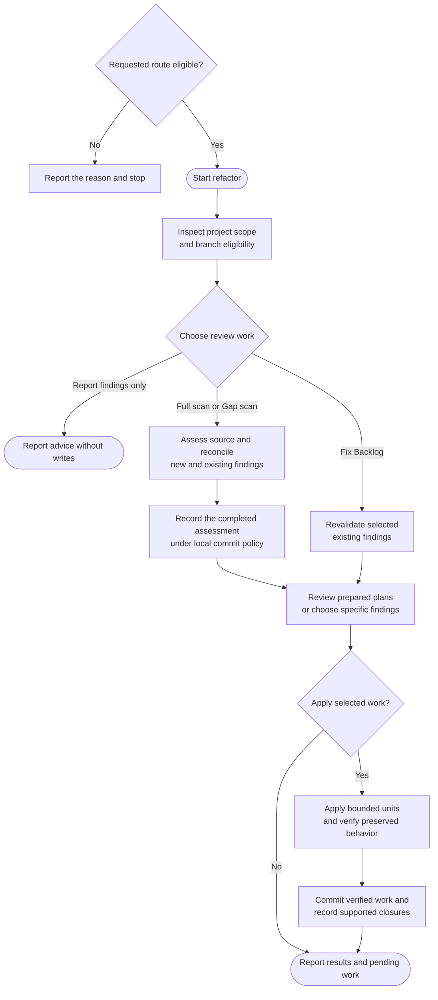

# Refactor



Refactor looks for changes that make this project's code easier to maintain without changing its behavior. You choose the worthwhile work after seeing its benefit, transformation risk and verification plan.

## Flow

## Start the command

Normal refactor checks branch eligibility and cleanliness before previewing project source: main/master, an established feature branch or an existing refactor branch. Source-only advice must be requested explicitly for an ineligible checkout and makes no code or record writes. Confirmed environment branches remain report-only even if their names start with `refactor/`.

Existing assessment records are validated before the normal source inventory. Where needed, one helper read can validate a record and return a useful index together. An absent record needs no parser setup until an approved first write requires validation; the agent does not build a replacement validator during the review. Unsupported or malformed records end the run without a source-only fallback. A failed prerequisite stops the run before further reading or planning. It does not switch automatically to source-only advice; earlier verified work remains preserved. An unanswered workflow question pauses the run; it does not authorize independent investigation while you decide.

## Choose the review scope

| Choice | What is investigated |
|---|---|
| Full scan | Every eligible implementation and test file, read in full in manageable batches. |
| Gap scan | Changes since a valid saved review, their affected consumers and relevant existing findings. |
| Fix Backlog | Selected saved findings, rechecked against the current source before work. |
| Source-only report | Advice without persistent assessment or source edits. |

Gap scan reassesses affected findings across open, resolved and obsolete states. Unrelated history keeps its earlier judgment and provenance; a bounded review does not become a fresh assessment of every saved record. Current patterns, contracts and consumers determine relevance, and a changed filename alone cannot determine a finding's status.

Incomplete coverage remains incomplete. A local syntax pass or a small sample cannot stand in for a full project review. A changed or unusable baseline can require broader investigation before old findings are reused.

## The six review perspectives

The review considers architecture, contracts and state, code clarity, performance, existing test quality and dependency boundaries. It follows the project's language and design rather than applying every fashionable pattern.

A proposal needs a concrete benefit. Extracting a small function may clarify duplicated business behavior; adding a new abstraction around a single straightforward call may increase the maintenance burden instead. Bugs, features, behavior-changing security fixes, upgrades and migrations remain separate work.

## Priority, risk and your selection

Priority estimates the current cost or benefit. Transformation risk describes how confidently existing behavior can be preserved. A high-priority issue can still be unready because a contract is unclear or its tests do not establish the necessary guarantees.

Choose recommended work, all ready findings, a subset or none. When a recommended plan or the plan for all ready findings already identifies the exact findings, paths, dependencies, preserved behavior and checks, Apply selects and approves it in one decision. The agent does not ask again to approve the unchanged plan.

A custom selection or unresolved remedy needs its resulting plan reviewed before edits. This applies to large and small sets alike; no ready-plan shortcut adds hidden findings or bypasses the earlier assessment checkpoint. Approval of a transformation plan does not approve an unknown implementation diff or later commit.

## Apply and verify

The agent works through small, coherent groups and checks the affected surface as it goes. A dependency group is completed and verified together rather than left halfway through an incompatible transition. Changed inputs are reconciled before the plan continues.

If a required check fails or cannot run, the affected work remains pending. Approved unverified drafts stay uncommitted. Expected performance gains are described as expectations until measured under comparable conditions.

## Refactor vs test

Refactor may maintain existing tests and add guards needed for a selected transformation. [Test](../test.html#what-kinds-of-tests-can-it-suggest) owns missing or stronger protection and independent testing-tool or strategy work. Refactor cannot silently weaken tests to make a transformation pass.

## Your result and finding history

The report identifies actual local changes, verification and remaining findings. Stable finding identities preserve your selections and useful history. Skipping, deferring or accepting risk does not mean an issue was resolved.

Before calling a problem new, refactor compares its underlying burden, preserved behavior and evidence with relevant records across all states. A different explanation, category, proposed remedy or set of files does not automatically justify a new finding. Several symptoms can be one problem; a genuine split into independent needs is explained with its old-to-new mapping. Ambiguous matches remain a reconciliation question rather than silently becoming more records.

An open finding is checked for continuing need, a verified fix or proved loss of applicability. A successful past fix keeps its resolved record. If that problem demonstrably returns later, a new finding links to the earlier one through `recurrence_of`; this differs from test's same-case reopening. A formerly inapplicable problem can likewise return as a linked finding. A record closed as a duplicate leads back to its retained finding instead of generating another duplicate. A same-run attempt disproved by verification can reopen its original entry without pretending it was a successful historical fix. Missing old evidence alone does not prove recurrence.

Summaries and judgments stay concise, with concrete evidence and check references instead of transcripts, raw logs or repeated run narratives. Bounded index pages and relevant full-record lookups keep unrelated history out of review context; moved files can require more than a narrow path lookup. Paging does not remove the cost of full structural validation. Unknown data, first-seen facts, decisions, dependency links and useful closed history remain preserved; age or size alone never authorizes deleting them. Git retains earlier judgments, and unrelated records are not rewritten merely to make the ledger look fresh or smaller.

A source edit, complete assessment and verified fix are separate achievements. Only supported results advance their respective records. Work stays on the current branch; [ship](../ship.html) handles publication.

## Explore the source

For implementation details, read [guides/refactor.md](https://github.com/myowinthein/agent-helm/blob/main/guides/refactor.md).
