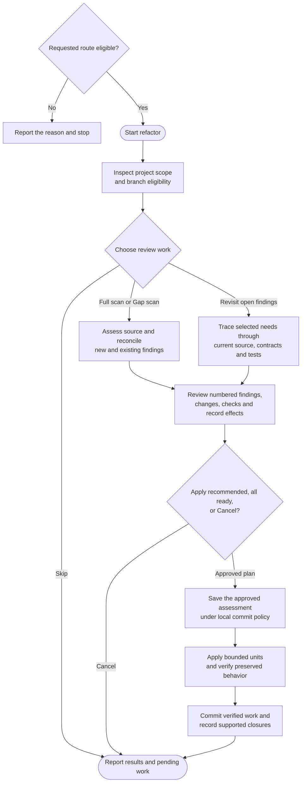

# Refactor



Refactor looks for changes that make this project's code easier to maintain without changing its behavior. You choose the worthwhile work after seeing its benefit, transformation risk and verification plan.

## Flow

## Start the command

Normal refactor checks branch eligibility and cleanliness before previewing project source: main/master, an established feature branch or an existing refactor branch. Source-only advice must be requested explicitly for an ineligible checkout and makes no code or record writes. Confirmed environment branches remain report-only even if their names start with `refactor/`.

Saved assessments are checked before source review. With no existing record, source assessment needs no Python setup until an approved save requires validation. Invalid or unsupported records stop the run with an explanation; the command does not automatically switch to source-only advice. Earlier verified work remains preserved, and questions wait for your answer.

## Choose the review scope

| Choice | What is investigated |
|---|---|
| Full scan | Every eligible implementation and test file, read in full, plus every open finding within the project scope. |
| Gap scan | Changes since a valid saved review, their affected consumers and related existing findings. |
| Revisit open findings | Selected saved needs and their current implementation, contracts, consumers and tests. |
| Skip | No new source assessment or recording. |

Full scan combines discovery with reassessment of all open findings in scope, including unchanged areas and moved/deleted evidence paths. Each receives a supported current judgment or an explanation of unresolved intent. Still-applicable human deferrals and accepted risks remain respected. Relevant closed records are compared under the existing identity and recurrence rules; unrelated closed history needs no exhaustive reread.

Gap scan starts at the last valid saved assessment, which may be several commits back. It follows changed behavior and affected unchanged consumers, tests, configuration and dependencies, revisiting related findings in any status. Older open findings outside that surface remain visible as not freshly reviewed and need reassessment before current work is proposed. A changed filename alone cannot determine status.

Revisit open findings starts from the selected needs and traces the current implementation, contracts and tests until a judgment is supported. For example, moving a file does not establish that its old problem is fixed. Missing context is explained, and any broader discovery waits for your scope choice. Unrelated observations remain separate follow-ups.

A revisit can retain a need, revise its remedy or propose a supported resolution/obsolescence update. It preserves both saved scan baselines, even when all open findings were selected. Explicit source-only advice remains available on request without code or record writes, ledger access or helper execution, rather than as a normal menu choice.

Incomplete coverage remains incomplete. A local syntax pass or a small sample cannot stand in for a full project review. A changed or unusable baseline can require broader investigation before old findings are reused.

## The six review perspectives

The review considers architecture, contracts and state, code clarity, performance, existing test quality and dependency boundaries. It follows the project's language and design rather than applying every fashionable pattern.

A proposal needs a concrete benefit. Extracting a small function may clarify duplicated business behavior; adding a new abstraction around a single straightforward call may increase the maintenance burden instead. Bugs, features, behavior-changing security fixes, upgrades and migrations remain separate work.

## Review findings and choose changes

The report leads with its finding count and actual scope and limits. Each numbered item has a short title and usually one or two sentences explaining the present maintenance or resource burden, the smallest useful improvement and what behavior must stay unchanged. New and reassessed findings share behavior groups, with each logical need shown once. Changed judgments and genuine linked recurrences are identified; proposed closures briefly name their supporting evidence. A small before/after example or diff can clarify a structural change, without a full patch dump or priority table.

Recommendations consider current burden, conditional future cost and useful improvements, weighing benefits against effort, compatibility/regression risk, complexity, coordination and future upkeep. Confidence, deliberate project choices and existing test protection matter. The report gives the deciding reason and material tradeoff without scores, fixed tier cutoffs or a checklist of every factor. Useful cleanup can earn a recommendation; an important concern can remain pending when intent or equivalence is unclear.

The actions show exact finding numbers or ranges:

- **Apply recommended:** approve the displayed ready plan whose benefits justify its tradeoffs.
- **Apply all ready changes:** approve every displayed ready transformation, including optional maintenance. When it matches Recommended, only All is shown; empty Apply choices are omitted.
- **Cancel:** make no new edits, run no guards and write no ledger checkpoint. Earlier accepted work is preserved; Skip/none expresses the same no-new-work intent.

Type numbers, ranges, groups, exclusions or a requested revision directly. There are no separate Choose findings or Revise options. A changed selection or unresolved remedy needs its resulting plan reviewed, including dependencies, companion edits and preserved guarantees. An unchanged concrete Apply plan needs no repeated approval. Human holds, unknown intent, blocked work, behavior changes and separately unapproved intrusive effects remain visibly outside ready sets.

A concise execution note supplies exact paths, coherent dependency units, guards/checks and targets, material effects, commit units and assessment/closure record changes before approval. Large reports use a numbered index and manageable batches with stable references. Apply covers only transformations whose concrete plan has been shown; the full assessment's finding and ledger effects must also be disclosed before recording. No undisplayed changes or unknown later diffs/commits are pre-approved.

The findings and plan are reviewed before the assessment is saved. Once approved, the eligible assessment is committed before guard/code work, recording all meaningful findings actually assessed in scope, including unselected or held work. Cancel before that approval writes nothing and does not trigger another save prompt. An explicit request to save findings alone can receive its own concrete checkpoint review. Later fix failure or cancellation preserves an already accepted assessment without claiming a verified fix.

## Apply and verify

The agent works through small, coherent groups and checks the affected surface as it goes. A dependency group is completed and verified together rather than left halfway through an incompatible transition. Changed inputs are reconciled before the plan continues.

If a required check fails or cannot run, the affected work remains pending. Approved unverified drafts stay uncommitted. Expected performance gains are described as expectations until measured under comparable conditions.

## Refactor vs test

Refactor may maintain existing tests and add guards needed for a selected transformation. [Test](../test.html#what-kinds-of-tests-can-it-suggest) owns missing or stronger protection and independent testing-tool or strategy work. Refactor cannot silently weaken tests to make a transformation pass.

## Your result and finding history

The report identifies actual local changes, verification and remaining findings. Stable finding identities preserve your selections and useful history. Skipping, deferring or accepting risk does not mean an issue was resolved.

Later reviews compare problems with earlier findings, including closed ones. Different wording, moved files or several symptoms do not automatically make a new problem. The same continuing need keeps its identity; an ambiguous match is clarified before it becomes another finding.

A problem that returns after a verified fix, or after becoming inapplicable, gets a linked finding that preserves its earlier history. Test instead reopens the same case when its protection is lost. A failed attempt in the current run remains unresolved rather than being presented as a successful fix followed by a recurrence.

Your decisions, supporting evidence and useful closed history stay intact. A review does not delete older findings or rewrite unrelated records to make them look fresh. New judgments need current evidence; missing old evidence alone proves neither resolution nor recurrence.

A source edit, complete assessment and verified fix are separate achievements. Only supported results advance their respective records. Work stays on the current branch; [ship](../ship.html) handles publication.

## Explore the source

For implementation details, read [guides/refactor.md](https://github.com/myowinthein/agent-helm/blob/main/guides/refactor.md).
