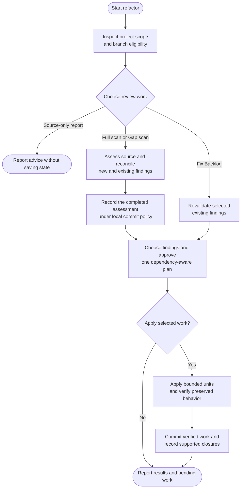

# refactor



Refactor looks for changes that make this project's code easier to maintain without changing its behavior. You choose the worthwhile work after seeing its benefit, transformation risk and verification plan.

## Flow

## Start the command

Source-only advice can be given without code or record writes. Saved assessments and fixes require a clean eligible branch: main/master, an established feature branch or an existing refactor branch. Confirmed environment branches remain report-only even if their names happen to start with `refactor/`.

## Choose the review scope

| Choice | What is investigated |
|---|---|
| Full scan | Every eligible implementation and test file, read in full in manageable batches. |
| Gap scan | Changes since a valid saved review, their affected consumers and relevant existing findings. |
| Fix Backlog | Selected saved findings, rechecked against the current source before work. |
| Source-only report | Advice without persistent assessment or source edits. |

Incomplete coverage remains incomplete. A local syntax pass or a small sample cannot stand in for a full project review. A changed or unusable baseline can require broader investigation before old findings are reused.

## The six review perspectives

The review considers architecture, contracts and state, code clarity, performance, existing test quality and dependency boundaries. It follows the project's language and design rather than applying every fashionable pattern.

A proposal needs a concrete benefit. Extracting a small function may clarify duplicated business behavior; adding a new abstraction around a single straightforward call may increase the maintenance burden instead. Bugs, features, behavior-changing security fixes, upgrades and migrations remain separate work.

## Priority, risk and your selection

Priority estimates the current cost or benefit. Transformation risk describes how confidently existing behavior can be preserved. A high-priority issue can still be unready because a contract is unclear or its tests do not establish the necessary guarantees.

Choose recommended work, all ready findings, a subset or none. One plan brings selected changes, dependencies, preserved behavior and required checks together. It does not quietly add unselected improvements while implementation is underway.

## Apply and verify

The agent works through small, coherent groups and checks the affected surface as it goes. A dependency group is completed and verified together rather than left halfway through an incompatible transition. Changed inputs are reconciled before the plan continues.

If a required check fails or cannot run, the affected work remains pending. Approved unverified drafts stay uncommitted. Expected performance gains are described as expectations until measured under comparable conditions.

## Refactor vs test

Refactor may maintain existing tests and add guards needed for a selected transformation. [Test](../test.html#what-kinds-of-tests-can-it-suggest) owns missing or stronger protection and independent testing-tool or strategy work. Refactor cannot silently weaken tests to make a transformation pass.

## Your result and finding history

The report identifies actual local changes, verification and remaining findings. Stable finding identities preserve your selections and useful history. Skipping, deferring or accepting risk does not mean an issue was resolved.

A source edit, complete assessment and verified fix are separate achievements. Only supported results advance their respective records. Work stays on the current branch; [ship](../ship.html) handles publication.

## Explore the source

For implementation details, read [guides/refactor.md](https://github.com/myowinthein/agent-helm/blob/main/guides/refactor.md).
