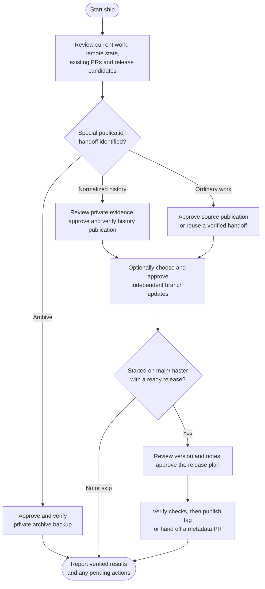

# ship

Publish reviewed work, optionally update other branches and prepare an approved versioned release. Ship separates pushing code, handing off PRs, releasing a version and verifying deployment, so the report makes clear what actually happened.

## Start the command

```text
ship
```

Use the prefix for your app or terminal from [Setup]({{ '/docs/setup/' | relative_url }}#run-a-command).

Start on the branch whose committed work you want to publish. Ordinary shipping supports **main/master, established feature and confirmed environment branches**, subject to project policy. Pending edits normally need committing first; main/master has an explicit option to commit reviewed safe changes before publication.

## Flow



Blocked actions stop their dependents. Successful earlier publications remain reported, along with anything not attempted.

## Publish the current branch

`ship-method` chooses **direct** or **pr**, independently of team size or branching layout. The default is `pr`. Both methods review the complete included work, destination, required checks and known automation before approval.

| Starting branch | `direct` | `pr` |
|---|---|---|
| **main/master** | Push the reviewed tip to its remote branch. | Publish one `ship/*` source branch and create or reuse its PR into main/master. |
| **Feature** | Push the existing feature branch. | Push the existing feature branch; choose integration PRs in the optional target step. |
| **Environment** | Push the reviewed tip to its remote branch. | Publish one `ship/*` source branch and create or reuse its PR into that environment. |

There is no automatic feature-to-main merge or main-to-environment merge just because of where ship starts. Already-published work needs no duplicate push, and already-integrated work needs no empty PR. Protection and required checks can block a selected method; ship does not bypass them.

For main/environment PRs, the source branch carries the reviewed local tip without rewinding the original branch. An established matching source and open request are reused. Pushing later fixes to a shared source updates **every open PR using it**; merged PRs do not receive those changes automatically.

## Optional branch updates

After source publication or a verified existing handoff, choose any applicable targets, or **None / Finish**:

| Starting branch | Optional targets |
|---|---|
| **main/master** | Confirmed environments. |
| **Feature** | main/master and confirmed environments. |
| **Environment** | main/master and other confirmed environments. |

With `direct`, ship integrates the same reviewed source into each selected target, checks the result and pushes it. With `pr`, it creates or reuses independent source-to-target requests. A main/environment helper is shared by its own-target PR and optional PRs; targets do not receive an older hosted source by mistake.

Targets are independent, with no required promotion chain or automatic main-first ordering. Each action needs review of its complete diff, policy and deployment effects. Optional integrations use the project-permitted `git-merge-strategy`, defaulting to squash; they never rewrite an already-published source to satisfy a rebase preference.

A verified PR is a completed review handoff. Ship does not wait for approval, merge requests or delete source branches. Optional targets receive no release tags, including when a feature or environment is integrated into main.

You can also ask to update environments from a specific already-published base or release. That route verifies the requested source instead of publishing unrelated work from your current branch.

## Optional versioned release

Releases are available only when ship **starts on main/master** and that same base contains the ready integrated work. An open code PR is not release readiness. After merging it independently, reconcile your local base and run ship again; no new code PR is needed merely to release integrated changes.

- **Work to publish:** finish its approved publication first, then offer a release when the base is ready.
- **Nothing to push:** offer only genuine unreleased work or missing actions for an identified release candidate.
- **Nothing to publish or release:** report that result without an empty commit, PR or tag.

Ship's version baseline is [Semantic Versioning 2.0.0](https://semver.org/spec/v2.0.0.html). It assesses the product's declared public contract in existing code/docs, including command behavior and supported formats where relevant. It reviews history since the applicable published release, or the complete scoped history for a first release.

For normal releases with major greater than zero, compatible internal bug fixes alone require patch, compatible public functionality or public API deprecation requires minor, and incompatible public API changes require major. Minor resets patch to zero; major resets both lower fields. Substantial private improvements may justify minor. Conventional Commit labels inform this assessment; actual compatibility takes precedence. The `perf` → patch heuristic is Helm policy, and dependency updates are assessed by their effect on this product.

Versions use `MAJOR.MINOR.PATCH`, optionally followed by `-prerelease` and `+build`. Core numbers and numeric prerelease identifiers cannot have leading zeroes; numeric build identifiers can. Suffix identifiers are nonempty, dot-separated ASCII letters, digits or hyphens. Ship uses SemVer ordering, including numeric counters: `2.1.0-rc.2 < 2.1.0-rc.10 < 2.1.0`. Build metadata does not affect precedence or make a prerelease; `2.1.0+001` and `2.1.0+002` are distinct versions with equal precedence. A `v` prefix is tag naming, not part of SemVer.

Initial versions, 0.x breaks, prerelease increments/graduation and non-bumping or mixed history need an explicit suitable choice. `0.y.z` is initial development; `1.0.0` establishes the public API's compatibility baseline. The FAQ recommends `0.1.0`, minor increments during initial development and considering `1.0.0` for production or a depended-on stable API. Ship preserves the project's explicit policy rather than forcing these recommendations. Custom versions need valid syntax and must not understate incompatibility; a deliberately higher increment needs explanation.

For prereleases and graduation, assess the intended normal version against the applicable published normal contract. Graduation notes cover cumulative changes since that normal release; intermediate prerelease notes may be incremental. Changing experimental prerelease-only interfaces does not alone force a major increase. Relevant historical releases with non-SemVer or ambiguous tags need reconciliation, not silent exclusion or guessed conversions.

Released contents stay immutable. A mis-versioned release needs an assessed corrective release, never replacement contents or retagging. Same-version resume completes missing actions while preserving already released contents and rechecking whether the chosen version still suits the integrated changes. Build-only changes do not meet Helm's new-release precedence policy; equal precedence does not establish the same candidate identity. Notes include relevant deprecations and migration guidance. SemVer recommends a documented minor deprecation release before later major removal; this advice adds no approval gate.

You review the version, exact tag, metadata changes, notes, destination and checks before release work. Skip leaves published code intact. If metadata edits require a PR, ship hands off that PR and stops tagging; after integration, rerun to continue the **same version**, unless changed content requires a refreshed version plan. Tag-only releases need no empty metadata PR.

Required checks must pass on the intended release content. Ship publishes only the approved branch/tag refs, then separately offers an available hosted release. It does not automatically publish packages, upload assets or declare deployment successful. Partial releases resume their missing actions rather than automatically bumping again or replacing an existing tag.

## Publish normalized history

For a [normalize](normalize.html) handoff, supply the exact private recovery path if it is not already known. Ship validates the old/new correspondence and recovery bundle, reviews each intended destination and all included committed work, then asks approval for history publication.

Required replacements use fixed expected remote IDs with `--force-with-lease`; ordinary divergence is never enough to authorize force. All affected branches are shown as selected, deliberately local-only or unresolved. A PR cannot replace remote IDs, regardless of `ship-method`. Tags stay preserved, and message/ID-only changes to already released work do not become a new product release.

## Publish an archive backup

A selected [archive](archive.html) backup uses its prepared payload and an approved existing private destination. Ship verifies payload publication and required recovery bytes, then commits and publishes a completion receipt. Local refs and remotes are preserved by default; cleanup is optional and separately reviewed.

This route ends after backup verification, with no ordinary branch updates or release tag. A later separately approved portable copy can include a Git bundle and available recovery inputs. Existing backups and interrupted publication steps are verified before any retry.

## Hosting support and your result

GitHub and GitLab have dedicated authenticated PR/MR and hosted-release procedures. Bitbucket, Azure Repos, Gitea/Forgejo and other hosts use the approved Git path with manual provider handoffs. Missing tools or authentication leave the affected action pending; ship does not install clients or create credentials automatically.

The final report separates source publication, each target, PR URLs, tags, hosted releases, checks and pending work. Ship safely returns to the original branch when possible, retaining actual drafts or conflicts if returning would be unsafe. Read-only/no-change runs do not switch branches.
