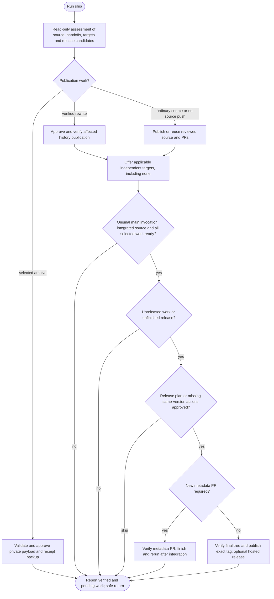

# /helm:ship

Publish reviewed work, handle verified history or archive handoffs and optionally create a release through one command.

```text
/helm:ship
```

In Codex, select Helm's ship skill. The workflow inspects pending work, presents concrete publication actions and asks for the approval each action needs. It changes no Helm settings and creates no shipping ledger. A push, PR handoff, integration, release and deployment are separate results.

## How it decides what to do

| Available work | Behaviour |
|---|---|
| Current work to publish | Publish through the configured direct/PR method, then offer independent branch targets |
| Verified normalization handoff | Validate the private recovery evidence and publish the approved affected histories with fixed leases where needed |
| Archive candidate | Ask to inspect that bundle for backup, then validate and separately approve its private payload/receipt publication; finish without a release |
| No source push, but target updates remain | Offer applicable target actions using the verified published source; never invent a push or PR |
| Published, integrated main has unreleased changes | Offer the proposed version/tag with Release / Skip release |
| An unfinished release exists | Offer only its missing same-version actions, without another bump |
| Nothing to publish or release | Report and exit; unknown evidence or an open review remains a pending limitation |

There is no release offer from feature/environment invocations or while the relevant main code/metadata PR is unmerged. A rerun after integration verifies the actual main commit and can finish the release without another code PR. No previous tag triggers first-release assessment, not an empty result. Non-bumping commit types can still receive an explicitly chosen version; they are not silently discarded.

### Safe discovery and continuation

Normalization is recognized from a trusted handoff or developer-identified private evidence. Exact Git-native metadata/ref clues may prompt an evidence request, but divergence or a marker alone never authorizes force publication. A fresh session may ask for the recovery path; ship never searches private directories, reconstructs proof or reads normalize's live ledger. Archive discovery checks only no-follow metadata at canonical/unsupported roots; opening a bundle requires its explicit inspection selection and packaged validation. Conflicting candidates need a scope decision. Missing/invalid selected evidence blocks dependent publication rather than falling back to an ordinary push.

After complete verified history publication, the caller may assess a separately approved main release using the proven old/new correspondence. Archive backup stays terminal and accesses only its selected journal/receipt. Existing receipts and successful pushes are verified and reused, not replayed. No new configuration, state schema or discovery file is added.

## Flow



Failures stop dependent actions and preserve earlier successes. The diagram grants no approval or check waiver. Before release after target checkouts, safely return to the original main branch; a failed return leaves release pending. PRs are never auto-merged or awaited. Deferred required checks remain unperformed, not passed.

## Investigation depth and coverage

Inspect the exact publication/release scope, complete required commit messages and relevant changes. Reconcile exact identities, not samples or counts. Ordered work normally stays with the parent; permitted independent read-only analysis can assist large scopes, while mutations remain with the parent. Follow the [shared investigation and exclusion rules](../setup/investigation.html). Inventories stay transient and unknown evidence stays visible; no generic Full/Gap choice or whole-code scan is added.

## Branch behaviour

`main` below is the actual resolved main/master. Every optional target receives the same reviewed published source, not another target's integration result.

| Current branch | direct core | pr core | Optional targets |
|---|---|---|---|
| Main/master | Push/verify main | Push one established ship/* source and create/reuse its PR into hosted main | Confirmed environments |
| Feature | Push/verify feature | Push/verify the existing feature; no helper/self-PR or automatic main PR | Main/master and confirmed environments |
| Confirmed environment | Push/verify current env prepared through normal development | Push one established ship/* source and create/reuse its PR into that hosted env | Main/master and other confirmed environments, excluding current |

For every selected target, direct means merge the pinned source into it, check and push; pr means create/reuse a source-to-target PR. None skips target updates; an original-main invocation still assesses release availability, while a feature can finish at branch publication without a PR. An aligned already-published branch gets no redundant core push or empty PR, but main may still have unreleased changes. Unknown/unsupported roles are not guessed from names. Stronger project rules may prohibit an edge or direct publication; report that blocker or offer a separately approved PR alternative, never bypass protection.

## 1. Review and publish the current work

Identify the actual worktree/repository, current role/base, HEAD, staged/unstaged state, in-progress Git operations, fetch/push mapping and signing/protection/check requirements. Source publication uses one explicitly bound push destination, not an assumed origin/fetch URL. Optional targets bind their own approved repository/destination; source approval does not authorize upstream pushes. Fork PR source/target identities and each actual main/env target are verified separately. GitHub/GitLab provide authenticated provider recipes; missing access is unknown/pending, never proof that no PR or policy exists.

A clean safe tree/index is required before mutations. Inspect pending path metadata first: operational records stay unopened, secrets/private keys/non-template env contents stay out of commits/publication, and unreviewable work blocks. Base retains an explicit reviewed safe preparatory-commit option; feature/env edits must already be safely committed. Nothing automatically stashes, resets, absorbs staged work or treats committed unfinished work as releasable. Review the entire included range/content and actual push/PR-preview deployment effects.

Write routes describe needed narrow fetch/history completion before it occurs, preserving unrelated refs/tags/configuration. Safely fast-forward a behind-only clean source when allowed, then reassess; divergence, unseen work or squash/rebase-equivalent prior integration needs deliberate reconciliation, not force, reset, automatic merge/rebase or a duplicate PR. Pin the actual reviewed source SHA and remote expectations. Run applicable approved checks, obtain concrete publication approval and verify actual remote results after success/uncertainty before retrying.

### Direct publication

Push only the exact current branch/ref and reviewed source SHA, with no-follow-tags and normal fast-forward policy. Do not merge it into main or merge main into the current env merely to finish core shipping. Already-published matching output is a verified no-op for source publication. Then offer optional targets and assess main's release availability. Core publication creates no version/tag/hosted release; those require approval of the later release stage.

### PR sources and repeat runs

A feature stays its own source. Push it and offer optional main/env PR targets; main is not mandatory and there is no PR to the feature itself.

Main/env uses one ship/* source at its reviewed local tip, targeting the corresponding hosted current branch. Local main/env is not reset/rebased to move commits, and no same-ref main-to-main/env-to-itself PR is opened. Already-integrated content gets no empty helper/PR. If no helper is needed because the current work is already published, that verified current ref may source optional targets.

Before helper creation, inspect complete applicable open-PR and explicitly identified retained-source evidence. Reuse a uniquely established helper tied to this original branch/work/own target, never by name prefix alone. Review actual graph/content, current remote tip and every open PR sharing it. Review fixes may fast-forward that same source only when its entire existing history/content is included in the approved new source. Helper-only reviewer changes absent locally, multiple/unknown matches, closed-unmerged requests or inaccessible lookup need reconciliation, not overwrite/force or another helper. If absent, create one unused ship/changes timestamp ref at the reviewed tip, with a collision suffix; no helper per target. Record reviewed original-branch/source context in the PR proposal without a new ledger.

If main/env's own PR merged but optional target PRs remain open, retain the proven applicable shared helper and skip the completed own-target request. Review its scope and any safe fast-forward update before publication. Do not replace it with hosted main/env and open parallel requests for the same work. Only when no applicable retained helper/handoff remains may an already-published current branch become the optional source. Changed/ambiguous work needs reconciliation, and historical requests alone do not justify helper reuse.

Publish/verify the source and create/reuse/read back the exact own-target PR through the provider recipe. After a partial push/API failure preserve and identify that source for retry. No automatic merge, update-branch API, source deletion or future review/CI wait occurs. An own-target handoff may be followed only by explicitly selected independent targets.

**Review feedback:** pushing new commits to the same feature/helper updates every open PR sharing it, not just the PR that received comments. Disclose that effect before publication and reuse existing requests. An already-merged target does not receive later fixes automatically: select a new PR/action for its genuinely new delta. Squash/rebase integration can leave local main/env with old IDs; reconcile deliberately rather than republish equivalent changes.

## Optional target selection and source semantics

Offer one complete role-appropriate target list with explicit None/Finish: one candidate uses Yes/Skip, 2–4 use a picker, larger lists use full numbered conversational selection. Never truncate or preselect main/production as consent. Preserve an already explicit unchanged selection. Before dependent writes show each full source-to-target diff/range, repository/ref/SHA, deploy effects, method and checks. Summary counts alone are not content review. Label feature-to-env, env-to-main/other-env and pending-main bypass implications.

Main/env PR mode uses its **same published helper** for every optional PR. Example: local main C is pending in helper→main; selecting staging creates helper(C)→staging, not old hosted-main(P)→staging. The reviews are independent: staging may accept C before main or even if main rejects it. Stronger project rules can block this edge, but ship never silently substitutes P or waits for main. Features similarly use their existing source for all targets.

Merging/PRs carry the complete source-to-target difference, not only today's edits; env-only configuration/history may reach main or another env. Local-edit eligibility is separate: env/test allow approved confirmed-environment work, while refactor keeps confirmed non-base environments source-inspection/report only; target selection bypasses neither command nor project policy. Helm's former blanket main-first/no-env-to-env policy is replaced by explicit reviewed eligible targets, not a new configuration flag. The old environment-promotion key stays preserved/inert and never restores chain ordering.

PRs track source refs: later source pushes may change every open request. Recheck the observed SHA at each handoff and disclose future movement rather than promise an immutable PR. Preserve source publication and earlier targets on optional failure; no recursive target propagation, auto branch cleanup or release follows.

## Optional main/master release

After verified publication/targets or a proven source no-op, assess release availability on an original-main invocation. Metadata/tag mutations require the current checkout to be that same actual main/master, reconciled with published integrated code, and explicit approval of the release plan or missing same-version actions. Feature/env invocations finish without a release offer or an automatic checkout to main. Unpublished application commits or an open code PR must finish ordinary publication/integration first. A subsequently approved direct release-metadata commit is the only normal new base delta within this route.

Detect an existing local tag, pending/merged metadata PR, original code PR with version changes, or identified failed release before computing another bump. An open metadata PR is an existing handoff, not a reason to create another. After integration, verify the accepted version/source on actual published main, including full content/provider proof for squash/rebase, and resume the same version. A failed direct candidate may retain its proven previously approved metadata-only delta for same-version continuation; it must not be resent through generic source publication, and unrelated unpublished application work still blocks. Ready integrated metadata needs no new code/metadata PR or empty commit merely to tag. Genuinely new metadata edits follow ship-method and may need a separate metadata PR; tagging happens after that integrates. Ambiguous candidate identity remains pending, never guessed from a name/version string.

## 2. Determine the version

Identify the existing canonical version source and tag convention for the selected product. Supported sources include confirmed plugin metadata, package.json, composer.json, VERSION and project-declared/tag-derived versions. Do not create version files/fields for tag-versioned projects or change independent packages. A reviewed tag-only release can proceed without an empty release commit.

Choose the appropriate published previous release and its proven reachable or mapped-equivalent boundary for the product and stable/prerelease/maintenance stream. An arbitrary nearest `git describe` tag or highest global version is insufficient. Keep the exact previous tag separate from its parsed version, preventing duplicated `v` prefixes. Metadata/tag disagreements, local-only tags and competing streams need explicit resolution.

After normalization, preserved published tags can be outside the new ancestry. Establish the prior release boundary from the exact tag and the verified private old/new mapping, proving its mapped commit and unchanged product tree. Keep the actual tag object fixed and use the mapped commit for the release range; never treat missing ancestry as a first release or count rewritten IDs as new product work. Multiple runs need explicit complete correspondence, not guessed/composed maps. Missing proof leaves release pending. Genuine unreleased changes remain assessable; a tree diff alone is not full history proof. Version analysis and notes use this same verified boundary.

Evidence of an existing prepared/partly published candidate offers same-version status/resume or Cancel before another bump. Starting a separate release requires an explicit choice and fresh assessment; uncertain tagless candidates are not inferred from HEAD.

First releases inspect full scoped history through the pinned source and confirm the intended initial version. An existing file version is a candidate, not an instruction to bump twice. With no version evidence, 0.1.0 is only a proposal. Missing/shallow history is unknown; an empty `..HEAD` range must not masquerade as no changes.

Read complete commit messages and relevant changes, not one-line subjects or a recent sample:

| Signal | Version decision |
|---|---|
| `!` on any type/optional scope, `BREAKING CHANGE:` or `BREAKING-CHANGE:` footer | Stable major candidate; explicitly resolve the project's 0.x breaking/graduation policy |
| `feat` | Minor candidate |
| `fix` or `perf` | Patch candidate |
| Other nonbreaking types | No automatic bump; an explicit release remains possible |
| Mixed/non-Conventional history or uncertain revert effect | Explain uncertainty and choose explicitly rather than inventing a bump |
| No new scoped changes | No new release; inspect/resume an existing one if relevant |

Highest applicable bump wins. Type/scope parsing follows Conventional Commits, including its case rules. Do not rewrite/normalize history. A `docs` label can describe the shipped product in a Markdown plugin, so it is not proof of no user impact.

Validate every proposed/custom version and full tag ref, not only manually typed versions. Check local/remote collisions, SemVer identifiers/precedence and stream policy. Build metadata alone does not increase precedence. Resolve prerelease increments/graduation and maintenance releases explicitly; same version means status/resume. A typed/custom version or 1.0.0 shortcut is not release approval.

## 3. Review the concrete plan

Prepare the exact intended metadata diff before release mutation:

- Update only the canonical version and verified companions. Supported narrow npm updates keep existing package-lock/npm-shrinkwrap root version records consistent without changing dependency versions/integrities. Uncertain companion updates block the affected release for explicit repair. No blind lockfile regeneration, lifecycle scripts or implicit `npm version` commit/tag operations.
- For plugin releases, update an unambiguous matching local marketplace entry's existing version when present. Do not invent optional fields or silently choose conflicting entries.
- Update only identified current own-product README mentions, preserving dependency/minimum versions, historical/pinned references, frontmatter, custom content and review markers.
- Respect existing changelog/release-tool ownership; update only requested or established changelog content, without creating a competing file.
- Derive reviewed reader-facing notes from the frozen release range, including relevant breaking guidance, features, fixes, performance and public security/non-CC changes. Do not publish private vulnerability details. Notes use safe file/stdin/structured input, never shell interpolation of commit text.

Show product/stream, source SHA/range, exact proposed version/tag, files/diff, notes, push repository/refs, publication method, channel/latest policy, required checks/protection, CI-owned actions and known/unknown deployment consequences. Offer Release / Skip release / Choose another version, plus a relevant 1.0.0 shortcut only within the four-option limit. Changed/custom versions return to the concrete plan.

Release approval covers only the described patch, commit/tag, branch/tag publication or the required release-metadata PR. No optional target actions follow release. Hosted-release API publication remains an explicit offer. Honor stricter project confirmations and reuse valid same-action approval. Material changes to scope, destination, content, version, targets or publication risk require refreshed review. Auto-commit, tool permission, timeouts and defaults never supply release approval.

## 4. Verify the final release tree

After release approval, recheck source/owner/policy/destination and apply only the reviewed patch. Run the established formatter/linter and full release test suite, plus actual configured required type/build/metadata checks. Do not install tools or invent new check categories. Publishing/deployment lifecycle scripts need their own scope; they are not harmless checks.

If no test framework is configured, obtain explicit consent to release without test validation. A configured failed/unavailable check blocks the release. Testing deferred means dependent release/publication stays pending, not passed.

Inspect final version/companions, docs/notes and the complete diff. Extra formatter changes require scope review; unrelated fixes use normal integration. Check the intended final tree after edits/formatting. Later hook/source changes invalidate the evidence and require the gate again, except verified metadata-only changes with applicable metadata validation and unchanged source/check inputs.

Stage literal approved paths and inspect the complete index. Commit only reviewed metadata, verify hook results/tree and bind checks to actual content. If the approved metadata patch needs a PR, create its source branch at shipping time before applying the patch and finish that verified handoff without a tag. Otherwise pin the verified integrated base SHA and create/verify only its approved annotated signed-as-required tag. A tag-only release has no empty commit/PR. Failed checks/commit/tag preserve pending work and stop dependent publication.

Release metadata edits under pr are committed on an unused ship/release source branch and published through the approved verified PR/MR handoff, then ship finishes without tagging, merging, waiting or promoting. Direct publication blocked by required PR policy offers that explicitly reviewed alternative without silently changing method. After independent integration, resume the same version; ship does not tag the pre-merge SHA assuming squash/rebase preserves it. Resume the same version against the verified integrated commit, reassessing changes/checks before tagging.

## 5. Publish exact refs and hosted release

Recheck approval, refs, tag objects, source and remote snapshots before publication. Enforce actual required pre-publication gates; do not invent a remote check requirement for an unprotected direct release. When checks need publication to run, disclose that ordering and its triggers, and keep dependent actions pending until results exist.

Prefer an atomic push of only the approved branch/tag refs to the selected single destination, with follow-tags disabled. No ambient refspecs, all-tags pushes, force or extra remotes. A newer published base containing the candidate is not moved backward.

Unsupported atomic publication offers an explicitly described sequential fallback or Leave pending. Other failures stop for diagnosis. Sequential branch/tag pushes are verified individually; partial success is retained and inspected before retry. Verify remote branch state, annotated tag object and peeled release SHA. Atomic Git updates do not include hosted APIs/CI/deployment or suppress duplicate triggers.

After verified Git publication, GitHub/GitLab hosted creation has its own exact repository/tag/notes/channel approval, subject to required checks and CI ownership. Existing matching releases are reused; mismatches/uncertain responses are inspected before any retry. No silent release-note updates, tag repair or extra version bump. Missing capabilities produce a same-tag manual handoff; they do not establish passed CI or successful publication.

## Hosting capabilities

| Provider | Workflow procedure |
|---|---|
| GitHub / confirmed Enterprise host | Authenticated repository-bound feature/env PR creation/reuse, exact-SHA checks and verified-tag hosted releases with explicit channel/latest behaviour |
| GitLab / confirmed self-managed host | Authenticated project-bound feature/env MR creation/reuse, exact-SHA pipeline evidence and create-only hosted release with readback |
| Bitbucket / Azure Repos / Gitea / Forgejo / other | Approved Git operations and provider-specific manual PR/hosted-release handoff; equivalent authenticated CI evidence may satisfy the shared gate |

GitHub creation uses `--verify-tag`, explicit host/repository, a notes file and the reviewed prerelease/latest flags. A maintenance or prerelease version is not automatically latest. Existing drafts are not treated as published releases.

GitLab resolves the numeric project ID, then paginates exact-SHA pipelines, their current jobs/bridge/downstream results and required external statuses. Required ref/event/policy matters: a green MR merge-result or unrelated tag pipeline is not proof for a published base/environment SHA. Missing pipelines, inaccessible required descendants or ambiguous included CI rules remain pending. Reading gates never executes manual deploy jobs or retries pipelines.

GitLab hosted creation verifies an existing published tag and uses a create-only API request without a tag-creation `ref`, or a suitably guarded supported interface. No automatic update of existing release notes, milestone closure, asset upload or registry publication occurs. GitLab has no equivalent GitHub prerelease/latest fields; its latest lookup uses release date. Disclose channel/latest implications and leave hosted creation pending if required project policy cannot be met, rather than fake dates or silently publish as stable/latest.

Provider procedures and primary references live in the packaged `prompts/shared/release-providers.md`. These are source instructions; runtime/native-provider validation remains deferred.

PR/MR creation binds exact source and target repositories/projects/refs to the authenticated host, reuses a matching open request and reads back its URL, open state and head SHA. Existing human content/templates stay intact. Unknown outcomes are inspected before retrying, and created requests are attached to the task when supported. No automatic login/install, auto-merge, source deletion or extra branch push is implied. Required release-metadata PR preparation remains a separate reviewed handoff.

For a fork feature, search/read in the verified target repository while checking the source fork identity; creation uses the provider's supported source/target fields. A changed head during creation/reuse leaves the actual request preserved but its result pending reassessment. Existing source-deletion/auto-merge instructions threatening retained permanent branches require reconciliation, without silently rewriting the request or provider settings.

## 6. Execute selected targets or an identified published source

After verified core publication, direct integrates the same pinned published source into each selected target independently, under the permitted configured method and commit policy. Check target/worktree safety and fresh refs; behind-only synchronization is allowed when safe, while divergence/unrelated changes stop. A published source cannot be rewritten by configured rebase: review a permitted merge/squash alternative or leave pending. Verify full resulting content/source inclusion or reviewed equivalence, run applicable target/integration checks, then publish/read back only its exact approved ref with no-follow-tags. No automatic version bump/tag/release follows a target merge into main.

PR target handling uses the exact published feature/helper/current ref and observed source SHA with each selected target as base. No target push/local merge/helper-per-target/source update/auto-merge/source-deletion request or later review wait occurs. Verify provider repository/ref/open-state/head identity before claiming each handoff. Movement/conflicts leave real requests preserved and results pending, rather than being silently repaired or called successful.

Main targets use actual integration gates. Environment targets require configured/applicable source CI success for this actual published feature/helper/base/env SHA/ref before integration or PR handoff. Older-main green results are not a substitute for a helper's unavailable checks. Required pending/failed/inaccessible evidence blocks the action. Later target PR/merge-result checks remain pending/not awaited; a source pass is not merged-target or deployment proof.

Inspect published-target inclusion/equivalence before calling a no-op; local inclusion alone cannot skip a required push. Reuse matching open PRs; after a prior merge, a genuinely new reviewed delta may need a new selected PR. Stop on the first failed/blocked optional action, retaining core success and earlier targets and naming the rest not attempted.

A failed check/push may leave a local integration candidate. Preserve/report its original source, pre-merge target/remote expectations, exact result/diff and missing action. Resume only from explicitly identified proven graph/content/remote/check evidence, completing the missing push rather than merging again. No message-only ownership, unrelated commit absorption, reset/stash/force or added ledger. Safely abort only this invocation's own merge if prior work stays intact, then independently verify safe return; otherwise leave manual recovery.

### Published source identified in the conversation

A published source selected in conversation preserves its published base/release→selected-env purpose. It skips current-branch core publication/own-target PR and creates no version/tag/release. Verify the selected source through the intended published base and review exact targets, including none, under the same gates. Direct uses the exact pinned tag/SHA; PR uses published base as head only when that current head equals the requested source. An older exact snapshot cannot silently become newer main or gain a snapshot helper. Report the additional range and leave the action pending, or accept a separate current-main plan. This explicitly scoped existing-source task finishes target work without proposing an unrelated new release.

Release has no automatic selector/promotion. Only a separately identified old approved target plan can resume missing target work; do not inherit its approval for another source. No source/target push or PR creation by itself certifies deployment.

## 7. Assess results and continue missing work

Ordinary status inspects current/identified source and remote refs, established helper/PR identity, actual source/target inclusion and selected partial actions without needing a tag. A matching open request is a completed handoff. An identified ordinary partial resume validates the original role/source/ref/observed tip, full diffs and target set, then offers only missing core or explicitly selected target actions. Without enough evidence, request the exact source/request identity rather than guessing a helper, creating duplicates or guessing an unrelated release candidate.

Assessment of a release candidate inspects authoritative local/remote refs, tag type/object/peeled SHA, metadata from that candidate's tree, hosted release, relevant CI and selected target state. Later checkout versions are not substituted for the release's metadata. They create no ledger. A destination containing the source proves inclusion, not deployment completion or ownership of an earlier operation.

Resume shows a per-action matrix and offers only missing actions under explicit approval. It can finish the same candidate's missing tag/push, hosted release without optional fan-out. Only an explicitly identified older approved target/promotion plan may continue its missing actions; release does not introduce targets. A matching open PR completes its review handoff; resume does not wait for or perform its merge. Inspect actual target inclusion and existing requests before repeating anything. Main advancing never silently upgrades an older exact-snapshot request. No repeated verified side effect, recalculated bump, fabricated old approval, overwritten tag/release or asset upload is allowed.

For a failed pre-tag candidate, require its exact commit from the current approved run/report or a developer-supplied SHA plus matching version/stream evidence. Do not guess from HEAD. For release metadata PRs, an open verified request completes only the handoff. After project integration, prove the version/source patch on the actual base, including provider merge evidence and full content comparison for squash/rebase, and use that verified integrated SHA. Missing proof blocks tagging even if ship-method changed. Unrecoverable identity/check evidence leaves a concrete handoff. Initial assessment never performs recovery writes.

Notes come from the correct frozen range/established changelog, not later unrelated commits. Inspect uncertain network/API outcomes before retry. A published base may have advanced while containing the release; never push it backward. Legacy lightweight tags are reported, never silently converted or replaced.

## 8. Report and safe return

Mutating routes attempt a return to the original branch only when independently safe: clean tree/index, no in-progress Git operation, existing unoccupied original ref/worktree, and no incoming tracked-path collision with ignored/untracked inputs such as local env files. Clean status alone is insufficient. If already there, verify without redundant checkout. Never force, reset, stash, discard/copy secrets, absorb drafts or pull/merge merely to return. A failed/unsafe return preserves actual work and gives a precise reason. Preserve feature/helper/base/env refs; no automatic local/remote deletion or PR source-deletion request. Read-only/no-op/cancel paths never check out for a cosmetic return.

Report core source publication/own-target PR separately from each optional target: actual source/ref/SHA, destinations, selected/none, observed heads, checks, verified/no-op/pending/failed/not-attempted results and exact continuation. Review/merge and deployment stay distinct pending/not-awaited outcomes. Optional failure does not undo core or earlier targets.

An accepted or pending release adds actual integrated SHA, version rationale, metadata PR/commit, tag identity, remote/hosted result and same-version pending actions. Publication/integration alone reports release not performed until the separately approved release stage succeeds. Required deferred checks remain unperformed, not green. No package/asset publishing is implied; no URL or local preflight proves deployment/runtime compatibility. Report actual original/current checkout and safe-return outcome, not an unconditional success.

## Publish normalized history

Ship selects the history publication procedure only from a validated normalization handoff and its identified private recovery evidence, independently of direct/pr. Divergence alone never selects it. Validate the private original/new graph, current-run map, recovery bundle, source tips and any explicitly reviewed later commits. Never load/migrate the live normalize ledger or rewrite history again.

Review one actual destination, every affected branch mapping/local-only status, fresh remote tips, containment in the preserved old history, exact new tips and all included work. Missing/uncontained evidence or a blocked intended ref blocks the proposed set. Replacing published commit IDs requires explicit fixed `--force-with-lease` approval; a PR cannot do it. Normal eligible updates/creations need their own stated scope, with fixed expectations protecting the coordinated transaction. No plain force, implicit refs, tags or rejected-lease refresh.

Prefer atomic bounded publication with no follow-tags. Unsupported atomic support needs separately approved sequential fallback. Recheck/read back each exact destination, preserve partial successes and original expectations, and resume only missing still-valid actions. Required policy/checks remain binding. The history procedure creates no tag or record PR. After complete verified publication, ship can assess its separately approved main release using the proven mapped release boundary. Partial/blocked publication stops dependent targets/releases; report remote consistency separately from local normalization and other-clone reconciliation.

## Publish an archive backup

After local [archive preparation](archive.html), run ship and select inspection of the detected archive for backup. It narrowly loads the selected bundle through the same root/schema/source/checkpoint protocol, preserving existing .archive/ runs and completed seals. Generic discovery probes only path metadata; selected inspection alone permits the narrow bundle validation. No restoration, moves, service stops, new archive run or unrelated ledger access occurs.

Verify the exact already-committed local payload and one actual private destination, complete captured/excluded history/artifacts, real recovery/LFS bytes, normal fast-forward eligibility, protection/signing/checks and push triggers. Show the payload-then-receipt plan and obtain explicit backup approval; local preparation approval grants none. Publish/verify the pinned payload, perform only expressly selected bounded post-backup cleanup, then commit/publish/read back the completion receipt. Keep names/remotes by default; no normal release tag, PR or environment promotion.

A narrow clean-state exception accepts only proven pending journal/receipt changes owned by the identified interrupted archive; unrelated work still blocks. Resume verified missing phases without recommitting/replaying the payload. Cursor 5 alone does not prove a seal. Previously completed runs replace nothing; optional external portable copies follow separate approval after receipt verification. See [archive finalization](archive/5-finalize.html) for full boundaries.

## See also

- [Git and CI behavior](../setup/git-and-ci.html)
- [Compatibility](../setup/compatibility.html)
- [`/helm:test`](test.html): coverage and testing workflow.
- [`/helm:manifest`](manifest.html): broader README maintenance.
