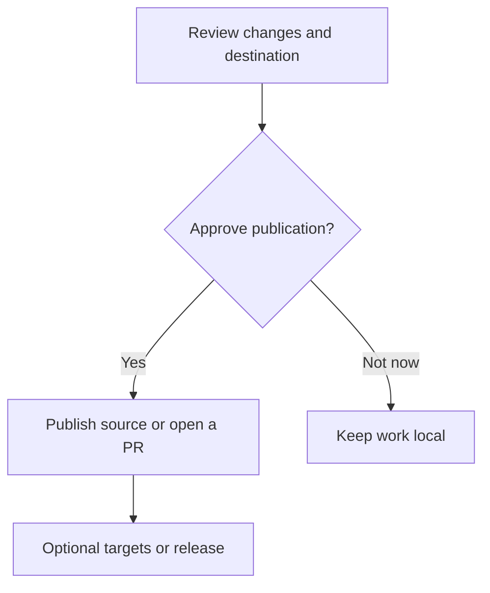

# ship



Use ship when reviewed work is ready to publish. It checks the source and destination, asks for concrete approval and reports what was actually published. Branch updates and releases are separate choices.

## Flow

Ordinary source publication follows this outline. History rewrites and private archive backups use the dedicated routes below.



## Start the command

```text
Codex → $ship    Claude → /ship
```

Use your client's [command prefix]({{ '/docs/setup/' | relative_url }}#run-a-command). Start on **main/master, an established feature or a confirmed environment branch**. Commit pending edits first; on main/master, ship can include a reviewed safe commit in the publication decision.

A fresh session is useful for a long-running chat, but ship still discovers pending work and verifies the source.

## Publish the current branch

[`ship-method`](../rules/git.html#configuration-owner) selects the approach:

- **direct:** publish the reviewed current branch.
- **pr:** publish source and create or reuse review handoffs. Main and environment work use a separate `ship/*` source; features use their own branch.

The default is `pr`. One publication review can cover a safe preparatory commit, the push or PR and any fully explained target choices. Each selected action needs its content, destination and effects in view. Required checks and protection still apply; unchanged approval is reused and already-published work needs no duplicate push.

Ship does not wait for reviews, merge PRs or delete branches. New pushes update open PRs sharing that source; an already merged PR needs a new handoff for later changes.

## Optional branch updates

| Starting branch | Optional targets |
|---|---|
| main/master | Confirmed environments. |
| Feature | main/master and environments. |
| Environment | main/master and other environments. |

Choose targets or finish without them. Fully prepared choices can appear in the publication review; selecting an explained action needs no second confirmation. Execution waits for verified source publication and required checks. Direct shipping integrates, checks and pushes each target; PR shipping creates independent review handoffs from the same source. There is no automatic main-first chain. You can also request updates from a specific published base or release.

## Optional versioned release

A release requires ship to start on **main/master with ready integrated work**. An open code PR must be merged independently before rerunning.

Review the version, tag, metadata, notes and checks in one release decision, choosing a tag alone or a tag plus its hosted release page when supported. Proposals follow [Semantic Versioning](https://semver.org/spec/v2.0.0.html) and actual compatibility changes; 0.x, initial and prerelease versions need an explicit suitable choice.

New tag annotations and hosted release titles normally match the exact tag. Notes explain the main benefit, necessary upgrade steps and relevant changes, with empty sections omitted. Prerelease and Latest settings are explicit choices, subject to hosting support.

Skipping a release keeps published source intact. If metadata needs a PR, tagging waits for integration. Published tags and versions stay immutable. Package publication, asset uploads and deployment are separate work.

## Publish rewritten history
{: #publish-normalized-history}

Ship finds and verifies [normalize's recovery evidence](normalize.html#your-result-and-later-publication), including across sessions in the same clone. If original rewrite evidence is unavailable, the same publication review can offer **Publish replacement history / Leave local**. It explains the uncertainty and includes a verified backup of the current remote history before replacement; approval also acknowledges that stated risk.

Publication uses fixed `--force-with-lease` expectations and separate approval. A PR cannot replace published commit IDs. Other clone owners receive sync guidance; existing tags stay fixed, and rewording released history alone creates no release. A replacement backup preserves what is overwritten without proving the original rewrite or a missing release boundary. If you already pushed independently, ship verifies the remote and skips satisfied publication without retrospective approval.

## Publish an archive backup

For a prepared [archive](archive.html), approve an existing private destination. Ship verifies the payload backup, then commits and publishes its completion receipt. Cleanup and portable copies are optional, separately reviewed work.

This route ends without ordinary branch targets or release tags.

## Hosting support and your result

GitHub and GitLab have dedicated PR/MR and release support. Other hosts use Git and manual provider handoffs where needed.

The result separates source publication, branch updates, PRs, releases and pending checks. Partial success is preserved. Interrupted work is checked before continuing under unchanged approval; new permission is needed only for missing or materially changed actions. Publication alone does not prove integration or deployment.
