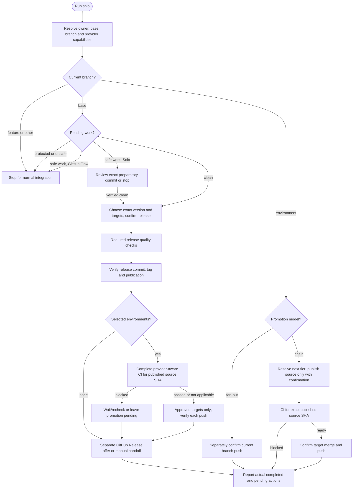

# /helm:ship

The release command: inspect commits since the last tag, calculate a Conventional Commits version, run quality checks, commit/tag/publish the approved release, and optionally promote it. Both hosts resolve the same configuration owner and actual main/master base. Ship never creates or migrates AGENTS.md/CLAUDE.md ownership or operational Helm state.

In Codex, select the same workflow from the skill picker. See [compatibility](../setup/compatibility.html) and [Git and CI behavior](../setup/git-and-ci.html).

## Flow

## Before starting

Resolve the configuration owner, invocation strategy, base branch and current checkout before mutation. For GitHub releases/promotion, check CLI/authentication/repository access and report missing capability without exposing credentials, installing tools or changing settings. Git transport access is separate from provider API access. Non-GitHub CI uses the applicable provider interface, never an automatic CI bypass.

On the base, require a clean release baseline. If work is pending:

- Protected `.helm/`, `.claude/helm/` or flat legacy records block ship without reading or committing those records. Leave them for their owning workflow/developer.
- Non-example env files, credential/private-key files, any secret-bearing pending content or unverifiable safety also block. An `.env.example` filename alone proves nothing. Report paths only; never emit values or raw secret-bearing diffs.
- GitHub Flow sends unrelated pending work through normal branch/PR review. The release-commit exception covers release metadata only.
- Solo may offer a preparatory commit only after locally verifying every pending change is safe and showing the exact safe diff/paths. Recheck the complete index and inputs, stage literal approved paths only, commit scoped logical units and verify a clean tree. Approval does not authorize tagging or pushing. Decline/failure stops, preserving actual work.

Do not merely exclude unsafe paths and proceed with a dirty release, or automatically stash/reset/discard them. Feature/other branches stop for normal integration. Environment branches use their promotion path, with no new version/release commit.

## 1. Select targets

On the base, discover qualifying remote environment branches. Fan-out offers all recognized targets; chain offers only first-tier staging/stage/uat/preprod, never a direct production hop. If only later tiers exist, report the missing first tier instead of guessing.

Use at most four options (recognized first tiers, then production/prod, then others alphabetically), disclosing any remainder for follow-up. One target uses Yes/Skip. Selection explicitly covers the described environment merges/pushes; it never waives CI. No targets means base release only.

## 2. Calculate and approve the version

Inspect the complete commit range since the last tag. Breaking changes (`!` or BREAKING CHANGE) bump major, feat bumps minor, fix/perf bump patch; other types are ignored for version calculation. Without a tag, use `.claude-plugin/plugin.json`, package.json, composer.json or VERSION in that priority, defaulting to 0.1.0 if absent. For a 0.x version, offer the existing v1.0.0 shortcut.

The calculated-version Confirm choice authorizes the concrete release. Manual/custom versions and the shortcut require format validation followed by confirmation of the exact version, base, targets and capability limitations. Typing a version is not approval. Cancel stops before release mutation; changed targets/version need renewed approval. Preserve stricter project push gates without duplicating an approval already covering the same exact action.

## 3. Quality checks

Apply Git rules' lint/format gates and the full test suite for the release. Configured checks that fail or cannot run block the release. If no test framework exists, the existing explicit release-untested question applies; absence is not a passing test result. These are workflow instructions for a future ship invocation, not evidence checks passed during source review.

## 4. Release and optional fan-out

Update the detected version, changed README references, and the matching marketplace version when plugin.json is canonical. Stage only approved release paths and reviewed formatter changes, never broad additions. Verify the full index/content and source baseline. Commit `chore(release): bump version to {version}`, create the approved annotated tag, publish the base commit and exact tag, and verify both refs. Stop on a failed commit/tag/push and report any partial publication; never silently start another version to retry.

Before selected-target promotion, require complete provider-aware CI for the exact published release SHA. Inspect all applicable runs, required checks and status contexts with pagination/current attempts. Missing GitHub Actions files or non-GitHub hosting does not prove no CI. Missing, failed, pending, inaccessible or unknown required results leave promotion pending; offer Wait/recheck versus Skip, with no Promote-anyway override. A published release remains published while promotion is pending.

Only a passed/not-applicable gate reaches target mutation. Recheck source SHA/CI and destination policy, merge the resolved base into each approved destination with a deploy commit, push only after success and verify its SHA. Stop on failure and report completed/pending targets separately.

GitHub Release creation remains a separate explicit offer after Git publication. Missing auth/access or a failed API call yields manual instructions for the same version, with no false success claim. Notes retain the workflow's feat/fix selection from the release range. Creating/retrying a GitHub Release never requires rerunning ship and cutting another version.

## 5. Environment-branch path

**Fan-out:** there is no chain to advance. Separately confirm the exact current-branch push and its deployment consequences. Cancel changes nothing; verify any successful remote update and report only evidence-supported deployment behavior.

**Chain:** resolve the next existing tier, asking for an explicit choice for unrecognized environments instead of guessing. Already on the final tier means no further promotion. Check CI for the exact published source branch SHA. An unpublished source may first need a separately confirmed source-only push; no target mutation is authorized by that push, and trigger filters may still leave required checks unavailable.

After the gate passes/not applicable, confirm the exact target merge/push. Recheck source SHA/CI, merge into the target and push only on success. Do not republish the already-verified source merely to continue the chain. Verify the target and safely return. Conflicts/failures stop and report actual state; no required CI waiver is offered.

## 6. Report

Report actual preparatory/release commits, version/tag and branch publication, CI status/source SHA, completed/pending environments, current checkout and GitHub Release URL or manual handoff. Never claim deployment from a failed/cancelled push. A blocked promotion does not undo the published release; retry its promotion through the appropriate environment/manual path after checks pass, not a new ship version.

## See also

- [`/helm:test`](test.html): test framework and coverage workflow.
- [`/helm:log`](log.html): shared project knowledge.
- [`/helm:manifest`](manifest.html): README maintenance.
