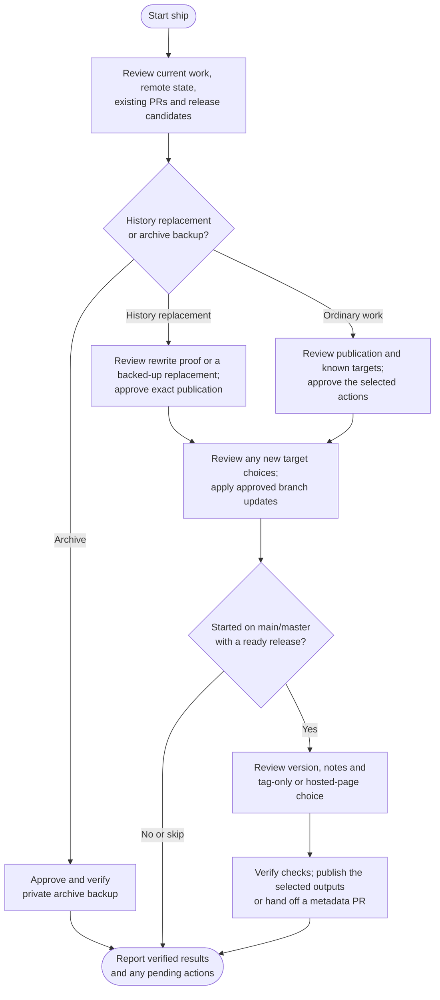

# ship



Ship takes reviewed local work to its publication destination. It separates publishing source, updating other branches and making a release, so you can approve each result with its actual effects in view.

## Flow

## Start the command

Start on main/master, an established feature branch or a confirmed environment branch. Pending edits normally need a separate commit first; on main/master, the publication review can cover a bounded safe commit and its push or PR together. A fresh chat can help with context, but the command still discovers unfinished work rather than assuming the project is ready.

History replacement and prepared archive backups use specialist publication reviews. A changed branch alone does not establish its cause or authorize either route; ship checks the actual source and destination.

## Publish the current branch

The project's [ship-method](../../rules/git.html#configuration-owner) chooses direct publication or a PR/MR handoff; the default is `pr`. Features use their own source branch. Main and environment work in PR mode use an associated `ship/*` helper so a real review handoff can be created.

Before publication, you review the destination, outgoing changes, refs, required checks and deployment effects together. The plan can include a safe preparatory commit and the resulting push or PR. Ship verifies the created commit against the reviewed changes and reports its actual ID before continuing under that approval. Unexpected changes require a revised review; auto-commit alone grants no publication permission.

Applicable target choices can join that review when their effects are already known. You approve only the listed actions you select, with the option to publish the source alone. History replacement and destructive cleanup retain explicit reviews, and required protections and checks remain binding.

Already-published source needs no duplicate push. Ship can create or reuse a matching review handoff, but does not wait for reviewers, merge the request or delete branches. Later pushes update open requests sharing that source; a request merged earlier needs a new handoff for new work.

## Optional branch updates

Choose independent target updates in the publication review when their complete effects are known, or once afterwards if they need later preparation. Selecting the explained actions supplies their approval; execution still waits for verified source publication and required checks. Main can target confirmed environments; features can target main and environments; an environment can target main or other environments. There is no implied main-first chain.

Direct mode integrates, checks and publishes each chosen target. PR mode creates independent handoffs from the same reviewed source. A green source check does not prove a target merge, review or deployment is complete. Partial successes are retained. On continuation, ship rechecks the remaining work and reuses valid approval; an interruption alone does not create another confirmation.

## Optional versioned release

A release needs ready, integrated work on main/master and its own decision. An open source PR must be merged independently first. If release metadata itself needs a PR, tagging waits for that integration too.

Review the semantic version, exact tag, metadata, release notes and checks together. Where supported, choose a tag alone or a tag plus its hosted release page in that same review. Ship creates a selected page only after verifying Git publication and required checks; tag-only selection does not lead to another page offer. Initial, 0.x and prerelease versions need choices suited to their actual compatibility. New tag annotations and hosted titles normally match the tag exactly; notes explain the benefit, necessary upgrade steps and relevant changes without empty boilerplate sections.

Prerelease and Latest settings are explicit. Published tags and versions remain immutable. Package publication, asset uploads and deployment are separate operations; a release page alone proves none of them.

## Publish rewritten history
{: #publish-normalized-history}

Ship first checks the intended destination against the local result. If you already pushed independently and the remote matches, it reports publication satisfied without another push or retrospective approval. That observation does not certify how the earlier rewrite was performed.

For a normalize run, ship verifies [the recovery evidence](../normalize.html#your-result-and-later-publication), including the approved correspondence and preserved refs. A PR cannot replace already-published commit identities.

If you rewrote history manually or the original proof is unavailable, the existing publication review offers **Publish replacement history / Leave local**. It shows the exact current remote and intended local commits, the changes being replaced, known effects and any remaining uncertainty. Your approval covers both the backup and that replacement; no additional risk-acknowledgement question follows.

After approval, ship preserves the selected remote histories in a private bundle under `Agent Helm/ship/<run-id>/` in your home folder and verifies recovery in an empty repository. Any necessary object retrieval stays in an isolated repository, leaving your working refs alone. If retrieval exposes material effects outside the reviewed plan, that changed decision needs review before publication. Backup failure, changed remote expectations and required-check/protection failures still stop the push.

A separately approved push uses fixed force-with-lease expectations. If the remote moved, the old approval is not a reason to overwrite unseen work. Other clone owners receive synchronization guidance; the private recovery material is retained. The fallback backup protects the remote snapshot being replaced, while the original rewrite remains unverified. Release analysis still needs independently established boundaries; successful source publication does not invent that missing proof.

## Publish an archive backup

For a prepared [archive](../archive.html), you approve an existing private destination. Ship verifies the payload backup before committing and publishing its completion receipt. The local payload and the receipt are distinct evidence of progress.

Cleanup and a later portable copy are optional, separately reviewed actions. A Git bundle alone does not contain external data, container images or LFS object bytes. This route ends without ordinary branch targets or release tags.

## Hosting support and your result

GitHub and GitLab have dedicated review-request and release support. Other hosts use Git with manual provider handoffs where needed.

The report separates published source, target updates, PR/MR status, release status and unresolved checks. It reads back actual results and preserves completed work after interruptions. Only missing permission or material changes to the approved action need another review. Published source is not proof of integration or a successful deployment.

## Explore the source

For implementation details, read [guides/ship.md](https://github.com/myowinthein/agent-helm/blob/main/guides/ship.md), [target updates](https://github.com/myowinthein/agent-helm/blob/main/prompts/ship/targets.md), the [release procedure](https://github.com/myowinthein/agent-helm/blob/main/prompts/ship/release.md) and [history publication](https://github.com/myowinthein/agent-helm/blob/main/prompts/shared/history-publication.md).
