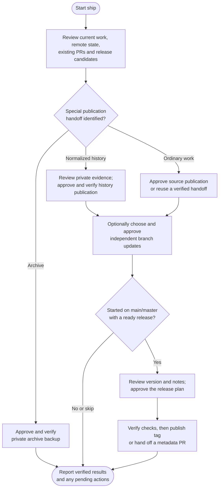

# ship



Ship takes reviewed local work to its publication destination. It separates publishing source, updating other branches and making a release, so you can approve each result with its actual effects in view.

## Flow

## Start the command

Start on main/master, an established feature branch or a confirmed environment branch. Pending edits normally need a separate commit first; on main/master, ship can offer a bounded, reviewed safe commit. A fresh chat can help with context, but the command still discovers unfinished work rather than assuming the project is ready.

Existing normalize evidence or an archive payload selects a specialist publication route. Those routes have different proof requirements and do not become ordinary pushes merely because a branch has changed.

## Publish the current branch

The project's [ship-method](../../rules/git.html#configuration-owner) chooses direct publication or a PR/MR handoff; the default is `pr`. Features use their own source branch. Main and environment work in PR mode use an associated `ship/*` helper so a real review handoff can be created.

Before a push, you review the actual destination, source commit, outgoing changes, refs, required checks and deployment effects. Auto-commit does not provide that approval. Existing protections and required reviews remain binding.

Already-published source needs no duplicate push. Ship can create or reuse a matching review handoff, but does not wait for reviewers, merge the request or delete branches. Later pushes update open requests sharing that source; a request merged earlier needs a new handoff for new work.

## Optional branch updates

After ordinary publication, choose independent target updates or finish. Main can target confirmed environments; features can target main and environments; an environment can target main or other environments. There is no implied main-first chain.

Direct mode integrates, checks and publishes each chosen target. PR mode creates independent handoffs from the same reviewed source. A green source check does not prove a target merge, review or deployment is complete. Partial successes are retained and missing work is rechecked before continuation.

## Optional versioned release

A release needs ready, integrated work on main/master and its own decision. An open source PR must be merged independently first. If release metadata itself needs a PR, tagging waits for that integration too.

Review the semantic version, exact tag, metadata, release notes and checks together. Initial, 0.x and prerelease versions need choices suited to their actual compatibility. New tag annotations and hosted titles normally match the tag exactly; notes explain the benefit, necessary upgrade steps and relevant changes without empty boilerplate sections.

Prerelease and Latest settings are explicit. Published tags and versions remain immutable. Package publication, asset uploads and deployment are separate operations; a release page alone proves none of them.

## Publish normalized history

Ship verifies [normalize's recovery evidence](../normalize.html#your-result-and-later-publication), including the approved correspondence and preserved refs. Missing or ambiguous proof needs reconciliation. A PR cannot replace already-published commit identities.

A separately approved push uses fixed force-with-lease expectations. If the remote moved, the old approval is not a reason to overwrite unseen work. Other clone owners receive synchronization guidance; the private recovery material is retained.

## Publish an archive backup

For a prepared [archive](../archive.html), you approve an existing private destination. Ship verifies the payload backup before committing and publishing its completion receipt. The local payload and the receipt are distinct evidence of progress.

Cleanup and a later portable copy are optional, separately reviewed actions. A Git bundle alone does not contain external data, container images or LFS object bytes. This route ends without ordinary branch targets or release tags.

## Hosting support and your result

GitHub and GitLab have dedicated review-request and release support. Other hosts use Git with manual provider handoffs where needed.

The report separates published source, target updates, PR/MR status, release status and unresolved checks. It reads back actual results, preserving completed work after interruptions. Published source is not proof of integration or a successful deployment.

## Explore the source

For implementation details, read [guides/ship.md](https://github.com/myowinthein/agent-helm/blob/main/guides/ship.md).
