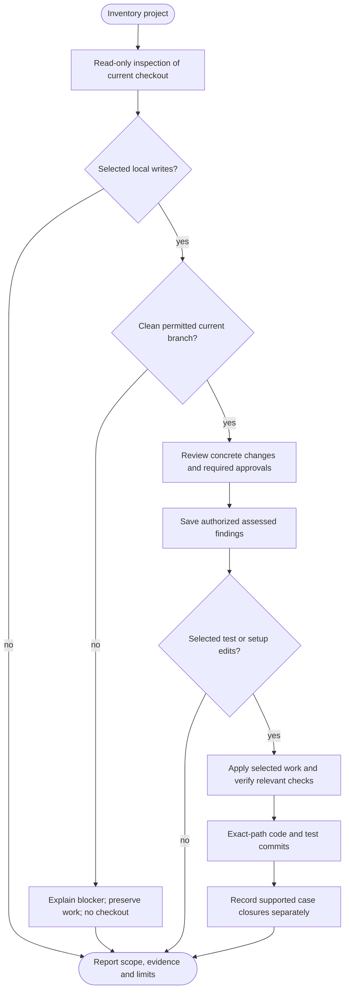

# /helm:test

Owning-state assessment prefers the shared [Python ledger helper](../setup/python-helpers.html) for complete schema-3 validation and digest-bound retrieval of relevant case indexes/full records, including closed history. The bundled implementation needs Python 3.11+. If Python/execution is unavailable, offer/reuse Set up Python / Continue without Python / Stop once per run. Approved equivalent tools may meet the same complete validation, safe-path, resource, retrieval and preservation checks, including canonical readback. Without equivalent evidence, continue independent assessment/planning with ledger-dependent edits/writes pending. Invalid data and broken packages retain their blockers. The helper writes/migrates nothing and proves neither semantic continuity nor passing tests. Existing approved writes still preserve the complete original; pages are not a replacement document. Report the actual validation method and unperformed automation.

Assess important behaviors and existing tests, then write or maintain approved cases for recent changes or the whole project. The workflow adapts to actual packages, languages and test layers. Assessment, successful execution, remaining gaps and publication are reported separately.

Choose testing techniques from project needs, including specialist checks when justified. Each recommendation needs a reason, a meaningful expected outcome and appropriate execution limits. This is not an all-types checklist: projects do not automatically receive every technique, new tooling or expensive test runs.

Command names use Claude notation. In Codex, select test from the skill picker to start the same workflow. Both hosts resolve the existing instruction owner, normally shared `AGENTS.md` with a `CLAUDE.md` import, including overrides and existing owners. Test does not create, migrate or edit instructions/settings. See [compatibility](../setup/compatibility.html).

Selected test/setup and eligible ledger writes stay on the same current actual main/master, established feature/maintenance branch or confirmed environment branch. Recommend targeted tests alongside a feature or against an environment branch's integrated snapshot, and main/master for project-wide Gap scan/Full scan; both scan depths remain available on eligible roles. Unresolved/unsupported roles need classification before writes. Project policies can further restrict eligibility; branch names alone do not establish role, ownership, safe runtime targets or resume permission. Actual script/service effects retain their approval and isolation requirements.

## Investigation depth and coverage

Full scan assesses every scoped component's behaviors and relevant existing tests in detail, tracing behavior-bearing implementation/configuration and cross-component flows. Gap scan assesses impacted logical behaviors, existing cases and consumers; it is not an automatic code quality review. Protecting assertions, fixtures and discovery need actual review, and executable glue/declarative behavior settings cannot be dismissed as metadata by name. Substantial Full scans prefer permitted read-only workers, with exact identity/depth, no-finding and unread reports reconciled by the parent. Test's eight-chunks-per-batch ceiling still allows further batches within actual host limits. Supported partial cases retain schema-3 persistence rules without global advancement.

Follow the [shared investigation and exclusion rules](../setup/investigation.html). Inventories and worker evidence remain transient; inaccessible required material is not silently excluded or marked complete. Finding counts, duration and reasoning effort do not prove coverage.

## Usage

```text
/helm:test
```

Start with static inventory, choose Gap scan / Full scan / Skip from the available baseline and coverage evidence, then review the findings and proposed cases. Select the cases to write or maintain before approving concrete test/setup changes or an assessment checkpoint. Developer answers are passed unchanged and never interpreted as shell code.

Initial source inspection works on dirty or detached checkouts, labelling exactly which worktree/staged/untracked or committed inputs were inspected. Without usable Git HEAD, only advisory static source review is available: no ledger access, helper execution, runtime-setup question, Git initialization or writes. Source inspection never checks out/updates/fetches, creates branches, refreshes the index, installs tools, collects/runs tests, imports project configuration, executes coverage/builds/services or writes reports/state. Inspection disables executable Git helpers and lazy object fetching or reports the affected read as unavailable. Output stays in conversation. The eligible ledger step separately permits read-only validation/retrieval; later writes revalidate the prepared source and approvals.

## Flow



The workflow can save authorized assessed findings before implementation, including when no tests are selected. Complete Full scan / Gap scan assessments can advance their appropriate source anchors; partial findings cannot advance project anchors. Later failure leaves the committed assessment intact and affected findings open. Pre-write cancellation, unapproved writes and genuine no-ops create no checkpoint or migration.

## 1. Inventory before preparation

Discover packages/services/workspaces, languages, manifests, actual package-manager declarations and lockfiles, build/module systems, existing tests/fixtures, runner scripts, validators, coverage reports and CI expectations. Inventory by test layer: a frontend runner does not establish backend coverage. Libraries, CLIs, plugins, scripts and data/configuration projects can use their existing native validation rather than receive a generic framework.

Honor effective user/project policy, then establish each selected package/layer's intended command from instructions, documented wrappers, package scripts, CI, configuration and existing tests. Evidence answers different questions: a CI job describes its own execution context; manager declarations, manifests, workspace configuration and actual lockfiles establish dependency ownership. No evidence source is conclusive for every tooling question. Explain stale or contradictory evidence and resolve material ambiguity before dependent setup/execution rather than guessing or migrating tools.

Keep a temporary working inventory of commands/working directories, runtimes, runners/configuration/adapters, package/environment managers and owning dependency/lockfile paths. Shared workspace install roots can differ from package execution directories. Multiple runners for different layers are valid. Reuse project-native/existing tools and conventions; [Go](https://go.dev/doc/tutorial/add-a-test) and [Rust](https://doc.rust-lang.org/book/ch11-01-writing-tests.html), for example, may need no added framework, but still need the correct runtime/dependencies.

This guide supplies evidence examples, not mandated frameworks, versions or install recipes:

| Stack | Inspect and reconcile |
|---|---|
| JavaScript/TypeScript | Scripts, manager declaration, actual lockfile/workspace root and unit/browser/E2E configuration. |
| Python | Metadata, requirements/constraints, actual environment/lock tooling, configuration, CI and unittest/pytest conventions. `requirements.txt` is not a universal lockfile. |
| PHP | Composer manifest/lock, scripts, dev dependencies and actual vendor/project test configuration. |
| Ruby | Gemfile/lock, Bundler context, wrappers/Rake tasks and existing test configuration. |
| JVM | Maven/Gradle modules, wrappers, plugins/tasks/profiles and unit versus integration lifecycle steps. |
| .NET | Solution/project, SDK selection, test host/framework/adapter and runner-specific configuration. |
| Go/Rust | Modules/workspaces, toolchains, build tags/features and native commands. |
| Native/mobile | Build targets/schemes/variants, SDK/device/simulator requirements, wrappers and platform-specific CI context. |

Describe readiness as declared but unverified, needing dependency restore, missing/incompatible runtime, missing configuration/adapter, or CI-only/another execution context, with evidence or unknowns. An environment directory or cached executable alone proves neither compatibility nor readiness; CI success does not prove local readiness. Respect intentional CI/container/platform contexts: propose scoped approved execution there or report pending work rather than forcing local installation. Static inventory runs no version/help probes, imports, dynamic configuration or test/task collection. Keep tooling discovery in conversation and working context only: no tool inventory in `test-log.json` or a new profile/config file.

Within the selected scope, inspect requirements, supported runtime/platform/browser matrices and existing specialist tooling/configuration, such as fuzz/property generators, benchmarks/load scripts, visual/accessibility checks, mutation tools and migration fixtures. This stays static: a declared tool is not executed to discover whether it works. Code can reveal a candidate risk but cannot establish an invented performance target or support promise.

Restore or repair an already declared suitable setup rather than replacing its framework because local dependencies are missing. If no suitable runner exists, consider native support first, then offer a stack-specific recommendation, meaningful alternatives and Skip, with at most four choices. Show the operation, compatible dependencies and their basis, configuration/scripts, owning manifest/lockfile paths, exact commands/working directories and lifecycle/network effects. When choosing/changing tools, check official compatibility guidance for the project's actual versions; do not assume latest. Missing evidence leaves that decision pending, without blocking independent static planning. Unknown stacks receive a bounded manual recommendation, without automatic installation or toolchain replacement.

The initial snapshot is advisory. Identify the actual main/master base separately from the current checkout and its role. The write destination is that same eligible current branch. A later source/branch change requires reassessment and updated approval; tests proposed for feature code must not silently be written against unrelated main code.

## 2. Own case ledger and validity

Only the invoked test workflow uses current schema-3 `.helm/test-log.json` through the shared state procedure. Strictly validate the complete canonical document and preserve unknown/untouched data. Unsupported paths or versions block with [upgrade guidance](../setup/upgrading.html); there is no old-shape reader, converter or automatic reset.

Schema **3** records individual findings rather than one priority per file:

| Root field | Purpose |
|---|---|
| `schema_version` | `3`. |
| `assessed_commit` | Complete project Full scan / Gap scan source baseline, null/absent until established. Not test success. |
| `full_scan_commit` | Latest complete whole-project source assessment, null/absent when none exists. |
| `cases` | Meaningful gaps, maintenance needs and required manual checks, including resolved/obsolete records. |

There is no Gap scan counter or Full scan boolean. Recommendations use actual impact/uncertainty, not scan counts, fixed file counts or commit distance. Derive counts from records; do not store duplicate summaries, branch identity, tool inventories or root pass/fail results. This is a current-state ledger with Git retaining earlier versions, not an execution journal or catalogue of every good existing test.

| Case fields | Purpose |
|---|---|
| `id` | Stable unique opaque ID, such as `g-` plus a random UUID; independent of path/title/priority. |
| `expected`, `basis` | Expected behavior/result and concrete evidence references or owner decisions. Unknown intent names the unresolved question, not an invented answer; code-only intent stays labelled inferred. |
| `paths` | Related source/configuration/fixture/consumer paths; one gap can span files and need several tests. |
| `priority`, `reason` | high/medium/low/unknown, with the actual project basis or missing information. |
| `action`, optional `layer` | add/improve/consolidate/replace/remove/manual and the fitting test layer. |
| `state`, `assessed_commit` | open/resolved/obsolete and the source of the last actual case judgment. |
| Optional `tests` | Actual existing/protecting file-and-case references, not merely planned outputs. |
| Optional `blocker` | `{kind, note}`: clarification/execution/verification, last observed while open and revalidated next time. Not a tooling cache. |
| Optional `decision` | `{type, note, date, commit}` for an explicit human deferred/accepted-risk choice. Retain real contextual facts; nonselection creates no decision. |
| Optional `closure` | Required for resolved/obsolete: `{reason, refs, method, outcome, commit}`; runtime proof also records `command` and `scope`. |

For example, this dummy structure contains one open finding; the commit and paths are illustrative:

```json
{
  "schema_version": 3,
  "assessed_commit": "aaaaaaaaaaaaaaaaaaaaaaaaaaaaaaaaaaaaaaaa",
  "full_scan_commit": "aaaaaaaaaaaaaaaaaaaaaaaaaaaaaaaaaaaaaaaa",
  "cases": [
    {
      "id": "g-b79901f4-445a-49cb-a072-22eecbbf4b71",
      "expected": "Retrying an order cannot create a second charge",
      "basis": ["docs/orders.md#idempotency"],
      "paths": ["api/orders.ts"],
      "priority": "high",
      "reason": "The documented one-charge contract lacks retry protection after a handler change",
      "action": "improve",
      "layer": "integration",
      "state": "open",
      "assessed_commit": "aaaaaaaaaaaaaaaaaaaaaaaaaaaaaaaaaaaaaaaa",
      "tests": ["api/orders.test.ts::retry"]
    }
  ]
}
```

Five gaps in `orders.ts` become five independent records. Resolving two changes those two records; the other three retain their own priorities, blockers and decisions. Already adequate protection needs no new finding. Keep alone proves neither adequacy nor passing tests. Preserve unknown fields and closed records, validate IDs/types/states/evidence and serialize deterministically by ID; no automatic pruning or file-level priority summary replaces the cases.

Unsupported formats stay untouched. A selected fresh start is explicit one-time maintenance outside the test command; it preserves a recoverable before-image and creates no empty replacement ledger. The next owning run assesses actual source before recording findings.

Validate commit availability/ancestry as identities against the relevant inspected snapshot, without fetching, accepting revision expressions or guessing replacement IDs. Later accepted code/evidence commit B is checked against the current accepted lineage, including reviewed setup/test overlays; it need not precede frozen assessment source A. New anchors use full commit IDs. An invalid/missing global baseline offers Full scan or Skip; only complete Full scan can replace it. Invalid/stale case or closure context needs scoped reassessment. Unchanged source bytes alone do not prove current context: tests, fixtures, requirements, dependencies, configuration and consumers matter. Historical proof is not a current pass.

Preserve IDs through demonstrated semantic continuity. Check expected behavior, evidence, layer and actual related code rather than path/title equality or fuzzy renames alone. Surface uncertain duplicates and same-ID/different-meaning conflicts for explicit reconciliation; never auto-union branch histories or overwrite human decisions. Reopen only from evidence of lost/changed protection, removing the active old closure while Git preserves it. Out-of-scope records remain intact. New guidance alone neither certifies more techniques nor forces a rescan.

## 3. Scope and behavior assessment

**Gap scan** assesses the complete diff-derived impact scope from a valid `assessed_commit`, including new findings and affected existing cases through relevant source/test/configuration/dependency/consumer context. Internal changes can affect unchanged callers; bounded searches are evidence, not a fixed-hop guarantee. Also show all retained open backlog, grouped/count-summarized if large, so unchanged unselected findings are not stranded. Reassess retained findings before proposing current work; unrelated backlog does not require a whole-project rereview or block the diff-derived anchor. Broad uncertainty recommends broader review.

When advisory review includes staged/worktree/untracked inputs, inspect those selected changes beyond the committed range and report their separate provenance. A baseline-to-HEAD diff cannot describe uncommitted work; it never becomes committed checkpoint evidence.

**Full scan** statically reviews every component of the whole project. Use read-only module chunks in batches of at most eight, queueing enough batches for complete coverage. Workers respect actual host concurrency, or the same review runs sequentially with that fallback reported. The parent reconciles duplicates and cross-module flows. On Codex the parent owns all writes; test writing is sequential on both hosts.

At an existing Full scan / Gap scan choice, use the [shared scan-depth selection](../setup/compatibility.html#shared-scan-depth-selection) with existing permitted facts. The helper grants no additional state access or execution permission.

No tests, no established prior Full scan, an unusable baseline or insufficient/broad impact evidence recommends Full scan. This workflow's separate Full-scan anchor supplies its own prior-coverage fact, without making unknown Full-scan history mean never-Full for other commands. A local unknown may instead need clarification or case reassessment. Age, counts and Gap scan frequency alone never trigger Full. Explicit supported depth remains subject to complete affected-surface coverage; malformed/conflicting state still needs its existing reviewed resolution, never an automatic reset through Full. Preserve the independent assessment and case-closure checkpoints. Keep questions within four options with faithful paging/chat fallback.

An empty diff produces a scoped statement such as "No new relevant changes found since {snapshot}; retained open findings remain." Offer relevant backlog work, reassessment or Skip. Absence of records does not prove complete testing; never report "tests are up to date" from an anchor alone. A genuine no-op does not refresh judgment/anchors or create an empty ledger commit.

An explicit request for another technique or existing-test maintenance, or changed requirements/support/risk context, can justify work even with unchanged production files. Consider it before declaring a no-op, within the requested scope. A plugin update alone does not force a review or checkpoint write.

Assess these perspectives when actual behavior or requirements justify them:

| Perspective | Typical evidence/cases |
|---|---|
| Main flows/contracts | Core calculations, API/CLI/library outputs and compatibility. |
| Boundaries/invalid inputs | Actual validation rules, limits, empty/malformed data and invariants. |
| Failure/recovery | Error contracts, dependency failure, timeout/retry and partial failure. |
| Access/data isolation | Roles/tenants, authorization and sensitive-data boundaries. |
| Persistence/state | Transitions, transactions/rollback, serialization and lifecycle. |
| Integration/user flows | Component/service contracts, cross-module journeys and relevant UI/accessibility. |
| Time/concurrency/idempotency | Asynchronous ordering, duplicates and repeat-operation guarantees. |
| Performance/resources | Defined constraints or evidenced regression risks, using bounded checks. |

Assess the residual protection missing from each case, with its expected contract, failure consequence, credible likelihood/exposure and evidence:

| Tier | Criteria |
|---|---|
| **High** | Evidenced severe exposure even if rare, or meaningful consequences with credible high regression likelihood/exposure. |
| **Medium** | Meaningful but recoverable supported-behavior failure without evidence warranting High. |
| **Low** | Useful protection against minor consequences/limited edges; no filler cases. |
| **Unknown impact** | Important intent/impact unconfirmed; record `unknown`, name the missing information and clarify. |

Folder/category labels, auth/money wording, silent wrong output, layer, LOC and coverage percentages are not automatic tiers. Escalation needs actual project evidence; adequately protected critical code needs no duplicate High proposal. Setup difficulty/cost/readiness stays separate from risk. Pure cleanup is labelled and normally excluded from the risk recommendation unless requested or necessary for meaningful verification. Choose the lowest fitting unit/component/integration/contract/E2E layer that proves the behavior. Review existing assertions before adding cases; no test-per-file or universal checklist applies.

### Maintain existing tests

Keep useful existing tests by default, regardless of who or what generated them. Review cases connected to the selected behavior and affected dependencies, without turning Gap scan work into a whole-project cleanup. Full scan does not require assigning an action to every test. Static review can justify keeping a test but cannot certify that it passes; distinguish reviewed-kept, unresolved/deferred and unassessed cases.

| Action | When it fits |
|---|---|
| **Keep** | The test protects a current contract/past regression, or evidence is insufficient to change it. Preserve unclear cases while resolving intent. |
| **Improve** | Keep the valid purpose while strengthening assertions/inputs, fixtures, isolation, cleanup or reliability. Correct stale expectations only from established intended behavior. |
| **Consolidate** | Share structure or parameterize related cases while preserving relevant inputs, assertions and guarantees, with identifiable cases. |
| **Replace** | Change the testing mechanism while mapping required protection to the replacement and explaining any layer/guarantee change. |
| **Remove** | Confirmed obsolete behavior has no remaining supported contract, or established remaining tests provide equivalent protection at the required layer/environment, with no unique required guarantee lost. |

Compare assertions, fixtures, layers, support targets and regression purpose. Similar code, matching line coverage or a lower test count is not proof of equivalent protection. Unit and integration tests may exercise the same lines for different reasons. Failing, flaky, slow, skipped/xfail, generated or unknown-provenance status is not evidence of obsolescence. Preserve uncertain cases and clarify or defer; never remove a live regression to make the suite green.

The existing plan names exact files/test names, durable finding IDs or clearly mapped report aliases, action, evidence/reason, relevant issue/history references, preserved guarantees and checks. Consolidation/replacement includes an old-to-new scenario/assertion and relevant fixture/snapshot mapping; removal identifies the obsolete contract or exact remaining coverage. Inspect CI selectors/tags, case-ID filters, shared-fixture consumers and documented references before renames/deletions. Unknown consumers or uncertain equivalence leave the affected change pending. Support files are removed only with established lack of remaining consumers and exact-path approval. Preserve meaningful regression context in surviving cases or the reviewed commit description.

This uses the existing concrete plan approval, including its listed removals. There is no five-option/per-case picker or extra universal confirmation. Material scope/mapping changes need renewed review. Include the detailed maintenance proposal before approval. Production fixes/redesign remain separate work.

### Select techniques from project needs

The eight perspectives remain the behavior checklist where applicable. Levels, purposes and techniques overlap: an API security case can also be an integration test. Select the lowest layer that demonstrates the actual risk; a unit test cannot substitute for a browser-compatibility or visual check.

Use this guide when evidence or an explicit developer need justifies it, rather than generating work for every row:

| Project evidence or need | Techniques to consider | Expected outcome to establish |
|---|---|---|
| Parsers, serializers, calculations or complex input rules | Property-based tests and fuzzing | Meaningful invariants, semantic results or relevant robustness/error guarantees |
| UI/design components and supported browsers | Accessibility, visual regression and browser/device checks | Applicable accessibility behavior, reviewed visual references and confirmed support targets |
| Libraries/CLIs supporting several runtimes/OSs or packaged distribution | Compatibility, installation and upgrade tests | Public contracts and supported installation/upgrade behavior on selected targets |
| APIs, roles, untrusted inputs or tenant boundaries | Contract, negative and security abuse cases | Correct responses and enforced access/data boundaries |
| Queues, jobs and distributed operations | Concurrency, retries, idempotency and controlled failure/recovery | Agreed ordering, duplicate handling, recovery and preserved state |
| Database migrations or versioned data | Migration, upgrade and backward-compatibility tests | Expected transformations and promised compatibility on synthetic old/new data |
| Defined latency/throughput/resource needs or hot-path regression evidence | Benchmarks, bounded load and justified stress/soak tests | Agreed measurements/limits for a specified workload and environment |
| Critical code with potentially weak assertions | Scoped mutation testing | Detection of relevant artificial faults, with surviving/equivalent/inconclusive cases reviewed |
| Business acceptance or ease-of-use questions | Acceptance scenarios and human usability review | Agreed acceptance criteria and separately evidenced human findings/sign-off |

The existing plan explains each recommended technique's evidence/risk, layer/scope, expected outcome and its source, paths/tooling, limits and manual requirements. Show material exclusions/prerequisites without a separate all-types picker, fixed recommendation cap, new mode or configuration. Reuse native/existing tools first; missing tools use the same approved setup flow. Unknown criteria use the existing clarification/characterization/defer choices, not invented requirements. An identified unselected technique remains a gap where applicable, not an invented human skip or unfinished selected work.

### What useful specialist tests require

- **Property/fuzz tests:** meaningful properties and constrained inputs derived from contracts or clarified requirements, with replayable failures and tool-provided settings/seeds/corpus where available. A successful round trip or crash-free run establishes only that property. Keep only approved synthetic regression fixtures, excluding secrets and uncontrolled generated output. [Hypothesis explains property-based input generation](https://hypothesis.readthedocs.io/en/latest/tutorial/introduction.html).
- **Visual, compatibility and accessibility checks:** agreed supported targets and controlled rendering conditions. New/changed visual references require review against intended output; generating a reference is not itself a regression pass. Reuse valid supplied approval. Automated accessibility findings cover tested rules/surfaces, while needed keyboard, assistive-technology, real-device, usability and business acceptance work remains explicit. [Playwright documents rendering differences](https://playwright.dev/docs/test-snapshots); [W3C explains the need for human accessibility evaluation](https://www.w3.org/WAI/test-evaluate/).
- **Performance and recovery checks:** agreed workloads/thresholds from requirements, comparable evidence or explicit decisions, plus meaningful before/after state and supported upgrade paths for recovery/migrations. Without a performance criterion, offer labelled measurement/characterization rather than an invented SLO or pass. A successful process exit alone is insufficient. [k6 defines explicit performance pass/fail thresholds](https://grafana.com/docs/k6/latest/using-k6/thresholds/).
- **Mutation and security checks:** investigate survivors and distinguish equivalent, uncovered and timed-out mutation outcomes rather than chasing a perfect score. Run mutants in isolated tool-owned copies; never commit mutated production code. Security tests establish the checked boundaries, not a penetration-test or security certification. Intrusive scans/pentests need concrete scope and authorized targets. [Stryker explains how mutation testing exercises a test suite](https://stryker-mutator.io/docs/).

### Expected behavior and approval

Use intended contracts, documentation, existing tests, relevant code evidence and developer clarification. Code may contain a bug; a real validation branch can still justify a meaningful boundary case. Batch contradictions/unknowns and offer Clarify, explicitly Characterize current behavior or Defer. Characterization labels current behavior and limitations; it does not replace an intended contract or authorize a production fix. Unknown intent stays open with a clarification blocker; a deferred/accepted-risk decision requires an actual contextual human choice. Nonselection never creates a human decision or resolves a gap.

Separate adequately covered behavior (cite where), kept useful tests (no adequacy/pass assumption), unclear intent, execution blockers and required manual work. Record meaningful findings, not every kept test. Group proposals by module/behavior with stable IDs or temporary P1/P2 aliases, expected outcomes, priorities/reasons, actions, layers and prerequisites. Aliases map to durable IDs when recorded and never encode priority. Category/tier/layer views overlap; count a finding once.

The same selection flow applies to Full scan and Gap scan. Small sets go directly to their concrete plan/approval with free-text refinements. Larger sets offer at most four scope choices:

| Choice | Candidate scope, not authorization |
|---|---|
| **Recommended** | Exact listed ready proposals and reasons. Full scan normally starts with actionable High; Gap scan also includes relevant Medium in the changed surface. Say when empty and omit the empty option. |
| **All ready proposals** | Listed ready ordinary work, including labelled cleanup. |
| **Choose cases or groups** | IDs, module/behavior/category or tier filters and exclusions, using faithful picker paging or chat. |
| **None** | No test/setup edits. Findings can still be saved only if an assessment-only write is authorized. Not Cancel or ledger permission. |

Show blocked, unknown-intent and expensive/intrusive work separately; explicit inclusion needs its reviewed setup/limits/manual requirements. Recommendations/defaults never count as selection. Preserve independent choices above host limits through paging/chat, without forcing whole modules or pretending both hosts have native multi-select.

Before approval disclose required setup, shared fixtures and coherent replacement mappings by finding ID. Do not add independent unselected cases; excluding a prerequisite requires revising/deferring dependents. Members keep their own priority even if a coherent unit is sequenced by its highest-priority member. Explicit cleanup requests remain eligible.

For example, a dummy Full scan could report:

| Report alias | Area | Priority | Proposal | Readiness |
|---|---|---|---|---|
| P1 | Orders | High | Improve retry protection against duplicate charges | Ready |
| P2 | Auth | High | Add cross-tenant invoice access protection | Ready |
| P3 | Orders | Medium | Add the documented stock-restoration check | Ready |
| P4 | Orders | Low | Consolidate equivalent fixtures, preserving assertions | Cleanup |
| P5 | Checkout | High | Add a required browser regression case | Execution blocked |

The recommendation can list P1/P2 while retaining all five findings. Replies such as "P1 and P3", "Orders except cleanup" or a tier filter narrow scope; explicitly including P5 also requires reviewing its setup. The concrete approval names only selected work, its prerequisites and the ledger writes. P1/P2 are display aliases, not permanent finding/test IDs. Each priority still needs actual project evidence; these examples assume the stated contracts/exposure.

Show the complete selected plan: source/destination, expected results/evidence, exact paths, actions/mappings, residual gaps, setup, safe commands/targets, coverage, commit units and assessment/closure ledger writes. **Write or maintain selected tests and approved setup / Cancel** remains the editing approval. Scope selection alone is not authorization; reuse existing exact approval. Ledger-only work uses **Record assessed findings / Cancel** only when its concrete write is not already authorized. Git commit policy remains binding; no per-case/per-stage duplicate gates.

## 4. Prepare writes and execution

Selected writes validate clean current actual main/master, an established current feature/maintenance branch or a confirmed current environment branch under the [local-edit procedure](../setup/git-and-ci.html). Unresolved/unsupported roles block writes without switching/updating/creating one. Preserve the current canonical-input rules without absorbing user work; revalidate policy/state on the same branch.

Pin `{assessment_head}` immediately after preparation and before framework/setup/test commits. If source SHA/branch or policy differs from the advisory plan, show the change and reassess/reapprove before writing. Keep the original source baseline through all approved local test/setup/record commits and revalidate it after later history changes. Setup/test outputs are reviewed overlays; unrelated source drift invalidates dependent work. Re-discover affected runner/config context after setup without moving the source baseline to an install commit.

Before test/setup edits or execution, save the authorized assessment on the prepared/revalidated eligible source using §6. Reconcile all meaningful in-scope findings, generate stable IDs/map report aliases and preserve unselected, blocked, unknown-impact, closed and out-of-scope cases appropriately. A complete Full scan sets both anchors to `{assessment_head}`; a complete Gap scan advances only `assessed_commit`. Partial findings can be saved with neither root anchor advanced. Missing/invalid baseline needs complete Full scan for replacement. A declined/failed write/commit stops later writes. This accepted checkpoint survives later test failure/cancellation; identical existing state needs no repeat commit. Old-schema rebuild/reset needs its concrete review/authorization.

Before execution, inspect exact scripts/configuration and actual database, filesystem, network, container/service and cleanup effects. Use isolated synthetic data and owned temporary resources, never assumed disposable production/shared targets. Keep credentials private. Reuse existing safety confirmations where evidenced; ordinary approved safe tests need no duplicate gate. Unknown safety or missing capability blocks affected execution, not static planning. [Pytest's fixture guidance](https://docs.pytest.org/en/stable/how-to/fixtures.html#safe-teardowns) illustrates why cleanup must be designed for failures too.

For selected specialist work, specify relevant limits in the same execution plan: fuzz/input size and iteration/time limits; load rate/concurrency/duration and stop conditions; mutation scope/operators/timeouts; platform/browser targets; fault/migration resources, recovery and cleanup. Identify the actual approved test environment, expected network/cost effects and artifact paths. Full scan/general test approval never implies expensive stress/soak, operational fault injection/recovery drills or intrusive scans. Infrastructure, CI/deployment matrix changes, shared/live targets and artifact uploads need their own reviewed scope and authorization. Missing prerequisites leave affected execution pending. Ordinary approved bounded tests, including simulated failures in isolated fixtures, retain the existing approval gate.

### Setup operations and verification

Distinguish these operations in the approved plan:

| Operation | Meaning |
|---|---|
| Restore | Recreate declared dependencies with existing selections and project policy. Missing local dependencies are not a request to update versions. |
| Add | Introduce justified missing tooling/adapter/dependencies, with compatible versions and exact scripts/configuration/dependency changes. |
| Repair | Correct an evidenced configuration/setup fault without replacing legitimate runners or layers. |
| Upgrade | Deliberately change selected versions/toolchain requirements and review compatibility and affected files. Never infer it from restore failure. |

Use the actual manager, dev/test groups and dependency policy at the correct package/workspace owner. Review exact commands/working directories, expected configuration/manifest/lockfile changes, downloads, lifecycle/pre/post hooks and cleanup. Test commands can implicitly restore/build/download too: see [uv's synchronization behavior](https://docs.astral.sh/uv/concepts/projects/sync/), [Gradle wrapper downloads](https://docs.gradle.org/current/userguide/gradle_wrapper.html) and [.NET test's restore/build behavior](https://learn.microsoft.com/en-us/dotnet/core/tools/dotnet-test-vstest). Inspect the actual project versions and flags rather than assuming every command has those defaults. Existing concrete approval can cover known setup effects and verification together; only changed scope/effects need updated review.

Do not incidentally create lockfiles, switch managers/registries, refresh unrelated dependencies, install globally, replace/provision runtimes or fetch credentials. Runtime/toolchain provisioning needs explicit reviewed scope/authorization, which can be included in the same plan. Offline/private-registry/auth failures stay blockers without policy/security bypasses. Unexpected restore changes require reviewing the actual diff before dependent work; preserve drafts rather than resetting/deleting files. Setup failure leaves completed steps and affected work honestly pending.

After approved setup, read back changes, resolve the intended command/configuration again and verify the actual runtime/runner and relevant configuration/adapter using safe output and real discovery/execution within scope. Install success, executable presence, version output or exit zero alone is insufficient. Do not invent a smoke fixture, weaken filters/assertions or force unrelated cases. Zero cases is limited evidence; if no cases exist, execution verification awaits approved real cases while independent planning/authoring can continue. A real failing test can prove the runner executed without proving tests passed; separate discovery/configuration/harness failures from behavior failures. Reuse relevant baseline/cluster results rather than requiring duplicate runs.

Commit an accepted setup unit separately under invocation auto-commit policy only with reviewed tracked changes and required checks passed. Restore-only work with no tracked changes needs no empty setup commit. Deferred/unavailable required verification leaves drafts uncommitted. Later cancellation preserves actual work and any previously accepted commits.

Run a scoped safe existing-test baseline after approval, recording command, collection/results and pre-existing versus environment failures. No existing cases is disclosed rather than called a pass. Full-suite baseline is required only by impact or project policy.

Coverage is optional evidence. Existing reports need source/command/scope provenance and stale/partial labeling. Approved execution may collect relevant measured coverage, reporting tool/command, packages/files and meaningful inclusions/exclusions, including omitted untouched files. Unknown is not zero or an estimated percentage. Respect existing thresholds and do not silently change instrumentation/exclusions. [Google's coverage guidance](https://testing.googleblog.com/2020/08/code-coverage-best-practices.html) explains why coverage alone cannot establish quality; [Jest's configuration](https://jestjs.io/docs/configuration#collectcoveragefrom-array) shows how file selection affects the report.

A complete static Full scan can exist without runtime coverage. Unreadable/omitted components prevent whole-project anchor advancement, though supported partial findings may be saved. Runtime limitations and unfinished selected writing keep affected findings open and block final completion/closure, not an already accepted assessment checkpoint.

## 5. Write and verify clusters

Process bounded coherent approved units sequentially by priority/domain and reviewed prerequisites. Unrelated features do not share a commit merely because both are High or use a shared fixture; each member retains its own priority and selection. Extend useful tests and preserve conventions.

Assert meaningful observable results/errors/invariants that can detect the intended regression. Use controlled fixtures and boundary mocks without mocking away the behavior. Keep data independent, time/randomness controlled, async waits tied to real conditions and cleanup reliable. Avoid implementation-mirroring assertions, tautologies, blindly accepted snapshots and real side effects. Parameterize when readable, with useful case IDs, rather than forcing a three-case rule. [Playwright's best practices](https://playwright.dev/docs/best-practices) give examples of observable behavior, isolation and reliable assertions.

For each cluster, write/improve only approved cases and verify them against the baseline. Preserve old protections while replacements are developed and verified where compatible; run relevant old and new cases together where contracts remain valid and the harness permits. Repair generated tests, approved existing-test weaknesses or harness mistakes within scope. A passing replacement alone does not establish equivalence. Never weaken valid expectations, skip failures, bless snapshots or change production behavior just to make green; production fixes/refactors require a separate reviewed plan.

Retire only approved old cases after mapped replacements or established remaining coverage are verified. A truly superseded expectation need not pass first: the plan must establish the changed/obsolete contract independently of current code, name the affected case and receive owner approval. Its failure/irrelevance must belong to that assertion, not setup or other live guarantees. Record the old failure and why it was superseded, without claiming it passed. Corrected expectations stay specific and preserve other required assertions. Pure removal has no replacement to invent: verify contract/consumer evidence and relevant remaining cases.

After retirement, inspect actual discovery/selectors and scenario/assertion preservation, explaining removed, renamed or parameterized cases from reporter evidence. Raw counts and coverage alone do not prove preservation. Run required affected checks on the final cluster tree before committing; unrelated required failures remain blockers. Review the complete index/diff and commit only exact verified paths, including approved removals, under invocation policy. Use a domain scope such as `test(orders): maintain duplicate-order tests`. Failed checks leave actual edits pending, without an automatic rollback or success claim.

After clusters, verify the justified combined affected/regression scope, including shared fixture/config effects and required project checks. Reuse current evidence; broaden/repeat checks when changed inputs, failures or risk justify it, without full coverage per file. Missing/failed required verification stays pending. If execution is unavailable, explicit approval can permit unverified drafts only, retained uncommitted without closure/final completion; a supported accepted assessment checkpoint remains. An explicit execution deferral is respected.

With verification deferred/unavailable, preserve existing protecting cases, assertions and required fixtures. Approved additive drafts can follow that draft-only path, but retirement through consolidation/replacement/removal remains described in the plan as pending verification. Do not weaken assertions or change discovery to substitute an unverified draft. If interruption/failure follows an approved retirement edit, preserve/report the actual partial tree under the pending-work rules; do not claim originals remain intact or reset user work automatically.

Inspect actual specialist evidence too: exercised generator domains/replay details, approved visual references and comparisons, tested matrix entries, measured workloads/results against criteria, mutation outcomes and before/after recovery assertions. Incomplete/aborted runs, harness failures and unresolved human review are distinct from a pass. A bounded run without findings is not a universal guarantee. Selected unresolved reference approval or required manual acceptance keeps work pending; optional unselected human follow-up is reported separately.

After coherent accepted work and required checks, record closures only for the specific findings addressed. Adding one test does not close every gap in its file; shared tests must actually prove every cited guarantee. A code commit awaiting its ledger update is pending, not permission to infer runtime success on a later run.

## 6. Assessment checkpoints and case closures

There are two persistence stages: save assessed findings before implementation, then record supported closures after accepted work. Test failure never retroactively invalidates a completed assessment. Declined/failed writes/commits, execution failure or source drift stop subsequent writes; preserve actual drafts, earlier accepted checkpoints and legacy sources.

| State | Required evidence |
|---|---|
| **open** | An identified need remains, including unselected, blocked, unknown, deferred/accepted-risk and pending-verification cases. |
| **resolved** | Its specific need is addressed: closure reason tested/equivalent-protection/static-contract/manual-signoff, refs, actual method/outcome and accepted code/evidence commit. |
| **obsolete** | Current contract and consumer evidence establishes that the finding no longer applies; require an obsolete closure, not disappearance from a report. |

Closure `method` is runtime/static/manual. Runtime proof includes the actual command, exercised scope/target/context and outcome; static protection/contract evidence is labelled static and never implies a passing test. Manual evidence requires real sign-off, not plan approval or automated inference. Preserve test-retirement guarantees. Keep closed records, priorities/reasons, evidence/actions and last actual judgment; no automatic pruning or per-file collapse. Human decisions retain their genuine context. Clear an open blocker when overcome or closed, while revalidating changed context next time.

Verify required checks on the relevant final inputs and accept exact-path code/test commit B. Confirm B matches the executable inputs/tree tested, including relevant configuration/fixture/environment effects; unchanged evidence need not be rerun solely because a commit changed the SHA, but later input changes require affected checks again. A subsequent ledger-only commit C records `closure.commit = B`, never its own future hash or blame-based inference. Existing accepted evidence commits can be referenced when no code change was needed. Batch supported closures after coherent work; no empty code commit is required.

Historical closure proves its recorded snapshot/scope only. Lost reporter evidence, unavailable/rewritten anchors or changed context need reassessment. If interruption leaves tests with an open case, inspect and establish closure evidence next time rather than replaying old approval. Reopen only when protection/requirements demonstrably changed, removing the active stale closure while Git retains prior versions. Do not synchronize/union branch histories automatically.

Only complete Full scan advances both anchors. Complete Gap scan advances its source anchor for the fully assessed diff-derived impact scope, retaining other backlog/provenance. Partial assessments change only supported in-scope cases and neither root anchor. Case judgments/human decisions come from actual assessment/choices, never fresh timestamps for reused data. Source anchors remain the pre-output source, not a later test or bookkeeping tip.

Before each update require the same clean eligible branch/no in-progress operation and verified expected lineage/owned overlays, retaining only the current canonical-input rules. Pending unverified drafts or unrelated source/index changes block persistence without staging/stashing/resetting them. Compare meaningful data: dates/order/default-only changes, own ledger HEAD changes and migration opportunities alone create no write. Inspect actual owned overlays before excluding bookkeeping; user tests/configuration/fixtures remain actionable, other workflows' records opaque. Preserve unknown fields and every out-of-scope/unaffected case. Old-schema replacement is bounded to its explicit reviewed rebuild/reset.

Recheck canonical bytes/existence, source and the unsupported-path tripwire on the same eligible branch before each update. Strictly validate schema 3 and intended ID-keyed changes, preserve all untouched cases/unknown fields and verify readback/commit. No alternate-path read or old-file retirement occurs.

Unapproved/pre-write cancellation and genuine no-ops write nothing. Authorized partial findings can be saved without project-anchor advancement. Accepted earlier checkpoints remain truthful historical records after later interruption; pending selected work is not final success.

## 7. Git finalization and continuation

Use local completion only with the declared assessment scope complete, verified intended commits/combined checks, supported closures/checkpoints accepted, clean state and no failed/declined/unfinished selected work. Assessment-only completion needs no invented runtime pass. Unselected backlog is not unfinished selected work. A partial scan remains a partial handoff even when findings were saved; it does not claim completed assessment. With no meaningful ledger delta, report actual outputs/handoff rather than create a synthetic checkpoint or advance anchors. Shared helper/other-command policy stays intact.

Finish on the same permitted branch after verifying local outputs and eligible commits. No push/PR question, branch creation/switch/update, integration, environment promotion, return checkout or branch cleanup follows. Remote/provider access and published source IDs are not prerequisites merely to finish locally. Invoke [ship](ship.html) separately when the whole selected work is ready to publish. See [Git and CI behavior](../setup/git-and-ci.html). Preserve actual source/judgment/decision provenance; never invent source IDs to make saved ancestry pass.

Genuine no-write/no-commit paths perform no branch cleanup. Declined/failed commits stop subsequent writes, integration, push, promotion, checkout and cleanup even when earlier clusters succeeded. Retain drafts and the current branch unchanged.

Continuation uses explicitly identified retained work, checked against actual commits/diffs, source baseline, current policy, own state and drafts. Branch names alone do not authorize reuse. Avoid duplicate successful clusters and parallel replacement branches; ambiguous provenance yields an exact completed/pending handoff rather than an improvised resume engine.

## 8. Report actual results

Report Full scan / Gap scan depth and actual scope, exact snapshot/branch/base, packages/layers/perspectives assessed and missing, stable IDs/alias mappings, per-case priority reasons, open/resolved/obsolete/reopened findings, historical versus current evidence and actual human decisions. Name new/extended tests and behaviors, distinguishing declaration blocks from actual collected/executed parameterized cases; use reporter evidence or mark counts unknown.

Report reviewed-kept versus out-of-scope/unassessed tests, proposed/selected versus applied improve/consolidate/replace/remove actions, their reasons and preserved/superseded guarantees. Include relevant old-to-new/remaining-coverage mappings and actual case/fixture/selector changes. Distinguish declined proposals, unresolved intent and draft/pending-verification work, without an inventory of every existing test or a new report artifact. Static Keep is not a test-pass claim.

Show recommended/selected techniques and reasons, actual layers/targets/matrix entries, expected criteria and material exclusions, including unassessed prior technique coverage. Separate automated results, unrun/unavailable checks and required versus optional human review/sign-off. Automation alone does not certify accessibility, usability, security or business acceptance.

Verification is **command → outcome and scope**, or **not run: reason**, with baseline/new failures, skips/todo/xfail/unexpected/flaky outcomes as known, pending checks and measured/static/unknown coverage. A process exiting successfully does not prove every relevant test executed.

Where produced, include generator domain/settings/replay evidence, reviewed visual references/comparisons, workload/duration/metrics/thresholds, mutation outcomes and before/after recovery evidence. Use actual reporter output and provenance; never invent measurements, per-type pass counts, thresholds or human approval. Keep sensitive data out of reports/artifacts. There is no default report/profile artifact or new per-technique ledger.

Report relevant package/layer commands and working directories, dependency owners, actual setup operation and outcome: declared, restored/added/repaired/upgraded, runner verified, tests passed/failed or blocked/unrun, with evidence and unexpected changes. A successful install is distinct from a working runner and passing tests. Restore-only work may have no tracked changes or setup commit. Tool inventory stays transient; a case blocker or actual closure command is not a tooling cache/profile.

Separate drafts and setup/test commits, the pre-implementation assessment checkpoint and later supported case closures, actual method/command/scope/evidence commits, schema-3 or pending reviewed rebuild, migration/commit status and unchanged anchors for partial assessments. Show recommended/selected versus unselected/blocked/unknown/cleanup/manual groups with scoped counts, without implying publication, integration, CI or deployment. Include actual current checkout, retained work and exact next action. No-write/Skip still reports; proposals, partial assessments, unverified drafts and published review branches are not completed testing/publication.

## See also

- [Git and CI behavior](../setup/git-and-ci.html): preparation, review, publication and handoffs.
- [Compatibility](../setup/compatibility.html): instruction ownership and per-command state migration.
- [Refactor](refactor.html#refactor-vs-test): owns guarantee-preserving test-code maintenance and selected-refactor companions/guards; this command owns missing/stronger protection and changes of testing layer/strategy. Neither command invokes the other or shares ledger access; establish useful guards before risky refactoring when practical.
- [Ship](ship.html): verifies applicable release checks on the intended final tree.
