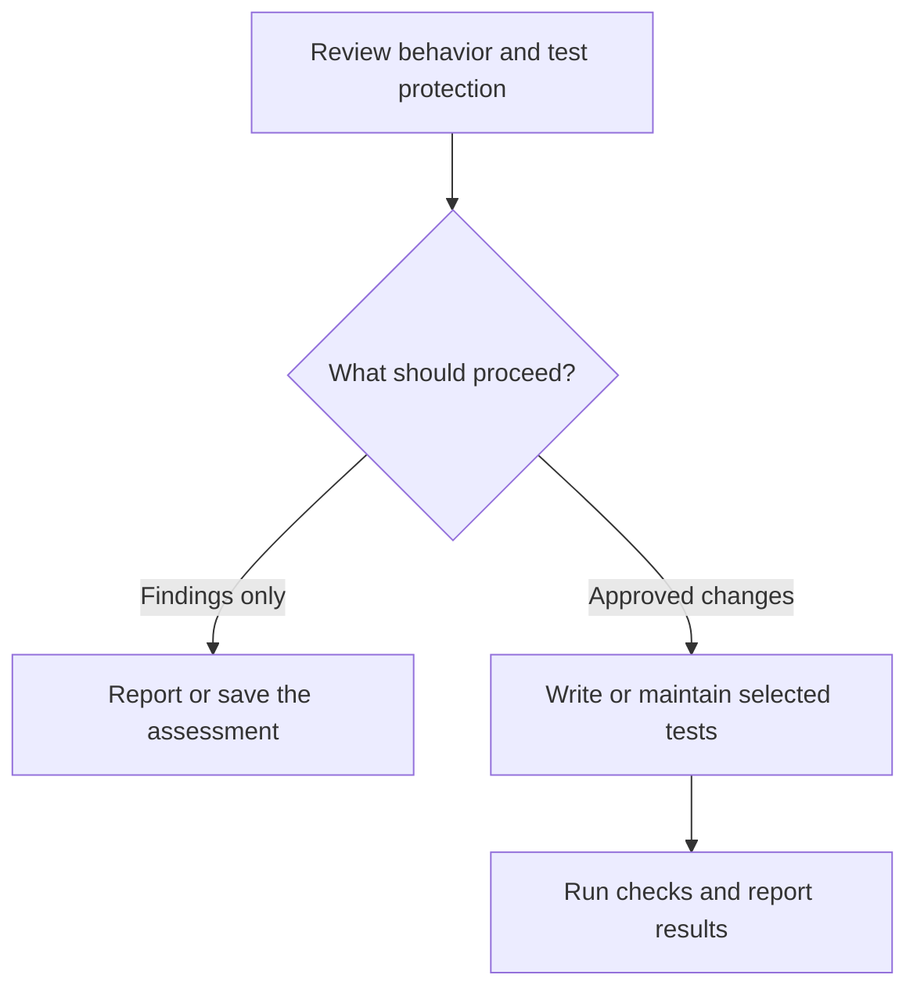

# test



Use test to find missing protection and improve useful existing tests. You choose which cases and tooling changes to implement after reviewing the findings.

## Flow



## Start the command

```text
Codex → $test    Claude → /test
```

Use your client's [command prefix]({{ '/docs/setup/' | relative_url }}#run-a-command). Static review works on the current checkout. Edits and saved assessments need a clean, eligible **main/master, feature, maintenance or confirmed environment branch**.

## Choose the review scope

- **Full scan:** assess scoped behavior and the protection provided by existing tests.
- **Gap scan:** follow changes since a valid saved assessment, including affected consumers and older open findings.

A first run or unusable baseline may need Full scan. Review itself is static: it does not run project code, test discovery or installers merely to find gaps.

## What kinds of tests can it suggest?

The approach follows the project. Suggestions might be unit or integration cases, an accessibility check, a useful fixture, or changes to the runner and tooling.

Existing tests can be improved, consolidated or replaced. Removal requires proved obsolescence or equivalent remaining protection; a failure is not a reason to weaken assertions.

## Priorities and your selection

Findings explain the risk left unprotected, separately from implementation cost. Choose recommended cases, all ready proposals, a subset or none. Review the actual cases, paths and setup before changes. Unknown behavior needs clarification or an explicit decision; production fixes remain separate work.

## Tools and verification

Existing tools come first. Installation, upgrades and service/database effects stay within the approved plan and isolated targets. When required checks cannot run, findings remain unverified and approved additive drafts stay uncommitted.

## Your result and the next run

You get test changes, actual check results and remaining work. An approved assessment saves findings before implementation; each case closes only when its protection is verified. Skipped or blocked work stays visible for later runs. Coverage is reported only when measured.

Work finishes on the same branch under your local commit policy. Use [refactor](refactor.html#refactor-vs-test) for behavior-preserving code maintenance and [ship](ship.html) for publication.
