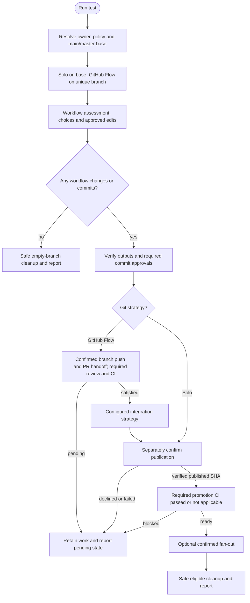

# /helm:test

Detect the test framework, load the run ledger, assess existing coverage and recent activity, then write tests scoped to recent changes or the full project. Commits per scope with `test({scope}):` messages, per [git.md's Auto-Commit rule](../rules/git.html#auto-commit).

Command names below use Claude notation. In Codex, select the same Helm workflow from the skill picker. Configuration comes from the existing memory owner, including through a bridge; [compatibility notes](../setup/compatibility.html) describe host-specific behavior.

## Flow

## Steps

### Before starting

Resolve the existing configuration owner through the shared runtime before Git actions: normally `AGENTS.md`, reached through `CLAUDE.md`'s import on Claude or directly on Codex, with legacy owners, overrides, and recognized fenced configuration supported. Read `git-strategy` (default: GitHub Flow), `git-auto-commit` (default: false), and GitHub Flow's `git-merge-strategy` (default: squash) there. The command creates or edits neither instruction file nor Helm configuration.

Use the [shared Git and CI flow](../setup/git-and-ci.html): resolve the actual main/master base and invocation policy, require a clean setup, use a unique GitHub Flow branch (unused suffix on collisions), and revalidate destination ownership/configuration after checkout. Solo stays on the base without a temporary branch. Preserve real drafts/commits on failure; only a genuine no-write/no-commit exit safely returns before deleting its empty branch.

Every cluster/framework/ledger commit follows invocation auto-commit. Declining/failing a commit or state checkpoint preserves actual work and stops subsequent writing/finalization.

### 1. Detect test framework

Scans for known config files and dependencies (e.g. `vitest.config`, `jest.config`, `phpunit.xml`). Also detects the project's coverage tool (`coverage.py`, `nyc`, `jest --coverage`, etc.) for use in the Full Scan step. If a framework is found, proceeds to the ledger load. If not found, forms a recommendation from what that scan already found (language, package manager, existing build tooling and module system, monorepo structure if any) rather than a generic default, then proposes the best-fit framework for the detected stack and lets the user pick or skip.

If a framework is chosen, installs it directly as a dev dependency, detecting the package manager from the project's lockfile (`package-lock.json` → npm, `yarn.lock` → yarn, `pnpm-lock.yaml` → pnpm, `composer.lock` → composer, `poetry.lock` → poetry, `requirements.txt` → pip, `Gemfile.lock` → bundler) rather than just telling the user how to install it themselves. If the install fails, stops and reports the error instead of proceeding with a framework that isn't actually installed.

### 2. Load ledger

Uses `.helm/test-log.json` and checks both legacy locations, `.claude/helm/test-log.json` and `.claude/test-log.json`. Validate every existing copy, applying the v1 conversion below in memory before comparison. Equivalent copies can be deduplicated; differing histories require explicit reconciliation. With no candidate, proceed with empty history. Path migration is separate from schema conversion and happens only at Step 6's successful authorized write, verifying canonical state before retiring legacy sources in the same commit. Skip or an incomplete run does not migrate; declining the commit preserves legacy sources and reports any canonical draft as pending. No other command's state moves.

The ledger stores:
- **`schema_version`**: bumped only if this structure changes in a future release. A ledger with `schema_version: 1` or none at all (the shape before this field existed: separate `findings`/`full_scan_findings` arrays and `last_test_run_commit`/`last_full_scan_commit` fields) is converted in memory on load and persisted only at an eligible authorized write. Explicitly map each legacy `findings[].status` to `files[].user_status`, preserving skipped/ambiguous decisions, notes, dates, and recorded commits alongside priority data. Conflicting or unsupported decision values require reconciliation; do not leave decisions only under the obsolete `status` key or discard unrelated fields. `full_scan_ever_run` is derived from whether `last_full_scan_commit` held an actual SHA, not merely whether the key was present: it could legitimately be `null` for a repo where a full scan had never run yet.
- **`files`**: one entry per file, everything currently known about it. `priority` and `last_judged_commit` come from sub-agent scan judgment (Full Scan only); `user_status` (`skipped-by-user` or `ambiguous`), `note`, `recorded_commit`, and `recorded_date` come from an actual human decision (the Behavior Clarity Check, or a skip choice). These two sets of fields are independent: a file can have either, both, or neither, and updating one never clobbers the other.
- **`last_run_commit`**: the actual inspected source snapshot `{assessment_head}`, used for the next diff. It is not the later test/ledger branch tip, so normal squash/rebase/provider integration preserves its base ancestry. Capture before framework/test commits, keeping approved setup edits identified as outputs. Explicit per-file judgment and decision IDs record their actual assessed snapshot too.
- **`full_scan_ever_run`** and **`consecutive_catchup_count`**: drive Step 3's scenario decision and Full Scan recommendation (see below).

Before using saved references, require a usable repository HEAD and validate each comparison's commit ID: it must resolve to a commit object and be an ancestor of the inspected HEAD. Syntax alone does not prove usability, and stored values are never arbitrary revision expressions. Validation is read-only and applies after conversion and on either host.

- An unusable or missing `last_run_commit` routes to Full Scan or Skip; no invalid diff, `HEAD~1` substitution, or up-to-date claim. The stored baseline stays intact until a successful full assessment replaces it.
- An unusable `last_judged_commit` invalidates priority cache reuse, so the next Full Scan judges that file again without erasing human decisions.
- An unusable `recorded_commit` prevents suppressing a candidate as an unchanged skip. Keep the decision/note and reassess it within the chosen scope; ambiguous entries remain outstanding.
- A failed comparison stops dependent work rather than counting as an empty diff. History changes require revalidation, including after normalize, squash, or rebase.

### 3. Assess coverage and recent activity

With a validated baseline, uses the same successful commit-range comparison as Catch Up: `git diff {last_run_commit}..{assessment_head} --name-only`. Without a usable baseline, offers Full Scan or Skip before incremental assessment. Also counts `files` entries with `user_status: ambiguous`, regardless of whether they appear in that diff: these are outstanding from a previous run, not just files that happen to have changed again. Scans for existing test files and estimates gap-in-recent-changes and overall coverage.

Four scenarios, with the recommendation depending on what it finds:

- **No tests yet**: Full scan or skip.
- **Tests exist, full scan never run or baseline unusable**: Full scan recommended, with the missing/invalid baseline reason disclosed. Skip writes and migrates nothing.
- **Tests exist, full scan done, baseline validated, comparison succeeded with no changes, no ambiguous findings outstanding**: exits cleanly with "tests are up to date." No prompt shown.
- **Tests exist, and either recent changes are detected or ambiguous findings are outstanding**: Catch Up, Full, or skip. Recommends Full Scan if `consecutive_catchup_count >= 5` (many Catch Ups since the last full look) or the diff touches 50+ files (this batch alone is big enough to warrant one); otherwise recommends Catch Up. Outstanding ambiguous findings alone (no other changes) still route here, since Catch Up picks them up via its ambiguous-entry union and gives the user another pass through the Behavior Clarity Check.

The clean exit in scenario 3 is the key distinction: if nothing has changed, a full scan was already done, and no ambiguous findings are waiting for another look, there is nothing for the developer to act on.

### 4. Catch Up path

Identifies changed files using a commit-range diff:

- Uses only the validated `last_run_commit`: runs `git diff {last_run_commit}..{assessment_head}` and checks command success.
- With no usable baseline, returns to the Full Scan/Skip choice instead of guessing a smaller scope or treating a failed comparison as no changes.

Unions in any `files` entries with `user_status: ambiguous`, even if they don't appear in that diff: they're outstanding from a previous run and get another pass through the Behavior Clarity Check, rather than sitting unresolved indefinitely until the file happens to change again.

Cross-checks the file list against `files` entries with `user_status: skipped-by-user` and drops a file only if its decision reference is validated and a successful comparison proves it unchanged since the skip. Changed files and candidates with unusable decision references stay in the plan for reassessment, preserving their recorded decisions. Ambiguous entries are exempt from this drop: they're always re-included regardless of whether they changed.

Groups the remaining files into clusters by module or domain (same folder, or a direct dependency, e.g. a controller and its service), the same clustering `/helm:refactor` uses. Files in unrelated areas never share a cluster, since git.md requires one commit per logical unit.

Applies the **Behavior Clarity Check** before writing any test (see below). Presents the test plan and waits for confirmation, then writes tests that reflect proven behavior, cluster by cluster, running the suite and committing after each cluster with `test({scope}): add tests for {feature}`, where `{scope}` is the cluster's primary module or domain per git.md's Conventional Commits convention, not a generic label.

### Behavior Clarity Check

Applied in both Catch Up and Full Scan before writing a test for any piece of code.

If the expected behavior is clear from the code, docs, or existing tests: write the test directly.

If it is ambiguous (undocumented edge case, unclear intended behavior, behavior contradicts docs): stop and ask the user to clarify or skip. If the user clarifies, proceed. If they skip, set `user_status: "ambiguous"` and a short note on that file's `files` entry (without touching any `priority` fields already there); never guess and encode a guess as a test.

When 3+ cases share the same input → assertion shape (e.g. one expected output per entry in a dictionary or lookup table), writes one parametrized test (`it.each`/table-driven, per the framework's convention) instead of a separate test block per case: same coverage, less bulk.

### 5. Full Scan path

**Coverage check**: runs the project's coverage tool across the full project on every run: never partial, never skipped.

**Priority judgment**: splits the project into at most eight folder/module chunks. Available read-only workers run within the host's actual concurrency limit; chunks are queued or scanned sequentially if delegation is unavailable, with the fallback reported. On Codex, the parent owns all code, Git, and ledger writes. Reuse a stored priority only when `last_judged_commit` is validated and a successful comparison proves the file unchanged. A new/changed file or unusable judgment reference gets a new judgment, preserving human decision fields. Entries for files no longer in the repo are removed as before.

Builds a coverage report grouped into High / Medium / Low priority with file-level notes, then asks which priorities to cover via multi-select.

Applies the **Behavior Clarity Check** before writing each test. Writes tests priority by priority, single-agent and sequential: no parallel writing. Within each priority, groups files into clusters by module/domain the same way Catch Up does, since a priority tier commonly spans multiple unrelated areas, and a single commit must never bundle them together just because they share a priority label. If a single cluster is too large for one agent's context, it is batched sequentially (write a chunk, commit, continue) without any planning or dependency system. Runs the suite and commits per cluster with `test({scope}): add missing {priority}-priority tests for {summary}`, `{scope}` again being the cluster's actual module or domain.

### 6. Update ledger

After the selected work completes and required commits are verified, or a complete Full Scan finishes with no priorities selected for writing. Incomplete work or a declined/failed commit does not advance a checkpoint:

- Sets `schema_version` to `2` if not already present, including when converting an old-shaped ledger on load.
- **Catch Up run**: sets `last_run_commit` to the verified `{assessment_head}` actually inspected before test writes and increments `consecutive_catchup_count` by 1.
- **Full Scan run**: sets `last_run_commit` to the verified `{assessment_head}` actually inspected before test writes, sets `full_scan_ever_run` to `true`, resets `consecutive_catchup_count` to `0`. Persists all `priority`/`last_judged_commit` changes into `files` (new entries, updated priorities, entries removed for files that no longer exist).
- For files flagged during the Behavior Clarity Check: sets `user_status: "ambiguous"` on that file's entry, without touching any `priority` fields already there. `skipped-by-user` has no writer in the current flow: the plan confirmation and priority selection are all-or-nothing/tier-level, not per-file. But a pre-existing `skipped-by-user` entry (e.g. from a schema migration or manual edit) is still honored by the Catch Up path's drop-from-plan check.
- For files resolved this run: clears `user_status`/`note`/`recorded_commit`/`recorded_date` from the entry, but keeps the entry (and its `priority` data) unless nothing is left on it at all.

Verifies and commits the ledger with `test(log): update test ledger after {catch-up / full-scan}`. If that commit is declined or fails, preserve remaining legacy sources and any canonical draft, report staged legacy removals if any, stay on the current branch, and go directly to reporting, even if earlier test commits succeeded. Do not enter merge, publication, promotion, or cleanup.

### 7. Merge and cleanup

Require all intended test/framework commits and ledger checkpoint verified, without unresolved drafts or failed/declined commits. A full scan with no writing priorities may still have a ledger commit and is not a no-op. Preserve the actual inspected source baseline and per-file judgment/decision provenance through integration; never assign an uninspected merge SHA to make ancestry pass.

Follow the [shared Git and CI flow](../setup/git-and-ci.html) after the command's own output verification and commit approvals. GitHub Flow offers separately confirmed branch publication and PR creation, or a local/manual handoff, until required review/checks pass. Integration uses the configured squash/rebase/merge strategy and actual main/master base. Solo requires no PR unless explicit project policy says otherwise. Base publication always has its own confirmation.

Before fan-out promotion, verify configured/applicable CI for the exact published source SHA with complete provider-aware coverage. Missing/failed/pending/unknown results stop or defer promotion; target selection cannot waive the gate. Use at most four target options or Yes/Skip for one, explicitly describing merge and push. Verify each operation and report completed/pending targets separately.

Declined/failed commits, unsafe local edits or incomplete checkpoints preserve actual work and stop dependent operations. Safe cleanup uses ancestry checks and `git branch -d`; squash/rebase branches outside ancestry are retained, never force-deleted. Remote deletion needs its own push confirmation. Report PR URL/review status, actual branch, commits, integration/publication, CI, and promotions separately. Summarize output verification captured before publication, not a different original checkout after cleanup.

### 8. Confirm completion

Reports the outcome (up to date / catch up written / full scan written / skipped / pending / blocked), the mode used, how many test cases were written (individual `it`/`test` blocks, not just files or clusters, so real volume is visible without grepping for it) and where, commits made, whether tests are passing, the ledger's skipped-by-user/ambiguous/resolved counts, whether the commit was pushed, which environments were promoted, and, under GitHub Flow, the effective merge strategy, temporary branch's fate, and actual current branch. Include baseline validity and reassessment reasons, pending files/actions, loaded state paths, canonical destination, checkpoint commit status, and migration status; distinguish drafts from verified commits. Runs even when nothing was written: Scenario 3's clean exit and any Skip choice both still reach this step to report the outcome, rather than exiting silently. When a Full Scan's scan ran but no priorities were selected for writing, the scan itself is still recorded in the ledger and reported here.

## Stop conditions

- **No framework, user skips setup.** Configure a framework and re-run.
- **Validated baseline, successful comparison with no changes, full scan already done, and no ambiguous findings outstanding.** Tests are up to date; reports via Step 8, no tests written.
- **User cancels at the test plan.** No tests written; reports via Step 8.
- **No priorities selected after a complete Full Scan.** No tests written, but the successful assessment can record its ledger before reporting. Scope-level Skip before a scan writes and migrates nothing.
- **Saved baseline unusable.** Offer Full Scan or Skip; preserve human decisions and do not run invalid comparisons.
- **Commit declined/failed or state write incomplete.** Preserve the current branch and pending files, report via Step 8, and skip finalization.
- **PR/CI requirements unmet.** Leave the committed branch for review and report the handoff.
- **Written tests fail.** The command stops before committing and waits for the user to fix the failure.

## See also

- [`/helm:refactor`](refactor.html): pairs naturally; refactor first, then write tests to lock the new behavior in
- [`/helm:ship`](ship.html): runs the test suite as part of the release gate
