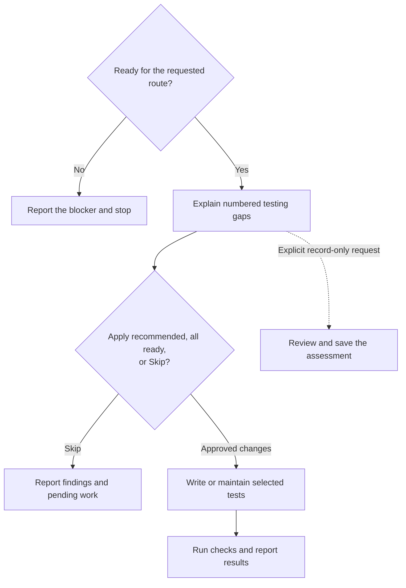

# Test



Use test to find missing protection and improve useful existing tests. You choose which cases and tooling changes to implement after reviewing the findings.

## Flow



## Start the command

```text
Codex → $test    Claude → /test
```

Use your client's [command prefix]({{ '/docs/setup/' | relative_url }}#run-a-command). Normal test checks for a clean, eligible **main/master, feature, maintenance or confirmed environment branch** before inventorying source or tests. Request read-only static assessment explicitly to review pending edits without records or fixes.

A failed prerequisite stops the run, including further assessment or planning. A later setup, verification or checkpoint failure preserves completed assessments and actual drafts without continuing other work.

A project without a saved assessment record needs no Python setup merely to begin source assessment; saving results still requires valid records.

## Choose the review scope

- **Full scan:** assess scoped behavior and existing test protection, reassessing every open finding within that project scope alongside new discovery.
- **Gap scan:** follow changes since a valid saved assessment, including unchanged affected consumers, tests and related open findings. Relevant resolved/obsolete findings are also reconsidered; unrelated older backlog remains visible as not freshly reviewed.

A first run or unusable baseline may need Full scan. Review itself is static: it does not run project code, test discovery or installers merely to find gaps.

You can also explicitly ask to revisit particular open findings or all open findings. Test traces each selected need through current source, tests, contracts and relevant dependencies until its judgment is supported or the missing evidence is clear. It reports limits and may recommend broader review, without silently starting a discovery scan. This request adds no menu option and leaves the saved Full/Gap scan baselines unchanged.

## What kinds of tests can it suggest?

The approach follows the project. Suggestions might be unit or integration cases, an accessibility check, a useful fixture, or changes to the runner and tooling.

Existing tests can be improved, consolidated or replaced. Removal requires proved obsolescence or equivalent remaining protection; a failure is not a reason to weaken assertions.

<a id="priorities-and-your-selection"></a>

## Review findings and choose changes

Findings appear as numbered explanations of what the current tests could miss, why it matters and what a proposed test or maintenance change would establish. New and reassessed findings appear together by behavior, with each need shown once. Findings now protected or no longer applicable have their proposed record updates explained; older findings outside this review stay distinct. You do not need to read test code or interpret priority tiers to understand the proposal.

Recommendations weigh useful protection and maintenance benefits against effort, setup, fragility and future upkeep. The report gives the deciding reason and any material tradeoff. Unknown behavior, blocked execution and production repairs stay visibly separate from ready changes.

Choose **Apply recommended**, **Apply all ready changes**, or **Skip**, with exact finding numbers shown beside each Apply action. When recommended and all are identical, only All is offered; empty Apply choices are omitted. You can type a subset, exclusion or revision directly.

Paths, setup, checks and record effects appear before approval. A complete Apply plan needs one approval; a changed custom selection needs its resulting plan reviewed. Large reports use numbered batches, and Apply covers only the ready changes shown. Skip makes no new changes or record writes; saving findings alone requires an explicit request and approval.

## Tools and verification

Existing tools come first; installation, upgrades and service/database effects stay within the approved plan and isolated targets. When required checks cannot run, findings remain unverified and approved additive drafts stay uncommitted.

## Your result and the next run

You get test changes, actual check results and remaining work. An approved assessment saves findings before implementation; each case closes only when its protection is verified. Skipped or blocked work stays visible for later runs. Coverage is reported only when measured.

The ledger helps recognise the same missing guarantee across scans, even when its explanation or files change. Relevant open, resolved and obsolete cases are reconsidered against current evidence; a closed case is neither ignored forever nor automatically reopened after an edit. The same need keeps its identity. Records stay concise, with bounded retrieval and useful closed history preserved; a Gap scan does not reassess the whole ledger every time.

Work finishes on the same branch under your local commit policy. Use [refactor](refactor.html#refactor-vs-test) for behavior-preserving code maintenance and [ship](ship.html) for publication.
