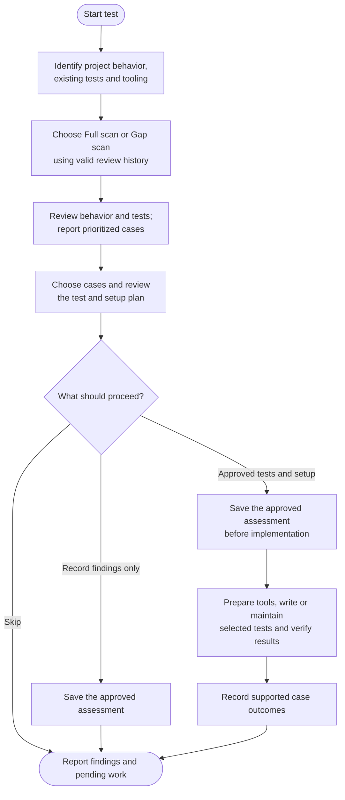

# test

Find missing test protection and maintain useful existing tests. The command reviews the project's behavior, reports cases that need attention and works on the ones you choose using tools suited to the project.

## Start the command

```text
test
```

Use the prefix for your app or terminal from [Setup]({{ '/docs/setup/' | relative_url }}#run-a-command).

Static inspection is available on the current checkout. Test edits and recorded assessments require a clean, eligible **main/master, feature, maintenance or confirmed environment branch**. The command does not create or switch branches.

## Flow



## Choose the review scope

A **Full scan** reviews every scoped component's behavior and relevant tests in detail, including assertions, fixtures, configuration and cross-component contracts. It uses bounded chunks, with read-only subagents when permitted. A representative sample or a coverage percentage does not establish a complete assessment.

A **Gap scan** follows changes since a valid saved source assessment, including affected unchanged consumers, tests and configuration. It also keeps older open findings visible. A first run, unusable baseline or broad change can call for Full scan. With no new relevant changes, existing findings can still be reviewed; an empty diff does not mean all tests are adequate.

Both reviews start with static inspection. They do not execute test discovery, installers or project code merely to find gaps. A limited review reports its actual coverage; it cannot claim a complete scan.

## What kinds of tests can it suggest?

The command looks at main flows, input boundaries, errors, access isolation, persistence, integrations, time/concurrency and relevant resource requirements. It chooses a fitting unit, component, integration, contract or end-to-end layer for each behavior.

Specialist techniques are suggested when the project needs them: property-based or fuzz tests, accessibility and visual checks, compatibility and upgrade tests, bounded performance checks, mutation testing and recovery scenarios. Human acceptance or usability work is identified separately. There is no requirement to add every type or a test for every file.

Useful existing tests stay by default. Where a concrete need exists, the plan can **Improve**, **Consolidate**, **Replace** or **Remove** them. Replacement and consolidation map old guarantees to the proposed protection; removal needs evidence of obsolescence or equivalent remaining coverage. Tests are not discarded simply because they fail, look repetitive or were AI-generated.

## Priorities and your selection

Priority describes the risk still left unprotected, with evidence for the project's actual consequences.

| Priority | Meaning |
|---|---|
| **High** | Severe consequences with credible exposure, even if rare, or meaningful consequences with high regression likelihood. |
| **Medium** | Meaningful but recoverable failure without evidence warranting High. |
| **Low** | Useful protection against minor consequences or limited edge cases. |
| **Unknown impact** | A material expectation or consequence needs clarification before ranking. |

Findings are grouped by module or behavior, each with an ID, expected result, reason, proposed action and prerequisites. For a larger report, choose **Recommended**, **All ready proposals**, **Choose cases or groups**, or **None**. You can select individual IDs or filter by group or priority. Blocked, unclear and unusually costly work remains visible separately.

Selection defines scope. Before edits, you review the concrete cases, paths, setup and execution plan. Unknown expectations can be clarified, explicitly characterized as current behavior or deferred. The command does not invent expected results or fix production behavior to make a test pass.

## Tools and verification

Tool detection follows manifests, lockfiles, project commands, configuration, CI and existing tests for each package and test layer. Existing tools are preferred. Missing dependencies lead to a proposed restore or repair, rather than automatic replacement of the framework. Adding or upgrading tools needs an explicit compatible setup plan.

Approved execution uses isolated test targets and synthetic fixtures. The plan includes material service, database, download or lifecycle effects. Tests run in coherent groups, with relevant existing protection checked before old cases are retired. Runner installation or exit zero alone does not prove the intended tests ran.

If required execution is unavailable or deferred, findings remain open. You can explicitly choose additive unverified drafts, left uncommitted; existing protecting tests are retained. Product bugs and broader refactoring are reported for separate work.

## Your result and the next run

You get selected test changes, actual commands and outcomes, remaining findings and any manual checks. Measured coverage is reported only when a suitable tool actually produced it.

`.helm/test-log.json` stores individual findings, priorities, decisions and evidence. It is not an inventory of every passing test or a cache of installed tools.

An approved assessment is saved before implementation, so unselected and blocked cases are remembered too. A complete scan records its source baseline; that checkpoint does not claim the tests passed. Cases close only with evidence for their particular guarantees.

The current ledger uses schema 3. Python helpers are preferred for validation and retrieval, with an equivalent checked fallback when Python is unavailable. Invalid state blocks dependent work; unsupported formats require explicit handling outside the command, not an automatic reset.

Verified work follows your local commit policy and finishes on the same branch. Reruns reassess relevant source and retained findings rather than replaying completed changes. Use [refactor](refactor.html#refactor-vs-test) for behavior-preserving code maintenance and [ship](ship.html) for publication.
