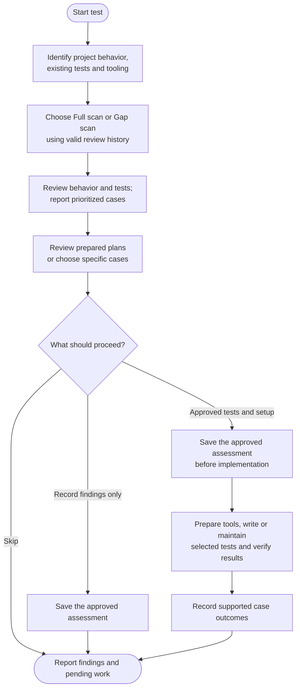

# test



Test turns gaps in protection into cases you can review and choose. It can improve existing tests as well as add new ones, while keeping assessment, implementation and verified results distinct.

## Flow

## Start the command

Static review works on the current checkout without running project code or test discovery. Saved assessments and edits need clean main/master, an established feature or maintenance branch, or a confirmed environment branch. The workflow preserves unrelated work instead of stashing it to make room.

## Choose the review scope

A Full scan assesses behavior and the protection provided by existing tests. A Gap scan starts from a valid earlier assessment, follows changed behavior and consumers, and revisits relevant open findings. A first run or an unusable baseline may need Full scan.

The assessment asks what could go wrong and whether a test would detect it. Counts and coverage percentages alone cannot answer that. A passing test can still assert the wrong thing or never reach the important failure path.

## What kinds of tests can it suggest?

Suggestions follow the actual stack and risk: unit cases, integration checks, accessibility behavior, fixtures, runner repairs or a different testing technique when it serves the project.

Existing tests can be clarified or consolidated. Removing one needs evidence that its behavior is obsolete or remains protected elsewhere. A failing assertion is not permission to weaken the guarantee.

For example, a payment retry case should verify the externally important outcome, such as avoiding a duplicate charge. Repeating each internal helper call in an assertion can make the test brittle without protecting that outcome.

## Priorities and your selection

Each finding explains the missing protection, evidence, priority and readiness. Priority describes risk; implementation cost is separate. Unclear intended behavior is surfaced before a case is written, rather than turned into an invented expectation.

Choose recommended work, all ready cases, a subset or none. A fully prepared recommended plan or plan for all ready cases can be selected and approved in one decision, with exact cases, paths, tools, execution effects and record changes visible first. There is no repeated Apply question for that unchanged plan.

Custom selections need their resulting plan reviewed, including replacement guarantees and prerequisites. Unresolved intent or intrusive execution stays pending until its own required decision is made. Findings are saved before implementation under the approved checkpoint plan; selecting none does not authorize a new record write or mark findings fixed. Unknown implementation diffs and later commits are not pre-approved.

## Tools and verification

Existing tools come first. Runner setup, installations, upgrades and database or service effects need to be part of the approved plan. An apparently local test command can still run hooks, contact a service or reset data, so the actual entrypoint and target matter.

Work proceeds in coherent groups of cases. Failed, unavailable or deferred required checks keep those cases unverified. Approved additive drafts may remain uncommitted when the required verification cannot run. Coverage claims need measurements, and a failed case can reveal production work outside the testing task.

## Your result and the next run

The report separates the assessment, test changes, measured results and remaining work. Saved findings preserve decisions and useful closed history; deferred, skipped and accepted-risk cases do not count as verified protection.

Later runs can continue from that evidence without pretending the whole project was reassessed. Changes finish locally on the same branch. [Refactor](../refactor.html#refactor-vs-test) owns behavior-preserving source improvements; neither workflow invokes the other automatically.

## Explore the source

For implementation details, read [guides/test.md](https://github.com/myowinthein/agent-helm/blob/main/guides/test.md).
