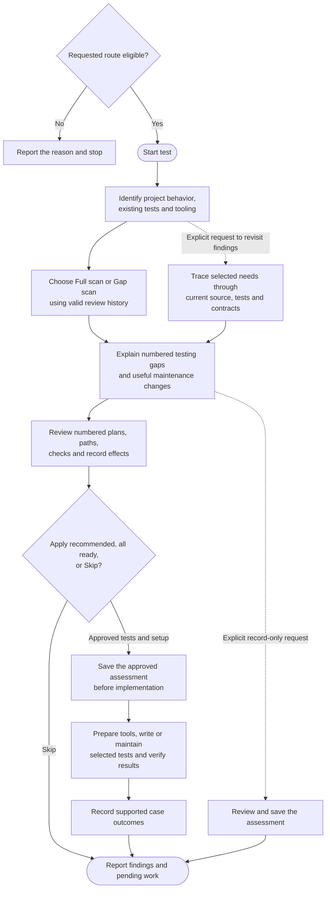

# Test



Test turns gaps in protection into cases you can review and choose. It can improve existing tests as well as add new ones, while keeping assessment, implementation and verified results distinct.

## Flow

## Start the command

Normal test checks for clean main/master, an established feature or maintenance branch, or a confirmed environment branch before source/test inventory. An explicitly requested read-only source assessment can inspect pending edits without project execution, ledger access or fixes. The workflow preserves unrelated work instead of stashing it to make room.

Saved assessments are checked before source review. With no existing record, source assessment needs no Python setup until an approved save requires validation. Invalid or unsupported records stop the run with an explanation. Later setup or verification failures preserve completed assessments and drafts, while questions wait for your answer.

## Choose the review scope

A Full scan assesses behavior and the protection provided by existing tests, and reassesses every open finding within that project scope alongside new discovery. That includes findings in unchanged areas and those whose original files have moved or disappeared. Each needs a supported judgment: still missing protection, already protected, no longer applicable or uncertain. Relevant closed findings are compared when current evidence puts their guarantee in question; unrelated closed history does not require a complete reread.

A Gap scan starts from the last valid saved assessment, which may be several commits back. It follows changes and their effects through relevant implementation, unchanged consumers, tests, fixtures and configuration, reassessing related findings in any status. It covers more than new code or diff lines, while unrelated older open findings remain visible as not freshly reviewed. They need reassessment before a current change is proposed. A first run or an unusable discovery baseline may need Full scan.

The assessment asks what could go wrong and whether a test would detect it. Counts and coverage percentages alone cannot answer that. A passing test can still assert the wrong thing or never reach the important failure path.

You can explicitly request a revisit, such as “reassess the duplicate-enrolment finding” or “review all open findings.” This uses the existing records to identify the selected needs and adds no new menu choice. Ambiguous references need clarification; the request does not automatically start Full or Gap discovery.

A revisit reads the current behavior, protecting assertions and fixtures, intended contract, and relevant callers, consumers, configuration and dependencies. The old record supplies leads rather than proof. For an enrolment retry finding, that might mean tracing a request through its handler, repository, database constraints and tests, including protection added outside the originally recorded file. There is no fixed file or reference-hop limit, and there is no need to investigate unrelated project areas once the selected judgment is supported.

The result can retain the need, revise its testing proposal, propose resolution/obsolescence with evidence, or identify missing intent or evidence. If required context cannot be inspected or the effects cannot be bounded, test explains that limit and may recommend a broader review; it waits for your scope choice before starting one. Newly noticed unrelated gaps remain follow-ups outside the requested reassessment. Static review alone supplies no runtime pass, edit permission or record-write approval.

Revisits use the same numbered report and Apply actions below. Approved meaningful case updates preserve both saved scan baselines, even when every open finding was revisited. A completed review of selected findings establishes that scope; it does not replace a project-wide assessment. An otherwise valid case review can proceed without a usable global scan baseline, while invalid or unsupported records still block it.

## What kinds of tests can it suggest?

Suggestions follow the actual stack and risk: unit cases, integration checks, accessibility behavior, fixtures, runner repairs or a different testing technique when it serves the project.

Existing tests can be clarified or consolidated. Removing one needs evidence that its behavior is obsolete or remains protected elsewhere. A failing assertion is not permission to weaken the guarantee.

For example, a payment retry case should verify the externally important outcome, such as avoiding a duplicate charge. Repeating each internal helper call in an assertion can make the test brittle without protecting that outcome.

## Review findings and choose changes

The report leads with the finding count and the actual review scope and limits. Each numbered item has a short title and usually one or two sentences explaining what the current tests could miss, the consequence and what the proposed change would establish. New and reassessed findings share behavior groups, with the same guarantee shown once. One finding can require several test functions. There is no priority table or implementation-code dump.

For example, “Retrying enrolment could create a duplicate enrolment” should explain whether current tests exercise a repeated request and that the proposed test would check that only one enrolment exists afterward. That tells you the protection being proposed without requiring you to inspect how the test will be written. The report identifies continuing or reopened findings so they are not presented as new discoveries. Proposed resolutions or obsolescence updates briefly explain the evidence under the existing finding identity. Older backlog outside the assessment is marked as not freshly reviewed, rather than mixed into current recommendations.

Recommendations consider whether the finding is a current problem, a conditional risk or an improvement. Expected protection or maintenance benefits are weighed against effort, setup and execution needs, compatibility, fragility and future upkeep, using existing coverage and confidence in the intended behavior. Short- and long-term effects matter when they differ. You get the deciding reason and material tradeoff, without a score or a checklist of every factor. Optional maintenance can be recommended when it earns its cost; a serious concern can remain pending when its intended outcome or safe execution is unresolved.

The actions show exact finding numbers or ranges:

- **Apply recommended:** approve the displayed ready work whose benefits justify its tradeoffs.
- **Apply all ready changes:** approve every displayed ready proposal, including optional maintenance. When this matches Recommended, only All is shown; an empty Apply action is omitted.
- **Skip:** make no new edits, run no new test/setup commands and write no assessment record. Earlier accepted work is preserved.

Type numbers, ranges, exclusions or a requested revision directly when neither Apply set fits. There is no separate Choose cases or Revise menu option. A custom scope choice needs its resulting concrete plan reviewed, including dependencies and replacement guarantees; an unchanged complete Apply plan needs no repeated approval. Unknown intent, execution blockers, manual work and production repairs are explained beside the findings and stay outside ready Apply sets until their required decisions are resolved.

A concise execution note supplies paths, setup, checks and targets, meaningful verification limits, commit units and record effects before approval. It reuses the finding explanations rather than repeating them as a long implementation plan. Large reports start with a numbered index and explain manageable groups, keeping their numbers stable. Apply covers only changes with a displayed ready plan, never unseen later batches. The assessment checkpoint still needs its findings and effects disclosed before it is approved.

The approved assessment saves all meaningful findings reviewed in scope before implementation, including those not selected for test changes. An explicit request to record the assessment without test changes can use its own record-only approval; Skip does not trigger that question or mark anything fixed. Approval does not cover unknown later diffs, commits or separately required intrusive execution.

## Tools and verification

Existing tools come first. Runner setup, installations, upgrades and database or service effects need to be part of the approved plan. An apparently local test command can still run hooks, contact a service or reset data, so the actual entrypoint and target matter.

Work proceeds in coherent groups of cases. Failed, unavailable or deferred required checks keep those cases unverified. Approved additive drafts may remain uncommitted when the required verification cannot run. Coverage claims need measurements, and a failed case can reveal production work outside the testing task.

## Your result and the next run

The report separates the assessment, test changes, measured results and remaining work. Saved findings preserve decisions, evidence and useful closed history. Deferred, skipped and accepted-risk cases do not count as verified protection.

Later reviews compare current behavior and tests with earlier findings before presenting a need as new. A continuing need keeps its identity even when its title, explanation or evidence paths change. Several tests may address one guarantee. When a finding splits into separate testing needs, the report links each new finding to the earlier one.

An open case may still need work, already be protected or no longer apply. If a resolved case loses its protection, or an obsolete requirement returns, test reopens the same case. A file edit or unavailable runner alone proves none of these outcomes, and an old pass does not become a current pass automatically.

A Gap scan leaves unrelated history intact and makes clear which findings were not freshly reviewed. Earlier deferrals apply only while their context still holds.

Changes finish locally on the same branch. [Refactor](../refactor.html#refactor-vs-test) owns behavior-preserving source improvements; neither workflow invokes the other automatically.

## Explore the source

For implementation details, read [guides/test.md](https://github.com/myowinthein/agent-helm/blob/main/guides/test.md).
